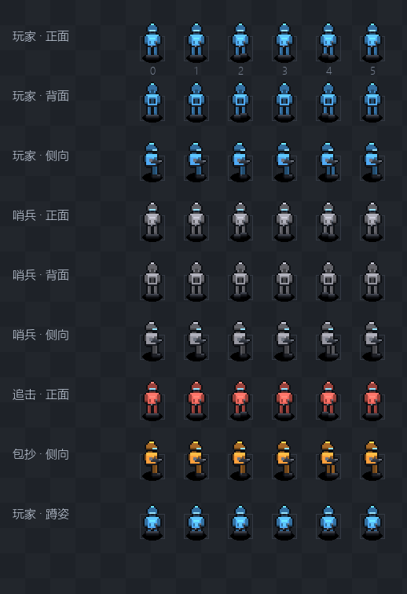
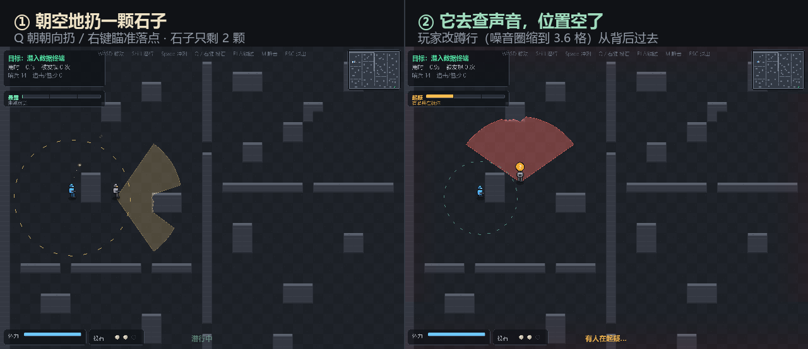

# 从零手写游戏 AI 决策栈：一个 2D 潜行游戏的技术复盘

> 这篇文章记录我在一个月内从零实现一套游戏 AI 系统的完整过程，包括架构设计、算法选型、性能优化和踩坑。目标不是"跑通一个 demo"，而是"每一个模块都能讲清楚为什么这么做"。

## 1. 为什么不调包

最开始的想法是用 stable-baselines3 跑一个强化学习 demo。但我很快意识到两个问题：

1. **调包无法体现技术深度**——面试官追问一句"你的 reward 怎么设计的"就会露底。
2. **一个月无法产出可讲的深度**——RL 训练需要大量调参时间，而"从零手写决策栈"每一步都是可展示的。

所以我选择了纯 Python 手写，从网格地图到寻路到决策全部自己实现。

## 2. 架构：四层决策链路

每个敌人每帧走一遍：**感知 → 记忆 → 决策 → 执行**。

### 感知层：为什么"看见"要做延迟确认

敌人的视觉不是 360° 透视，而是：

- **视野锥**（FOV）：只有朝向 ±55° 内的目标才产生感知
- **射线遮挡**（DDA raycast）：即便在锥内，中间有墙也看不见
- **距离衰减**：越远越难发现
- **可疑度累积**：看到玩家不会立刻报警，而是 `suspicion` 慢慢涨到 0.7 阈值才"确认"

为什么这么设计？因为**如果敌人秒发现玩家，玩家会觉得 AI 像开了透视**。拟真感知的关键就是"延迟确认"——这既是游戏体验，也是真实安防/机器人感知的设计逻辑。

### 记忆层：丢失目标后不该原地发呆

最开始的实现有个 bug：敌人一旦丢失视线（`suspicion` 衰减到阈值以下）就立刻回巡逻。实测"追击捕获率 0%"——敌人追两步看不见就放弃了。

修复：加入**最后已知位置**（`_last_seen`）。看到玩家时刷新这个位置，丢失视线后朝它搜索，`suspicion` 缓慢衰减（0.15/s）而不是瞬间归零。这是真实 AI（和真实追捕）都会做的"追击记忆"。

## 3. 三代寻路：为什么需要三个算法

很多人会问"为什么不用 A\* 就够了"。答案是：**不同规模用不同算法，这是性能的分水岭**。

| 算法 | 单敌人耗时 | 200 敌人耗时 | 适用场景 |
|---|---|---|---|
| A* | 2.19ms | 449.17ms | 基准、单敌人 |
| JPS | 1.24ms | 275.47ms | 开阔大地图 |
| 流场 | 7.43ms | **8.60ms** | **多敌人共享目标** |

关键洞察：**A\*/JPS 是"每个单位独立算一条路径"，复杂度 O(N × 单次寻路)**。而流场反过来——**只为目标做一次全图 BFS，之后任意多单位 O(1) 查表**。

这解释了为什么流场在单敌人时"亏"（全图 BFS 白算），但 200 敌人时快 **52 倍**。**这个 trade-off 本身比"三个算法都快"更有面试价值**——它证明你真的理解了每种算法的适用边界。

> 表里的数字是 W10 换图后重测的（每个规模跑 3 轮取最小值）。早前那一版是 1.79 / 211.83 / 8.4 倍 —— 数字变了不是算法变了，是地图从"空地加掩体"换成了"实心开挖 + 门"，A* 要绕的弯变多了。

### 一个反直觉的发现：JPS 在小地图上反而慢

JPS 的价值是"剪枝减少扩展节点"，但在 40×30 密集障碍地图上，它的跳点递归开销（Python 函数调用）超过了省下的节点。JPS 要到 100×100 开阔地形才体现优势。

**教训：算法复杂度是"渐近"的，小规模下常数因子可能主导。** 这也是为什么 benchmark 要跑多规模、多地形，而不是只看一个数字。

## 4. 决策层：从 FSM 到行为树到 GOAP

### 为什么不用 FSM

FSM（状态机）的问题是"加一个状态要改一堆转移边"。行为树（BT）是组合式的——用 Selector（或节点）/ Sequence（与节点）组合子行为，加一个行为只需插一个子树。

关键差异在**三态返回**：BT 节点返回 SUCCESS/FAILURE/RUNNING，其中 RUNNING 让"跨多帧的任务"自然表达（比如"追击"这个动作持续多帧），不需要显式的状态变量。

### GOAP：为什么不写死状态转移

GOAP（Goal-Oriented Action Planning）声明"目标"和"动作"（每个动作有前置条件 + 效果），规划器在状态空间里搜索动作序列。我实现的版本：

- 世界状态用 `frozenset` 谓词表示（不可变、可哈希）
- A* 在状态空间搜索，启发式 = "还差几个目标谓词未满足"
- 动作数量通常个位数到几十，不会状态爆炸

实测能规划出 `get_food → eat` 这种序列，而不是写死。

## 5. 协同分工：防止 8 个敌人挤成一团

多敌人追同一目标时，如果各自独立寻路，会全走同一条最优路径，叠成一团。

方案：一个 Coordinator 根据"能看见玩家的敌人 + 玩家位置"分配角色：

- **CHASE（追击）**：最近的 2 个，用共享流场直接逼近
- **FLANK（包抄）**：绕到玩家侧翼/背后
- **BLOCK（封路）**：抢占"咽喉格"（通道口），堵逃生路

### 一个差点毁掉性能的 bug

封路角色需要找"咽喉格"（邻墙多 = 通道口）。初版每帧在 25×25 范围扫 625 格 × 8 邻，cProfile 定位到 **3337 万次墙体查询，帧率崩到 21 FPS**。

修复：**咽喉格是地图静态属性，构建时预计算一次缓存**，封路角色 O(1) 查表；再加分配节流（0.3s）。帧率从 21 FPS 拉到 **1100+ FPS**。

**教训：任何"每帧都算、但其实不每帧变"的东西，都要预计算。** cProfile 是定位这种问题的利器。

## 6. 三个小但关键的工程细节

### 网格碰撞的精度

圆形碰撞用"四角包围盒"判定，会导致"贴墙但没真正碰到"时被误判为碰撞，敌人卡在墙角。改用"圆心到墙格最近点距离"判定后解决。

### 流场方向要引导到格中心

流场只给"格子级纯方向"（纯右/纯上），但敌人在格子内的亚格位置偏了，沿纯方向会贴墙卡死。改成"朝下一格中心移动"，敌人被自然引导到格中心。

### A\* 启发式用 octile 距离

八方向移动（斜向 √2）时，正确的 admissible 启发式是 octile 距离，不是切比雪夫（切比雪夫只适用于斜向代价 = 1）。用错会导致找到次优路径。

## 7. 最难查的 bug：所有哨兵都被钉死在出生点

这是整轮优化里最值得写下来的一件事。

演示 GIF 里玩家一开门就被抓，我以为是关卡太挤。顺手测了一下"敌人 2 秒内移动了多远"，结果是 **18 个哨兵，位移全部为 0**。

根因在三个正确的东西撞在一起：

1. 敌人配置写的是整数格点 `(10.0, 10.0)`；
2. 整数坐标恰好是 4 个格子的**公共角点**；
3. 圆形碰撞用"圆心到墙格最近点距离"判定，圆心贴角点时该距离**恰好为 0**，`0 < r²` 成立 → 判定为"一直在墙里" → 两个轴都被挡住，永远出不来。

三个地方单独看都对，组合起来就是"整支守卫部队变成雕塑"。更刺眼的是：**所有测试都是绿的**。感知、寻路、协同、性能——全都没有断言"敌人真的动了"。一个从没被验证过的假设，撑起了整场演示。

修法是三层的：配置坐标统一转格中心（`+0.5`）；碰撞加 1e-6 容差（角点相切不算碰撞）；再加一条 W7 测试，专门守"2 秒内所有哨兵必须离开出生点"。

教训很直接：**测"模块行为"不等于测"系统行为"**。模块级单测全绿，系统可能整体是死的。

## 8. AI 撒谎的两种方式

### 流场拿玩家真实坐标建场

追击用共享流场（一次全图 BFS 供所有追兵复用）本身是对的，但目标位置写成了 `player.pos`——**玩家真实坐标**。

这条代码不会报错，行为上却等于给全图追兵开了透视：只要被看见过一次，你绕到墙后、蹲进掩体，追兵依然精确地朝你走。实测结果是被一路追着跑 60 秒都甩不掉，"跟丢"这个机制在体感上根本不存在。

改成朝"全队最后已知位置"建场。还有一个时序坑：这个位置必须在**敌人刷新完感知之后**才更新，写在之前会读到上一帧的 `sees_player`，等于延迟一帧的透视（玩家瞬移/绕墙后仍被记成"刚被看见"）。

### 警觉不设时限

拿数据后全图永久 +2 格视野 +0.6 追击速度。听起来是"提高后期难度"，实际效果是：返程要横穿整张地图，而整张地图的守卫永久强化 → 撤离阶段无解。

改成 28 秒限时封锁，HUD 上给倒计时。玩家于是有了两种正解：抢在封锁期内冲出去，或者找个角落等封锁解除。**一个有倒计时的威胁是资源，没有倒计时的威胁是墙。**

## 9. 难度不该靠手感，该靠测量

这一版把"难不难"拆成两个不依赖操作水平的指标（`audit_difficulty.py`）：

| 指标 | 加掩体前 | 现在 |
|---|---|---|
| 视锥覆盖率（被任一敌人视锥覆盖的地面占比） | **~89%** | **11.7%** |
| 无影通路率（仍存在全程不被看见的通路的时间占比） | 不存在 | **96%** |
| 无视野硬走对照（沿最短路径闷头走、无视视锥） | 89% | **92%** |

> 这两个指标在第 14 节被换掉了：地图改成"实心开挖 + 20 道 2 格门"之后，"无影通路率"恒等于 0%（它要求所有门同时空着）。指标没错，是我的关卡换了形态 —— 现在测的是**门窗口**。

89% 覆盖意味着"潜行"这件事根本不存在，玩家只能在别人视锥里硬走。加了成组掩体、把哨兵从 18 砍到 14、视野从 8 格降到 6.5 格之后，才有 11.7% / 96%。

注意第三行：改完之后，同一条最短路上闷头硬走**依然是 90% 暴露**。这说明难度不是靠"少放几个敌人"放水放下去的 —— 覆盖率降的是"安全的地面"变多了，硬走的人该被看见还是被看见，差别全在会不会绕。

配套写了一个"看得懂视野锥的玩家"机器人：加权 A* 绕开视锥、视锥扫过来就蹲下等、被咬住就跑向掩体。它**当时**在这张地图上的成绩是 **74.6 秒通关、途中被咬住 4 次并全部甩脱、0 击倒、222 分**——`assets/demo.gif` 就是它的实跑录像，而且录像是直接调用同一个 `run()`，不是另写一份走位。（后面的版本里这张图、这套 AI 和计分都变过，最新成绩见 README；这里留着的是当时的数字。）

写这个机器人的过程中，还顺手抓到自己两个低级错误：A* 返回的路径**不含起点**，而索引从 1 开始，等于每一步都丢掉第一格（短路径时直接原地不动）；以及逃跑用"贪心远离威胁"必然被逼进地图角落。这两件事真人也容易犯后者。

## 10. 怎么证明"AI 变好了"

最后一个致命问题：面试官问"你怎么证明你的 AI 变好了"。答案只能是数字，不能是"感觉更聪明了"。

我设计了四个可复现的指标（`benchmark_ai_metrics.py`，30 局取平均）：

- 平均发现时间 1.57s（4 格正对；距离越近越快，贴脸才接近"秒发现"）
- 追击捕获率 100%，平均 2.99s（不半途放弃）
- 潜行绕后成功率 100%（感知有方向性）
- 协同分散度 3.90 格（不挤成一团）

改完参数后这组数字一度变成"发现 0.25s、捕获率 0%"，看着像 AI 忽然变蠢。查下去发现是**测试场景本身不成立**：捕获率那项把敌人固定摆在 (8,8) 让它往右追，而地图在那个位置有立柱 —— 敌人直线撞柱子卡死；发现时间那项没有每局重置世界，前一局留下的 DEFEAT 状态直接冻结了后续试验的 `world.update`。

教训：**指标崩了，先怀疑测试夹具，再怀疑被测试的代码**。指标的坑和产品 bug 一样值钱。

外加两个**关卡层**指标（`audit_difficulty.py` / `audit_routes.py`，第 14 节详述）：

- 最小割 4 格（路线确实很少）
- 门窗口平均 65%、最紧的门 2.0s（有解，但不是白送）
- 无视野硬走对照 89%（没放水）

AI 指标证明"敌人像人"，关卡指标证明"玩家有活路"。只有前者，做出来的是个残忍的自动追踪器；只有后者，做出来的是个空场子。

## 11. 敌人卡墙：三行代码里藏着的三个假设

W7 结束时我以为"AI 会动了"这件事已经解决。玩家一句话打回来：**很多敌人贴着墙不动，根本没有巡逻的样子**。

拆开看是三个独立的假设同时错了：

**假设一：巡逻可以直线逼近。** 巡逻的移动原语是 `_move_toward(巡逻点)` —— 朝目标方向单位向量乘速度。在空地没问题，但掩体挡在两者之间时，x 和 y 两个轴同时吃碰撞，`_move()` 的两行代码都不生效，实体就永久顶在墙上。**直线逼近只适用于"目标就在眼前"，巡逻属于"要绕过障碍"的层级，必须走路径。**

**假设二：A\* 给出的路径，实体一定走得过去。** 八方向 A* 的对角移动只检查目标格是否可走，两个正交邻格都是墙时也允许斜切 —— 从几何上讲路径是连通的，但半径 0.35 的圆走这条斜线时，圆心正好经过两个墙格夹出来的角点，碰撞判定把两个轴同时挡住。**"路径存在"和"实体走得过去"是两件事。** 修法是禁止切角：对角移动要求两个正交格都可走。（JPS 的剪枝规则建立在"允许切角"的经典语义上，所以基准对比时得用 `corner_cut=True` 对齐口径，否则两个算法算的根本不是同一个问题。）

**假设三：敌人每帧只更新一次。** 这条最要命。`world.update()` 里

```python
for e in self.enemies:
    e.update(dt, self)

# ……后来插入的"最后已知位置"更新……

for e in self.enemies:
    e.update(dt, self)      # ← 加新逻辑时留下的重复循环
```

后果是哨兵实际移速 2.2 → **4.4 格/s**（比玩家走路还快），可疑度也是双倍速上涨。而**所有测试照样全绿**：它们只断言"能追击""能捕获""帧率够高"，没有一条断言"速度等于配置值"。这类 bug 不会让任何东西报错，只会让手感和数值表悄悄脱节——发现时间是 0.78 秒还是 1.57 秒，全看你数了几遍循环。

修完这三处之后：

| 改动 | 效果 |
|---|---|
| 巡逻走 A* 路径（0.45s 重算节流） | 不再顶墙，60 秒走 90~110 格 |
| A* 禁止切角 | 路径 = 实体真的走得过去的路线 |
| 到点站岗 1.6 秒 + 左右各扫 40° | 哨兵像在值班，也给玩家创造了"等它转身"的时间窗 |
| 卡死看门狗（0.5s 位移 <0.04 格 → 重算；连续 3 次 → 换点 + 转 90°） | 几何修正漏掉的贴墙姿态有兜底，不会再出现"顶着墙推 30 秒" |

体检脚本 `diag_patrol.py` 跑 180 秒：14 个哨兵最长"原地不动"时间是 **1.6 秒**，正好等于站岗时长——一个卡住的都没有。这条现在是回归测试。

有意思的副作用：**关卡难度上升了**。因为以前一半哨兵其实是静止靶子，现在全都在动，同样一张图的视锥覆盖率从 7.5% 涨到 11.7%，机器人从"0 次被发现"变成"被咬住 3 次"。这不是地图变难了，是之前的地图一直在作弊。

## 12. 美术：程序化像素小人的三个决定

原来的角色是"圆头 + 方身体 + 两条线段腿"，玩家评价是"火柴人"。重做时没有引入任何素材，全部代码生成，三个关键决定：

**1. 离线烘焙，而不是每帧画。** 一个能看出是"人"的角色需要头盔、护目镜、战术背心、弹匣袋、腰带、手臂、枪套、靴子——40 多条绘制指令。15 个角色 × 60 帧 = 每秒 36000 次 draw call，Python 撑不住。所以按 (配色, 朝向, 帧, 蹲姿) 烘焙成精灵缓存，运行时每个角色一次 blit。加了 40 个细节，渲染开销几乎没变。

**2. 1px 深色描边。** 暗色地板上，没有描边的人物会和背景糊成一坨。描边不是手工画的，而是取剪影往四个方向各偏移 1 像素涂深色再盖回本体——对任何造型都自动生效。

**3. 把"朝向"塞进配色。** 护目镜是全身唯一的亮色：玩家冷青、哨兵琥珀、进入追击变红。玩家不用去读头顶的 `!` 标签，第一眼就能看出"谁在看我、朝哪看"。背面没有护目镜，只有背包和背带——这一个细节就消灭了"八方向小人像纸片"的问题。

造型上踩过的坑：**头不能和肩一样宽**（那是机器人的比例，人的头明显窄于肩）；正面不要画"抱在腰前的枪"（3 个像素的空间只会糊成一块灰，看着像腰带）；枪在侧面视图里最好看——枪托、枪身、枪口、弹匣四个元素刚好能在 7 个像素里排开。



## 13. 玩家不能只有"躲"这一个动词

前面十二节都在讲 AI。但把游戏交给别人玩，反馈往往不是"AI 不够聪明"，而是"我能做的事太少"。

在这之前，玩家面对哨兵只有一种交互：**等它自己转开**。所有主动权都在 AI 手上 —— 巡逻路线是它定的，停留多久是它定的，你只是在这些既定缝隙里找一个能钻过去的时间窗。这在设计上叫"纯反应型潜行"，玩久了会退化成背板。

所以补了石子。它是潜行游戏的入门工具，但真正值得写的是**怎么让它不像个作弊码**：

- **听到 ≠ 看到**：石子只把可疑度抬到 0.42，确认线是 0.70。哨兵会过来"看看"，但不会直接锁定你。
- **声音定位是模糊的**：落点会被猜偏 ±0.75 格。这是听觉该有的精度，也是"扔过去它就精确跑到那个点"这种机器感的解药。
- **有上限**：3 颗、0.55 秒冷却。有资源限制，"这一颗扔哪"才是决策。
- **追兵不吃饵**：已经在追你的、或正看着你的哨兵直接跳过。视觉优先于听觉，这条规则同时挡住了"用石头甩锅"的歪招。

还有一个意外收获：为了让石子有意义，必须先修掉**"听觉给出精确坐标"**这个老谎。原来哨兵隔着墙听见脚步就能精确走到你脚下 —— 它和流场拿真实坐标一样，都是"AI 知道得太多"。改完之后（听到只给带偏差的猜测），机器人的成绩反而变好了：57.8 秒 / 1 次被发现（之前 55.7 秒 / 3 次）。**AI 少知道一点，玩家才多出空间。**

最后是"可见性"。听觉在这之前完全是个黑箱，玩家只能通过"莫名其妙被发现"反推。现在角色脚下有一圈虚线，半径就是当前能被听见的距离：潜行 3.6 / 走路 5.8 / 冲刺 7.5 格。它和 `can_hear` 共用同一个公式，不是画个好看的圈糊弄人。玩家看一眼就知道"现在跑会不会招人"—— 这才叫把机制交给玩家。



## 14. 结构反转：把"路"从玩家手里收回来

前 13 节都在"AI 怎么更聪明"。但玩家给了一句更要命的反馈：**"通关还是偏简单，路上几乎不用做选择。"**

我去数了一下旧图的路线，结论很难看：所谓"关卡"是一大块空地加几组货箱，玩家永远可以贴边走。视锥再密，也只是"绕远一点"；堆到 18 个哨兵，游戏就变成冲刺跑酷。**空地里的"路"是玩家走出来的，不是作者画的** —— 作者无法控制它有几条，也就无法控制难度。

所以这一版做了结构反转：不再"空地加墙"，而是**先把整张图填满岩体，再挖出房间、走廊和门**（`GridMap.filled()` + `_carve()`）。80×60 的图最后只有 1597 个可走格（开挖率 33%），9 个房间、10 条走廊、20 道门。

拓扑是 θ 形：出生舱 S → 终端舱 T，中间只有三条并行弧（北弧 / 南弧 / 竖井捷径 X1），门全是 2 格宽。**2 格 = 一次只够一个人过。**

于是"路径很少"第一次变成了可以算的数字。`scripts/audit_routes.py` 用节点拆分 + 最大流算最小割：

| 指标 | 值 | 含义 |
|---|---|---|
| 最小割（= 互不重叠路线数） | **4 格** | 想切断关卡必须同时堵 4 格；空地撒欢的图这里是几十 |
| 门 | **20 道，全 2 格宽** | 每道门都是一次"等窗口"的决策 |
| 最短路线 | 115 格，穿 8 道门 | 一趟要在 8 双眼睛下卡 8 次时机 |
| 北弧 / 南弧 | 119 / 115 格 | 几乎等长：取舍来自"10 道紧门 vs 8 道松门"，不是距离 |

难度指标也被迫换了一次。旧的"无影通路率"（同一瞬间存在全程不被看见的路线）在门控关卡里恒等于 **0%** —— 它要求 20 道门同时空着，等于要求 21 个哨兵同时闭眼。它测的不是玩家体验，是我的想象。新指标是**门窗口**：每道门"至少有一格没被看着"的时间占比 + 最长连续窗口。

| 指标 | 值 |
|---|---|
| 平均门窗口率 | 65%，最紧的门最长窗口 **2.0 秒** |
| 北弧 / 南弧 / 捷径 | 55% / 74% / 85% |
| 无视野硬走对照 | **89%** 的时间在别人视锥里（峰值同时被 6 人盯） |

人穿过 2 格门约 0.5 秒，所以"最长窗口 2 秒"是能过的；如果哪天改参数改到 0.8 秒，体检脚本会立刻告诉我这关劝退 —— **这才叫可测量的难度**。

代价也是真的：自由度换可控性。旧图那种"从侧面摸过去"的野路子没有了，玩家会感觉"这关是设计过的"，而不是"这关是一片场地"。对我来说这个交易是值的 —— 潜行的乐趣来自"读守卫的节奏"，而节奏需要窄口才能成立。

还有一笔意外的学费：**2 格门 + 会站岗的 NPC = 永久封路**。有个哨兵的巡逻点正好落在门内侧，机器人开局 8 秒就撞死在出生舱东门。而"地图连通性检查"永远发现不了它 —— 格子是通的，人被堵住了。现在硬规则是"任何巡逻点离任何门 ≥3 格"，并且写成测试逐个量距离。

## 15. 手枪：怎么让"能杀人"不变成"清场"

玩家第二个要求是"手上加武器，弹药有限，敌人 5 秒后重生"。这句话里真正的难点不是开枪，是**别让它毁掉潜行**。

一把能杀人的枪，天然会滑向两个结局：要么强到"清场流"成为最优解，要么弱到"不如不带"。

我用五条约束把它钉在中间：

1. **5 发**，不可补给。图上有 21 个哨兵 —— 数字本身就说明它不是清场工具。
2. **hitscan**（射线步进 0.08 格），射程 12 格。做子弹实体就要处理"子弹追不上贴墙哨兵"这种荒唐判定。
3. **枪声只起疑，不确认**：半径 9.5 格，可疑度抬到 0.62（确认线 0.70），定位误差 0.35 格。听到 ≠ 看到这条老规矩对枪也成立，否则一枪就等于给自己画了个全图红点。（最初写的是 16 格 —— 一把"消音手枪"的动静覆盖半个房间，本身就自相矛盾；这个数字后来在补尸体机制时一并调对了，见第 17 节。）
4. **5 秒重生，落点是自己巡逻网里离玩家最远的点**，提前 1.3 秒亮预警环；如果实在离得太近（<3 格），再给 0.9 秒苏醒延迟。打倒是"借 5 秒"，不是"删掉这个人"。
5. **击倒扣 60 分**，S 档要求"零击倒 + 零被发现"。

第 5 条是关键：它把"要不要开枪"从"能不能"变成"值不值"。同一个机器人跑两种玩法：

| 玩法 | 用时 | 被发现 | 击倒 | 尸体暴露 | 得分 |
|---|---|---|---|---|---|
| 纯潜行 | 74.6s | 4 | 0 | 0 | 222 |
| 允许开枪 | 64.0s | 1 | 5 | 3 | **324** |

5 发全打光，快 10.6 秒、被咬次数从 4 降到 1，代价是 300 分和 3 具被认领的尸体。**这就是"买时间"的定价：买到干净，买不到 S 档。**

还有一个容易被忽略的实现细节：死亡必须清干净所有跨帧状态。只把 `alive` 置 False，复活后的哨兵会带着上一轮的追击目标直接奔向你 —— 那不是重生，是墓碑定位打击。`kill()` 里显式清角色、记忆、路径、调查计时，一个都不能漏。

## 16. 一个让单测全绿的 bug：玩家说"打不死人"

上线之后玩家第一句话是：**"为啥一直打不死敌人"**。

我写的第一版单测是绿的：在敌人正前方开一枪，血量、弹药、击倒数全都对。但玩家点的是**画面上的人**，测试点的是**敌人的中心坐标**。

差异在这里：命中判定点是脚底 `(e.x, e.y)`，而精灵是脚底对齐往上画的 —— 48px 高 ≈ 1.5 格，身体中心在脚底上方 0.7 格。玩家瞄着看到的身体开枪，射线就从它头顶飞过去，打在背后的岩体上。

我把这个复现了一遍：站在哨兵正对面，在屏幕上分别点脚底 / 小腿 / 躯干 / 头部 / 左右各偏 16px：

```
点脚底   -> enemy    命中
点小腿   -> enemy    命中（擦边）
点躯干   -> wall     打空
点头部   -> wall     打空
点偏左   -> wall     打空
```

**只有点脚底那一小圈能命中，而那一圈在画面上是"它脚下那块地板"。** 6 种点法里 5 种落空 —— 玩家没有任何理由认为这是"自己没瞄准"。

修法有两步：

1. **先认人，再开枪**。`World.aim_target()` 把鼠标点翻译成"玩家其实想打的那个人"：点在身体轮廓（半径 0.85 格、中心在脚底上方 0.7 格）里就吸附到本体中心，然后照常走射线。
2. **把规则变成可见的**。准星框住某个哨兵 = 这一枪打得中；没准星要么没瞄准，要么被墙挡。玩家不需要读文档就能学会。

有一条红线必须守住：**吸附只解决"打的是谁"，不解决"能不能打到"**。隔墙点人依然是墙（`_los` 会否掉，`test_aim_snap_never_shoots_through_walls` 守着）。否则"瞄准辅助"就变成了"穿墙外挂"。

这件事的教训比 bug 本身值钱：**判定和画面不一致时，玩家只会认为功能坏了，不会认为自己没瞄准。** 而且这类 bug 永远不会被"点中心坐标"的测试抓到 —— 测试跑在代码的坐标系里，玩家活在画面的坐标系里。现在 `test_w10` 里那条回归测试点的是**身体中心和头部**，不是脚底。

## 17. 代价的形式，比代价的大小重要

上一节修完"打不死人"，枪终于能用了。但它当时其实没什么用：`--armed` 的机器人 3 局全胜，看起来挺好，读一遍轨迹才发现 —— 它把 5 发子弹全打在**追兵**身上，边跑边还击，杀完接着跑。枪在这里只是个"逃跑时的减速道具"。

于是我给它补了一重代价：**尸体被同僚发现，那块区域进入警戒**。逻辑上很自然 —— 枪声只说明"有人开了枪"，尸体是物证，说明"自己人没了"。

第一版实现写得也很自然：

```python
# 目击者：可疑度抬到 0.50，去尸体位置调查
finder.suspicion = C.BODY_SPOT_SUSPICION
finder._last_seen = (corpse.x, corpse.y)
finder.searching = True          # ← 这一行杀了整个玩法
```

然后 `--armed` 从 **3/3 胜变成 0/3 全灭**，而且死法每次都一样：39.6 秒，同一位置，`spotted: 0`。

`spotted: 0` 这个数字很刺眼 —— 玩家"没被发现"却"任务失败"。顺着它挖，发现了第一个真 bug：`_check_capture` 只看距离，不看"这个哨兵知不知道你在附近"。一个只是路过、压根没注意到你的哨兵，从你身上踩过去就把你抓了。

修完还是输。于是我用土办法做 A/B：直接 monkey-patch 常量，跑四组。

```
无广播（只有目击者自己去看）  -> defeat 40.4s  bodies=2
无尸体机制（半径 0.1）        -> victory 68.8s  bodies=0
原始（16 格枪声 + 8.5 广播）  -> defeat 39.6s  bodies=3
枪声降到 9.5 + 广播 5         -> defeat 40.4s  bodies=2
```

**结论很清楚：只要"有人会因为尸体而移动"，带枪就是必输。** 跟半径多大、广播多远没关系。

原因在关卡结构里：这张图是实心开挖的 θ 形，玩家开枪的位置几乎总是**一道门** —— 因为门就是唯一的瓶颈，人只会堆在门口。让目击者"去现场看看"，等于把他精确地派到玩家唯一的必经之路上。而 5 秒后死者还会在别处补位，于是"开枪 → 有人来堵门 → 5 秒后前后夹击"是一条必死连锁，跟玩家操作没关系。

**代价没写错，形式写错了。**

改成"原地警戒"只需要两行：不设 `_last_seen`、不设 `searching`，只给一个 12 秒的 `body_alert` 计时器，在这段时间里把可疑度托底在起疑线以上。

效果立刻反过来：

```
纯潜行  -> victory 74.6s  被发现 4  击倒 0  尸体暴露 0  222 分
带枪    -> victory 64.0s  被发现 1  击倒 5  尸体暴露 3  324 分
```

同一份代价，从"堵你的路"变成"这片区域短时间很敏感"：
- 玩家能从暴露条和头顶 `?` **读出来**（旧版是"人突然出现在门口"，没有任何预告）；
- 玩家能**绕开**（警戒是一种状态，不是一堵墙）；
- 但不能再赖在原地（12 秒托底 + 5 秒后补位）。

顺带一个意外收获：机制改对之后，**机器人自己学会了正确策略**。之前它在 4.5 格就开枪还击，等于边跑边造尸体；现在它只在"没人能看见目标位置"时才开枪（`_body_would_be_seen()`）。从 0/3 到 3/3，我一行机制都没再动。

这就是好机制和坏机制的区别：**坏机制逼玩家背参数，好机制教玩家做判断题。**

最后说回"形式"这件事。给一个动作加代价，至少有三种落点：

| 落点 | 例子 | 玩家体验 |
|---|---|---|
| 位置 | 派个人去你刚才的位置 | 堵死，变成随机惩罚 |
| 时间 | 让你多等 5 秒 / 少 5 秒 | 可以等、可以抢，是取舍 |
| 状态 | 这片区域变敏感一段时间 | 可以绕、可以忍，是取舍 |

只有第一种会变成死结。因为潜行游戏的核心资源本来就是**位置**，往位置上加惩罚，等于直接删掉玩家的解。

## 18. 修不了的 bug，先修"可诊断性"

有一天反馈很简单：**"出现 bug 了"**，再问一句，是**闪退**。

我按老办法找了一遍，什么都没找到：

- 8 套测试全绿；
- 180 秒无人值守模拟，没有哨兵进墙、没有卡死；
- 3000 次随机操作（随机击倒 / 开枪 / 投石 / 重开 / 强制结算 / 瞬移）零异常；
- 真实窗口启动 6 秒，控制台干干净净。

也就是说：这一版代码在我能构造的所有输入下都不崩。但**别人的机器上崩了**，而我看不见。

### 先别修 bug，先让它能被看见

一个"闪退"之所以难修，不是因为它复杂，而是它**什么都不留下**：窗口先消失，控制台跟着关，连是哪一行挂的都不知道。所以我做的第一件事不是找崩溃点，是把崩溃现场落盘：

```python
except BaseException as exc:
    log = _dump_crash(exc)      # 时间戳 + 版本 + 完整调用栈 → crash.log
    _show_crash(exc, log)       # 窗口还活着就把异常类型和日志路径画上去，停 8 秒
    return 1                    # run.bat 据此判断
```

`run.bat` 也从"只在失败时 pause"改成**无论正常退出还是崩溃都停住**，崩溃时直接把 `crash.log` 打到窗口里。这一步之后，"闪退"就不再是"闪退"了 —— 它至少是一个带堆栈的错误。

### 顺手挖出两个真问题

加固的过程中翻到两处，都属于**"保护代码自己失效了"**：

**① 屏幕适配写了，但从来没生效过。**

原来是一行裸 `set_mode((1280, 960))`，笔记本 1366×768 / 远程桌面 / 无显示设备都会抛 `pygame.error`。我加了按屏幕降级的逻辑，测试也过了 —— 但那是因为我在测试里 monkeypatch 了 `pygame.display.Info()`。

真实情况下 `Info()` 在 `set_mode()` 之前调用会抛 `video system not initialized`，异常被外层 `except Exception: pass` 一吞，**降级分支永远不执行**。一行 `pygame.display.init()` 才让它真的生效。

教训很具体：**`try/except` 包太宽，会让防御性代码静默失效** —— 它看起来在工作，实际上在兜底路径上跑了两年。后来我加了一条测试专门盯"无头环境不许缩窗口"，反过来逼着这条路径必须被真的走到。

**② 测试把玩家的存档冲掉了。**

`records.py` 里写着一行注释："允许测试覆盖（避免测试污染真实记录文件）"。但**没有任何测试真的去设置它**。

于是 `test_gameplay` 里那局 0.1 秒的假通关拿了 1000 分，比任何真实成绩都高，直接顶掉了玩家真正的最佳纪录（612 分）。之后无论怎么打，结算页都显示"最佳 1000 分 / S 评级"，而且永远拿不到新纪录 —— 玩家只会觉得"记录系统坏了"。

约定写在注释里，就等于没有约定。改成入口自动隔离：从 `scripts/` 启动就写系统临时目录，只有正式入口才写项目根。顺带把 `load()` 的每个字段都做了类型规整 —— 存档是玩家唯一会亲手去碰的外部数据，`"score": null`、`"六百"`、`[1, 2]` 都会真实出现，而修复前的 `int(old.get("score"))` 会在**通关那一瞬间**炸掉（又是一次"窗口突然消失"）。

### 一条一般性的结论

**不可复现的 bug，第一步产出物应该是"证据通道"，不是"修复"。**

我以前的做法是：收到"闪退"→ 猜原因 → 改代码 → 让用户再试。这个循环里，每一次猜测的信息量都是零 —— 因为无论对错，都拿不到反馈。

改成"先把堆栈留下"之后，哪怕这一轮没修到根因，下一轮也一定是在读一个真实的调用栈，而不是在猜。这也是为什么我把 crash.log 写进测试断言：可诊断性本身要被回归测试守住，否则它会在下一次重构里悄悄消失。

## 19. 补给与护盾：奖励不能替玩家做决定

W11 给地图加了 14 个补给点（弹药 ×6、石子 ×5、护盾 ×3）和一套护盾机制：护盾挡下一次抓捕，碰到护盾的哨兵直接倒下。

第一个版本的补给点是我**手摆的**，摆在巡逻线正中间 —— "这里路过频率高，玩家容易看见"。然后机器人 `--loot` 跑 3 局全灭：绕路捡东西的路线正好穿过巡逻网，捡一个弹药包的代价是被两个哨兵夹住。玩家面对的选择根本不是"捡不捡"，而是"要不要死"。

改成规则求解之后问题消失了：每个点距最近巡逻线 ≥3 格、距最近的门 ≥2.5 格，要么周围开阔（易拿）要么藏在深谷（高风险高回报）。补给点从此**只能影响收益，不能制造死亡** —— 绕不绕路由玩家自己算，点位本身不替他做决定。

护盾那边踩的是"上限"的坑。第一直觉是护盾可以叠加，但叠两层就等于无限复活 —— 潜行游戏里"容错"是最贵的资源，无限容错等于没有失败。所以 `SHIELD_CAP = 1`：它买到的是**一次犯错的保险**，不是免死金牌。反杀同样要付代价，动静半径 7.0 格 —— 比枪声安静，但不是无声。

## 20. 计分：先写一个能推翻自己的工具

W14 重做了计分。原来的公式只有一行：

```
得分 = 1000 − 4×秒 − 90×被发现 − 60×击倒
```

它"没坏"，测试也是绿的。但它有三个问题，而这三个问题在单个数字里全都看不出来。

第一个：**时间项决定了全部玩法**。4 分/秒意味着"快 30 秒"值 120 分，正好等于"多被发现一次"。于是最优解永远是直线冲，任何"多绕两步但更干净"的打法都在数学上不成立。

第二个：**失败局有分数**。结算页早就不显示分数了（"任务没完成就没有效率可言"），但 `score()` 照样返回数字。写 `score_table.py` 第一次跑就抓到这一局：被抓、33 秒、827 分 —— 全场最高。

第三个：**明细无处可看**。玩家看到一个 798，不知道它好在哪。

改法是拆成两层，并且让每一层都写进结算页：

```
得分 = 基础分（效率） + 风格分（方式）
基础分 = 1000 − 1.5×秒（超 90 秒部分折半） − 45×被发现 − 100×击倒
风格分 = 全身而退 +120 · 零击倒 +80 · 引开 ≥3 人次 +60 · 护盾反杀 +50 · 开枪未被目击 +30
```

### 我做对的一件事：先造工具，再调参数

调权重这件事，靠读代码是没有判断力的。所以我先写了 `scripts/score_table.py`：让同一个机器人用四种策略打同一张图，把六列数字摆在一起 —— 用时、被发现、击倒、基础分、风格分、总分。

它第一次运行就否掉了我两个假设。

假设一："失败局只是不显示分数"。错。分数照样被算出来，只是没人看。修法不是在结算页藏起来，而是在 `score()` 里 `if state != VICTORY: return 0` —— **规则要写在产生数据的地方，不是展示数据的地方**。

假设二（更贵）：我在脚本里写死了"稳着走的那一档必须第一"。跑出来"冒险流"第一，我判定权重歪了，开始调参：被发现从 90 分/次降到 45，冒险流还是第一；降时间扣分，还是第一。

停下来看数据才想明白：这个机器人已经学会绕开视线，它跑出来的"冒险"档只被发现 3 次、还快 14 秒。**按设计它就应该是第一名。** 我硬要求"稳的赢"，等于让设计去迁就一个比较笨的机器人。

所以最后没有改排名，改的是脚本验什么：不再验"谁第一"，改成**逐局对账** —— 另写一个独立实现的公式，把"这一局的用时/发现/击倒应该值多少分"重算一遍，和引擎返回的分数比。这才真正抓得到"权重改了但公式没跟上"，而且不会因为机器人打得好而误报。

### 顺带学到的一个判据

调参过程中最有用的不是最终那组数字，而是一个反例：在时间项不封顶的版本里，`weight=7`（谨慎）和 `weight=4`（敢冒险）两种策略的总分，差距几乎全来自"快 7 秒"。风格分在那里就是装饰。

判据是这样的：**如果把某一项拿掉，整体排序不变，那这一项就没有在工作**。时间项拿掉排序就乱了，说明它权重过大；风格分拿掉排序不变，说明它在装饰。所以最后给时间项封顶（超 90 秒只按 25% 计），把"够快就行"和"快多少"分开定价。

### 还有一个渲染层的教训

这轮同时修了结算页的重叠。审计工具原来靠"矩形 A 完全包住矩形 B"判断父子关系 —— 于是"石子小圆点压住'投石'字样"永远查不出来，因为小圆点被自己所在的面板包住了。正确做法不是推测关系，而是**按来源分层记录**：每个 `_draw_*` 单独录一次，同一层内的相交才算重叠。

同一件事的第二个漏点：审计只记录 `blit`，而进度条、图标、雷达点是 `pygame.draw.*` 直接画在画布上的，一个都不产生 blit。"暴露度条压住巡逻状态行"就藏在这个盲区里。修法是让 `draw_bar` 先画到独立 Surface 再 blit —— 既让审计看得见，也省掉每帧三次直接绘制。

## 21. 把 GOAP 从文档里搬进代码

发布之后我做了件不舒服的事：把 README 里写的每个模块都 `grep` 一遍，看谁真的被调用。

`GOAP` 的结果是零。除了 `test_w3` 里那段"饿了就找食物"的玩具测试，全项目没有任何一行游戏代码
import 它。可它已经在 README 的决策层里躺了很久，和"行为树"并排写着。

这比没有它更糟：**死代码让文档说谎，而且一被追问就露馅**。

### 先问"它该干什么活"，而不是"怎么让它跑起来"

最省事的接法是让敌人每一步都问规划器，日志里就会有很多 `plan()` 调用，看起来很忙。
但那是表演，不是使用 —— 一个 3 条分支的决策树用 A* 在状态空间里搜一遍，
除了慢没有任何收益，而任何懂行的人第一句就会问："你都有行为树了，为什么还要 GOAP？"

所以我先找**真的需要顺序搜索的那件事**：跟丢之后去哪找。

现在的实现是"走到最后已知位置，原地环视一圈，放弃"。问题是玩家只要拐个弯蹲在箱子后面，
哨兵就会盯着空走廊看 2 秒然后回去值班 —— 这不是 AI，这是一个定时器。

改成：以最后已知位置为圆心，找出**从那里看不见**、又**至少三面贴墙**的格子（藏身点），
把它们和记忆点一起交给规划器，让它排出总脚程最短的访问顺序。
写死顺序不行，因为"先查最近的箱子"两次就会被玩家摸清；而这正好是一个极小规模的
旅行商问题，A* 在状态空间里搜是它的本职。

分工也说得清了：**行为树负责抢答（角色一被改，下一帧必须切到追击），GOAP 负责思考（先查哪、后查哪）**。

### 坑：一个人同时站在所有去过的地方

状态是 `frozenset`，动作只能往里加谓词。于是 `at_A` 一旦成立就永远成立，
规划器给出的计划是"在 A 搜完 → 走到 B → 再在 A 搜一次"，中间那 20 格白走。

这就是 STRIPS 里 **delete list** 存在的理由：动作不只要"加"，还要"减"。
给 `Action` 补上 `removes`，`apply()` 从 `state | effects` 变成 `(state | effects) - removes`，
位置这种互斥谓词才表达得出来。

如果没有 `test_w15` 里那条"路线必须等于暴力枚举的最优解"，这个 bug 根本不会显形 ——
计划看起来完全合理，只是多走了几步。**规划器的错误不会报错，它只会给你一个更差的计划。**

### 然后我发现测试根本不可复现

接完线先跑 `score_table`，四种玩法三种在 31 秒被抓，而且时间一模一样。调参调了一轮没变化，
我开始怀疑是确定性出了问题，于是把 `botrun` 连跑三次：

```
{'state': 'defeat', 'time': 30.8, ...}
{'state': 'defeat', 'time': 30.8, ...}
```

看起来一致。但我把搜查参数改回旧值再跑，结果和上次跑旧值时**不一样**。

根因在 `Coordinator.assign` 的节流：它用 `time.perf_counter()` 卡 0.3 秒，
而无窗口跑测试时一帧只要几毫秒 —— 墙钟推进得比模拟时间慢得多，
"什么时候到点"取决于当时的机器负载。于是决策层的更新频率变成了随机数。

改成传模拟时间（`now=self.elapsed`）之后，三次输出逐字节一致。
**在确认可复现之前，所有"调参"都是在给噪声编故事。**

### 难度：一次只动一个旋钮

可复现之后再调，才看得见因果：

| 配置 | 四种玩法通关 | 备注 |
|---|---|---|
| 搜 3 处、9 秒、1.25 倍速 | 1/4 | 全部 31 秒被抓，比原来难得多 |
| 搜 3 处、9 秒、0.9 倍速 | 3/4 | 慢下来之后可躲 |
| 半径 5、搜 3 处、9 秒、0.9 倍速 | 4/4 | 定稿 |

有两个必须先立的规矩：

1. **只有真看见过你的哨兵才翻角落**。只听到脚步的，去记忆点看一眼就回去值班 ——
   否则一次路过就能让半个走廊的哨兵离岗去搜箱子，玩家读不出任何规律。
2. **搜查时的速度要慢于巡逻**。1.25 倍速的"搜查"其实是冲锋，它不是在找，是在撞；
   撞上你就是一次纯随机死亡。

最后定在 9 秒、半径 5 格、0.9 倍速。定稿后机器人从 74.6 秒 / 被咬 4 次变成 69.5 秒 / 被咬 2 次 ——
守卫变聪明了，但玩家的绕行空间也变清晰了。

### 一个我不太想承认的副作用

带枪玩法从"59.7 秒、比潜行快 15 秒"变成"71.9 秒、比潜行慢 2.4 秒"。

原因很直接：守卫会翻角落之后，每具尸体都是一支搜索队 —— 目击者原地警戒 12 秒，
附近同僚进入搜查计划。杀得越多，被搜得越狠。

所以 README 里那句"枪能买时间，买不到分数"必须改。现在它买不到时间了，
只剩"被抓之前救你一次"这个用途。**我没有为了让旧结论继续成立去改平衡 ——
是那条结论建立在旧 AI 上，AI 变强之后它自然不成立了**。
文档里最贵的东西不是结论，是结论依赖的那个前提。

## 22. 听觉：给耳朵补上眼睛已经有的地图

发布之后我把每个模块的"输入输出对不对得上"又过了一遍，撞见一处很尴尬的不对称：
视觉每一帧都在打 `raycast` 判断遮挡，听觉则只是一个欧氏距离。

同一个哨兵，**眼睛看不见你，耳朵却能听见你** —— 只要直线距离够近。
地图是从实心岩体里挖出来的，两条走廊之间常常隔着二十几格实体；
玩家蹲在隔壁走廊，屏幕上离哨兵只有 3 格，于是被"听见"了。
玩家看到的是"隔着岩层被抓"，学到的是"这游戏的墙不作数"。

### 为什么不能只加一句"有墙就听不见"

最省事的修法是在 `can_hear` 里补一条 `raycast_blocks`：中间有墙就返回 0。

它会在门缝和拐角处跳变：往前挪半格，声音从 0 变成满值；再挪半格，又归零。
玩家的体感不是"声音被挡住了"，而是"AI 又抽风了"。

而且它也不符合实际。声音从来不是"被墙完全挡住"，是**被墙削弱**——
隔一道木门的脚步你还听得见，隔五层混凝土才听不见。这个削弱必须用连续量表达，
因为下游的可疑度累积是连续的；断成 0/1 之后，AI 就只剩"听见"和"聋了"两个状态。

### 用代价，而不是布尔值

改成：声音沿地图传播，从声源跑一遍 Dijkstra，一步算欧氏步长（对角 √2），进一格墙加 3 格代价。

| 情形 | 直线距离 | 传播代价 | 结果 |
|---|---|---|---|
| 空旷直走廊 | 5.0 | 5.0 | 和旧版一致 |
| 隔一格薄墙 | 3.0 | 6.0 | 还听得见，强度打折 |
| 隔五格厚岩 | 7.0 | ∞ | 听不见 |
| 回字形绕行 | 6.0 | 16.8 | 绕过去比穿过去便宜，就走绕的那条 |

第一行很重要：空旷处代价等于距离，**这一改动不会顺手改掉整张图的听觉强度**。
改数值最怕的就是"修一个角落，重排整个平衡"。

最后一行是意外收获。我原本只想堵住穿墙，写完之后发现它还会**选路**：
回字形走廊里，直接穿墙要 21，绕外圈只要 16.8 —— 声音会自己选便宜的那条。
这正是"数穿过的墙格子"做不到的：数墙只会选穿墙（21），因为它的世界里没有"绕"。

### 顺手修掉的一份重复公式

改的过程中发现另一处更隐蔽的谎：屏幕上的噪音圈（`Player.noise_radius`）和 AI 真正用的听觉半径
（`Perception.can_hear`）是**两份各写一遍的同一个公式** `min(1.5, 0.55 + 0.6 × 噪音)`。

只要哪天调了系数，画面上的圈就不再是 AI 的圈 —— 玩家照着那个圈做决策，而它是假的。
更糟的是这种错误**不可能被测试发现**：两边各自都"工作正常"。

现在收成一个 `hearing_range()`，并让 `test_w16` 断言"圈的边界正好是有声/无声的分界"。
**画给玩家看的数，必须就是 AI 用的那个数**，不能是它的复述。

### 修完 bug，基准反而变差了

四种玩法的成绩全变了。其中"冒险流"从 61.0 秒 / 被发现 3 次，变成 72.7 秒 / 被发现 5 次 ——
更慢、更吵，成了最低的潜行档。

第一反应是"听觉改弱了，AI 变笨了，所以玩家更容易被抓"。但它恰好是反的：
听觉变弱应该让玩家**更安全**。

真正的原因在基准自己身上：机器人 `botrun` 的路线打分里用了 `e.suspicion`
（"离我最近的哨兵有多警惕"）。而这个 suspicion 里，有一部分是**隔着岩层听来的幻听**。

幻听关掉之后，机器人的危险感知整体下降，它以为自己更安全，于是走了更冒险的路。
**基准一直在偷偷吃这个 bug 的红利。** 修掉它之后基准变差，不是回归，是基准终于开始为真实的代价付费。

A/B 对照（同一局、同一份代码，只切换"听觉是否过地图"）："有哨兵听见你"的帧数从 2751 降到 1925（−30%），
同一局的分数从 788 变成 879。

### 更糟的是，有两个指标一直在测一个冻结的世界

顺手重跑了 AI 行为指标，发现"潜行绕后成功率 100%"和"协同分散度 3.90 格"这两个数字**都不成立**。

四个指标共用一个 `Game`，而"捕获率"那一项的结尾就是玩家被抓住 —— 世界停在结算态，
`World.update` 第一行直接 `return`。后面两个指标于是跑在一个**冻结的世界**里：
可疑度再也不会涨（永远"没被发现" = 100%），敌人也永远不会离开巡逻（"没人在追" = 跳过）。

还有一个更细的：分散度那项一共跑 120 帧，而可疑度按 0.22/秒衰减 —— 玩家站着不动、
身边又没有连续视线，1.9 秒后 8 个人里有 7 个回到巡逻。以前 8 个人都还在追，
是因为**隔着墙也能听见**他。也就是说那个 3.90 格，正是这次的 bug 亲手喂出来的。

两条规矩：每个指标先 `_restart()`（谁都别继承别人的世界），
"被抓"必须算测试失败（否则"世界冻结"会被记成"绕后成功"）。
修完重跑：绕后 100%（这次是真的：站背后确实没被发现），分散度 3.80 格。

### 然后"枪能买时间"第三次成立了

上一章我刚写过：守卫学会翻角落之后，枪**买不到时间**了（71.9 秒 vs 潜行 69.5 秒）。
这一版之后，同一个机器人带枪跑出 **62.8 秒 / 被咬 1 次**，比潜行快 11.9 秒 —— 又买得到时间了。

三句话都是真的，只是各自成立在不同的 AI 上：

| 版本 | 带枪 vs 潜行 | 结论 |
|---|---|---|
| θ 形地图 + 旧搜查 | 快 14.9 秒 | 枪能买时间，买不到分数 |
| 守卫会翻角落 | 慢 2.4 秒 | 枪连时间都买不到 |
| 听觉过地图 | 快 11.9 秒 | 枪能买时间，买不到分数 |

所以 README 里那句话现在带着一段注：**这个结论已经翻过两次，每次动 AI 都要重跑一遍那张表**。
文档里最贵的东西不是结论，是结论依赖的那个前提 —— 前提不写出来，读者会把一时的平衡当成设计。

## 23. 如果重来一次

1. **先做 benchmark 框架，再做功能**——否则到 W4 才发现指标不好统计。
2. **寻路先上流场**——A*/JPS 是正确性参照，但多敌人场景流场才是主角，应该更早接入。
3. **碰撞检测用精确的圆-格距离**，一开始就用，省掉后面卡墙角的调试。
4. **每个"实体必须有位移"的假设都要写成断言**，而不是靠肉眼看演示。
5. **先做难度体检，再加敌人**。18 个哨兵看着热闹，实际把游戏变成了冲刺跑酷。
6. **"能看见 AI 在工作"比"AI 很聪明"更重要**。敌人卡墙、锥体穿墙、角色像火柴人——这些都不影响决策逻辑跑分，但玩家一眼就会觉得"这是个半成品"。
7. **演示代码不许抄策略**。抄一份走位代码，两次改动之后就必然对不上；录制脚本必须调用和测量同一份 `run()`。
8. **先问"玩家能做什么"，再问"AI 有多聪明"**。AI 再可信，如果玩家只有"躲"这一个动词，游戏也只是个动态障碍赛道。
9. **关卡结构要在第 3 周就定，不要等到第 10 周**。"空地加墙"和"实心开挖"是两种完全不同的游戏：前者的路是玩家走出来的，后者的路是作者画出来的。改结构比加敌人大十倍，但只有后者能让难度真正可控。
10. **给动作加代价时，先问"它落在哪个维度"**。落在位置上（派人去你刚才的地方）会变成死结，因为潜行游戏的核心资源就是位置；落在时间或状态上才是取舍。我在这上面白写了三天。
11. **所有"体感"都要找一个能算的代理指标**。"路径很少"→ 最小割；"门过不过得去"→ 门窗口 + 最长连续窗口。指标选错了比没有指标更糟（无影通路率 0% 就是例子）。
12. **测试要按"玩家的坐标系"写**。点敌人中心坐标全绿，玩家点画面上的人全空 —— 判定点和精灵位置必须一起断言的。
13. **给玩家的每一件武器，都要配一条"代价"**。枪的代价是枪声、弹药和分数；只给威力不给代价，潜行游戏会在一周内退化成射击游戏。
14. **可诊断性要在功能之前做，并且要写进测试**。崩溃日志、启动自检、失败时的可读提示——这些在"没出事"时毫无价值，但它们是唯一能把"闪退"变成"第 412 行越界"的东西。而且必须被断言守住：我那套屏幕降级逻辑就是因为没人验证兜底路径，静默失效了很久。
15. **注释里的约定不算约定**。"允许测试覆盖存档"写了半年，没有一个测试遵守，最后真的把玩家的最佳纪录冲掉了。要么在入口强制生效，要么别写。
16. **检查表要能说"不"**。只会打勾的检查表等于没有。测试期望写成常量，就只能证明"代码还是老样子"；写成一份独立实现（比如 `score_table` 里那条重算公式），才能证明"代码还是对的"。
17. **文档里声明的每个模块，都要能被 `grep` 到调用点**。GOAP 在 README 里待了很久，但游戏代码一行都没用过它。发布之前做一遍"文档 vs 代码"的对账，比多写一个功能有用。
18. **不可复现之前不要调参**。决策逻辑读墙钟、随机种子没固定、依赖字典顺序 —— 这些都会让"改一个数、跑一次、看结果"变成掷骰子。先把"同一份代码跑两遍结果一致"做成前提，否则你调出来的每一个结论都是噪声。
19. **同一层里的不同感官，不能各有一张地图**。视觉打 raycast、听觉算直线距离，于是"看不见却能听见"——每个感官单看都正常，合起来就是作弊。而且这种不对称永远不会让测试变红，只会让玩家在结算页上看到一个无法理解的场面。
20. **基准会偷偷吃 bug 的红利**。修掉一个 bug 之后基准变差，先别急着回滚：很可能是基准一直在用那个 bug 当传感器（`botrun` 就靠"隔着墙听来的可疑度"当危险信号）。**修完变差，有时才是变对了。**
21. **画给玩家看的数，必须就是 AI 用的那个数**。屏幕上的噪音圈和 AI 的听觉半径各写一份公式，等于给玩家一份会过期的说明书。要么共用一个函数，要么别画。

---

**代码**：[lxb0957/sneak_ai](https://github.com/lxb0957/sneak_ai)

**技术栈**：Python 3.11+ / pygame-ce / matplotlib

**四周边界**：W1 框架 → W2 寻路 → W3 决策协同 → W4 包装
