# 潜行协议 (Stealth Protocol)


从零手写游戏 AI 决策栈的 2D 潜行沙盒。三关连续潜入，目标是做出一套能在面试里讲出技术深度的 AI 系统，而不是调包跑 demo。

> **核心定位**：不用任何现成 AI 库（无 stable-baselines3、无现成行为树/寻路库），感知、决策、寻路、协同全部从零实现。每一个模块都能被面试官往深处追问。

> **不想装 Python？** [下载 Windows 免安装版](https://github.com/lxb0957/sneak_ai/releases/latest)（28 MB 单文件，双击即玩，存档 `records.json` 就写在 exe 旁边）。

## 演示

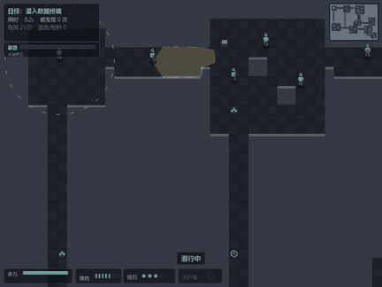

上面这段 GIF 不是摆拍：它由 `scripts/record_demo.py` 录制，而录制脚本**直接调用** `scripts/botrun.py` 的 `run()` —— 和 README 里引用的成绩是同一条代码路径，没有任何写死的走位。这一局是 **63.8 秒通关、途中被咬住 1 次并甩脱、一枪没开、939 分（评级 A）**（结算页上的数字是引擎实跑值，没动过；录像略微加速播放，所以看起来比 64 秒短）。

> 为什么演示视频里不开枪：这一局是"**关卡不靠枪也有解**"的证明。同样的机器人允许开枪并顺路捡补给时是 **62.8 秒 / 被咬 1 次 / 打倒 7 人 / 161 分** —— 比不开枪**快 11.9 秒、少被咬两次**，但 7 次击倒扣掉 700 分，4 具尸体还被同僚认领（详见下面的「手枪与重生」）。**枪能买时间，买不到分数**。

| 玩家视角（暴露 HUD / 小地图 / 状态气泡） | F1 AI 调试视图（视野锥 / 听觉圈 / 角色标签） |
|---|---|
| 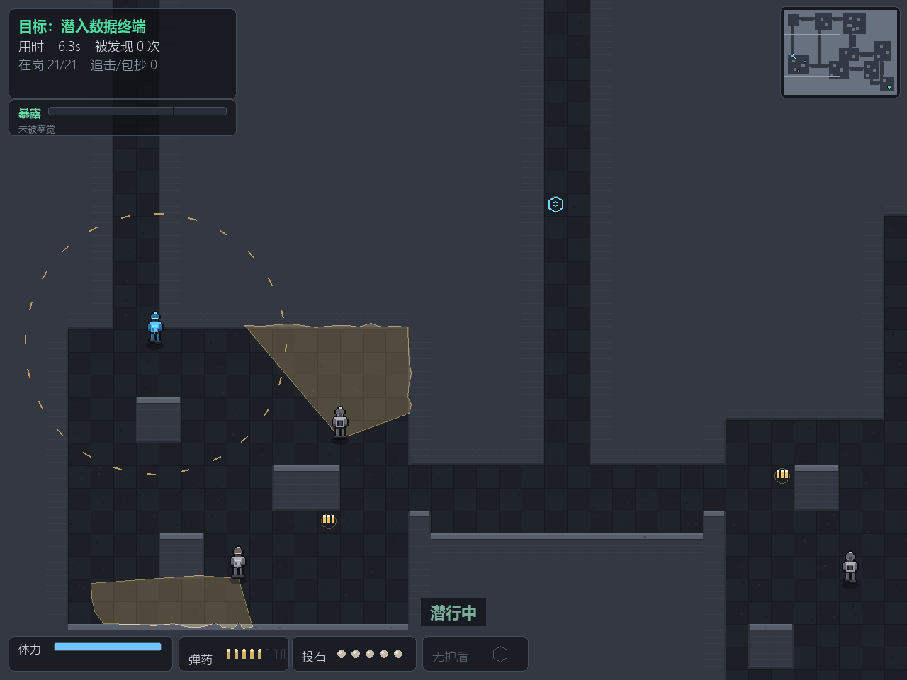 | 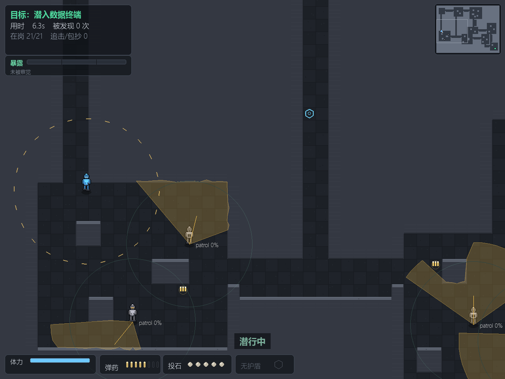 |

按 **F1** 打开 AI 调试视图，能看到每个敌人的视野锥、听觉圈、行为标签（巡逻 / 调查 / 追击 / 包抄 / 封路）和实时可疑度。

## 操作

| 按键 | 作用 |
|---|---|
| WASD | 移动 |
| Shift | 潜行（噪音 ↓ 至 0.3，几乎听不见） |
| Space | 冲刺（速度 6.5，噪音 ×1.85，消耗体力） |
| **鼠标左键** | **开枪**：消音手枪，5 发，射程 12 格，冷却 0.38 秒 |
| **Q / 鼠标右键** | **投石**：Q 朝当前朝向扔，右键朝鼠标位置扔（每局 3 颗） |
| F1 | AI 调试视图 |
| M | 静音（跨局记住，`settings.json`） |
| R | 结算后重开 |
| ESC | 回主菜单（菜单里再按退出） |

启动先进主菜单：一句话玩法说明 + 最佳纪录（分数 · 用时 · 评级 · **创下时间**）+ 操作摘要，回车开局。开局后按"走到哪教到哪"的原则给上下文提示——走近补给点才告诉你它能干嘛，不搞开局弹一堆字的说明书式教学。

## 技术栈

- Python 3.11+ / pygame-ce（渲染）/ numpy（程序化音效）
- 零外部素材：像素美术与音效全部代码生成（无版权风险）

## 架构：每帧每个敌人都走一遍这条链路

```
感知层 → 记忆层 → 决策层（行为树）→ 执行层（流场 / A*）
```

| 层 | 模块 | 技术点 |
|---|---|---|
| 感知 | `perception/` | FOV 视觉锥（110°）+ DDA raycast 遮挡 + 听觉（按噪音分级、**声音过地图**）+ 可疑度累积 |
| 记忆 | `entity/enemy.py` | 最后已知位置（`_last_seen`）+ 调查环视超时 + 追击韧性 |
| 决策 | `ai/` | 行为树（Selector/Sequence/Blackboard）**真正驱动行为选择** + GOAP 规划器**排搜查路线** + 协同分工 |
| 执行 | `pathing/` | A* / JPS / 流场（Flow Field）三代寻路 + 协同包抄 |

### 行为树的三条分支（敌人每帧 tick 一次）

```
Selector
├── if role != PATROL      → engage      协同追击 / 包抄 / 封路
├── elif 起疑 or 搜索中     → investigate 去最后已知位置 + 按 GOAP 计划搜附近藏身点
└── else                   → patrol      按巡逻点走
```

> 这一版之前的"行为树驱动"名不副实（敌人里是 if/else，BT 模块只被测试用到）。这次把决策真正接到了 BT 上：加一条"调查"行为不需要动任何既有状态转移，只是在 Selector 里插一个分支 —— 这正是 BT 相对 FSM 的可组合性。

### GOAP：跟丢之后"先搜哪、后搜哪"由规划器算

行为树负责**选行为**，GOAP 负责**排顺序**，两者分工不重叠：

- 行为树是**反应式**的：角色一被协同分配器改掉，下一帧就必须切到 engage —— 这种抢占不需要"想"，需要的是优先级。
- GOAP 是**深思式**的：跟丢之后要去查几处、按什么顺序查，是一个小规模路径优化问题，
  写成 if/else 只能是"永远先查最近的箱子"，玩家两次就摸清了。

实现（`ai/search_plan.py`）：

1. 在最后已知位置周围找**藏身点**：从记忆点**看不见**（raycast 被挡）、且**至少三面贴墙**的格子。
   空旷地中间被排除，看得见的地方不用搜。
2. 把"起点 / 记忆点 / 每个藏身点"变成一组 `at_i`、`chk_i` 谓词，移动与搜查变成动作，
   目标是"每处都搜过"，交给 `goap.plan()` 在状态空间里搜。
3. 移动代价取曼哈顿距离 —— 顺序决策对距离误差不敏感，而真跑 A* 会在跟丢那一帧卡一下。

这里踩过一个坑：状态是 `frozenset`（只能加、不能减），于是 `at_A` 一旦成立就永远成立，
规划器会给出"在 A 搜完、走到 B、再在 A 搜一次"的**瞬移计划**。补上 STRIPS 的
**delete list**（动作的 `removes`）才修好 —— 位置这种互斥谓词必须能被划掉。

对应的验收方式也很硬：`test_w15` 用**暴力枚举所有访问顺序**算出最优脚程，
再和规划器的输出比。把规划器换成写死的顺序，这条断言立刻会红 ——
"接了规划器"和"用上了规划器"是两回事，只有前者能靠读代码相信。


## 关卡设计：把"路线很少"变成能算出来的数字

上一版的难度是"空地 + 掩体"堆出来的：玩家永远可以贴边走，视锥再密也只是"绕远一点"，实际路线几十条。这一版把结构反转了 —— **先填满岩体，再挖出房间和走廊**。路线数量不再由"玩家怎么绕"决定，而由"我挖了几条洞"决定：

| 指标（`scripts/audit_routes.py`） | 当前值 | 判读 |
|---|---|---|
| 最小割 = 互不重叠路线数 | **4 格** | 想切断关卡必须同时堵住 4 个格子；"空地撒欢"的图这里会是几十 |
| 门 | **20 道，全是 2 格宽** | 2 格 = 一次只够一个人过；哨兵站在门内侧，你就只能等 |
| 最短路线 | **115 格，穿 8 道门** | 这一趟要在 8 双眼睛底下卡 8 次时机 |
| 两条主弧 | 北弧 119 格 / 南弧 115 格 | 几乎等长：取舍不来自距离，来自"10 道紧门 vs 8 道松门" |

拓扑是 θ 形：出生舱 S → 终端舱 T，中间只有三条并行弧（北弧 / 南弧 / 中间一条竖井捷径 X1），最后并回同一个终端舱。走哪条都要付"等门"的代价，只是价钱不同。

难度指标也跟着换了一次，原因写在 `audit_difficulty.py` 的 docstring 里：旧的"无影通路率"要求**同一瞬间所有门都空着**，在门控关卡里恒等于 0%（实测 0%）——它测的不是玩家体验。现在测的是**门窗口**：

| 指标（`scripts/audit_difficulty.py`） | 当前值 | 判读 |
|---|---|---|
| 门窗口率（20 道门平均） | **65%**，最紧的门最长窗口 **2.0 秒** | 人穿 2 格门约 0.5 秒；窗口 < 1 秒的门就是"过不去" |
| 北弧 / 南弧 / 捷径 | 55% / 74% / 85% | 近路门多而紧、远路门少而松 —— 取舍是有定价的 |
| 无视野硬走对照 | **89%** 的时间在别人视锥里（峰值同时被 6 人盯着） | 不会绕路就是送，地图没放水 |
| 整条无影路线 | **0%** | 门控关卡的必然结果，所以不作为可解性判据 |

机器人（`scripts/botrun.py`）在新地图上的成绩：**63.8 秒通关、被咬 1 次并甩脱、0 击倒、939 分**，`assets/demo.gif` 就是它的实跑录像。它只看得懂"当前视野锥"，不会读门窗口表，所以每次都是硬等 —— 人类玩家读到"这道门有 2 秒空档"能走得更快。

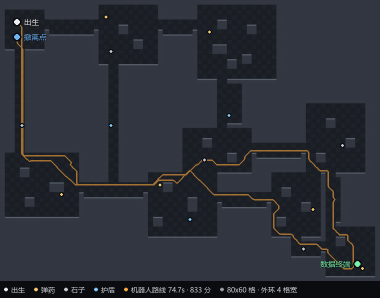

*(橙线是机器人这一局的真实轨迹（`scripts/make_level_map.py --level 0 --path` 跑一遍再画上去）：0 秒从出生舱出、沿西侧 2 格宽长竖廊南下、经西仓库 → 南机房 → 泵站，34 秒摸到终端；回程改走东厅 → 中继站，再从中继站直接切回南机房，74.5 秒回到出生舱旁边的撤离点。)*

> 这一版最贵的一课写在"技术难点"里：**路线数是挖出来的**。旧图加 18 个哨兵还是能贴边绕，因为空地里的"路"是玩家走出来的，不是作者画的。结构反转之后，"再多给几条路"变成一件需要显式决定的事 —— 而"不给路"才是把难度交到关卡设计手里的前提。

## 三关：把"一关"抽象成"关卡"

上面那张图在很长一段时间里就是整个游戏 —— 因为"一关"不是数据，是散在 `world.py` 里的四份模块级常量加 `constants.py` 里的两个全局坐标。想加第二关，得同时改地图、巡逻、补给、目标点、评级阈值、存档字段，漏一处就是"第二关的终端画在第一关的坐标上"。

所以先做抽象：`core/levels.py` 里一关 = `Level(地图构建器, 巡逻, 补给, 门闸, 终端, 撤离点, 出生点, 评级基准)`。**不搞随机生成** —— 三张图仍然逐格手写，因为手写的图有作者意图（哪道门该紧、哪段廊该空），生成器给不了。抽象只解决一件事：换图不改代码，只换数据。

| | 第 1 关 · 哨站 | 第 2 关 · 环形枢纽 | 第 3 关 · 柱林中庭 |
|---|---|---|---|
| 空间 | θ 形：两条弧 + 一条捷径 | 一圈外环 + **一条辐条** + 中央金库 | 一圈 3 格服务廊 + 56×40 错位柱林 |
| 走廊宽 | 2~3 格（只能侧身） | 4 格（能贴对面墙走） | 服务廊 3 格，大厅里**没有走廊** |
| 视线 | 短，门会切断 | 长，能看穿整段廊 | 中，但没有一条直街 |
| 难点 | 等门窗口 | 跟着巡逻兵的后背走 | 选哪条"缝"穿过去，以及什么时候冲 |
| 门 / 闸 | 20 道 | 8 道闸 + **1 个金库入口** | **2 道门** |
| 最小割 | 4 格 | **2 格**（金库单入口） | 4 格（两道门各 2 格） |
| 最短路线 | 235 格 | 218 格 | 131 格 |
| 哨兵 / 补给 | 21 / 14 | 14 / 12 | **34** / 14 |
| 追兵速度 | 3.4（走路能甩开） | 4.0（得冲刺） | **4.4**（和走路一样快） |
| 机器人（6 相位） | 4/6 胜 · 均时 61.5 秒 | 3/6 胜 · 均时 47.5 秒 | 3/6 胜 · 均时 29.0 秒 |

三关是**一次连续行动**：用时、被发现、击倒、剩余弹药跨关延续，最后一关打完才结算成绩与评级；评级基准按"已打的关数"累计（三关 S 线 170 秒），否则越往后越容易拿 S。中途失败只重开**当前关**，但已经耗掉的时间留着 —— 罚时间、不罚进度。

> **v1.5 把难度整体抬了一档，动作在两根轴上，不在"多放几个人"上：**
> ① **结构**：第 2 关金库的四条辐条砍到一条（四个入口等于没有入口，机器人 46 秒穿过去时连金库里的两个人都没碰），第 3 关的柱林从正交网格改成**隔行错开 3 格**（原来横竖都是直街，等于空地加装饰）。
> ② **威胁**：追兵速度原来是全局 3.0，而玩家走路 4.4 —— **走就比追兵快 47%，"被发现"等于没被发现**。现在它是一根关卡参数：3.4 / 4.0 / 4.4，最后一关和走路一样快，被发现就只剩"冲刺 + 找柱缝"这一条路，而冲刺要花体力。
>
> 判断标准也换了：不再看"机器人跑多少秒"（单次成绩只是某一个相位下的数，BLOG 经验 31），而是看 `scripts/audit_phases.py` 的**六相位胜率**——同一张图换哨兵初始相位跑六局，胜率落在 30%~80% 才算"有压力但过得去"。

换关是**自动**的：踩到撤离点 → 屏幕压暗、显示「第 N 关完成 / 下一关 · 柱林中庭」→ 1.6 秒后自己进下一关。不需要按键，也不弹结算页（半路弹结算会把一次连续行动切成两段互不相干的小局）。这 1.6 秒里世界是冻结的：哨兵不动，用时也不涨。

*(这段过场曾经有个玩一次就能发现的 bug：计时器被设成 1.6 秒，却**没有任何地方递减它** —— 卡片永久停住、输入被吞、永远进不了第 2 关，而 CI 全绿，因为机器人在"胜利"那一刻就 `return` 了，没有任何测试走过后面那 1.6 秒。修法不只是补一行递减，而是把主循环拆出 `Game.step(dt)` 让测试能喂帧：`test_w18` 现在真的踩撤离点、喂 3 秒帧，断言"1 秒时还在卡片、2 秒时已在第 2 关"、"过场期间敌人不动且用时不变"。)*

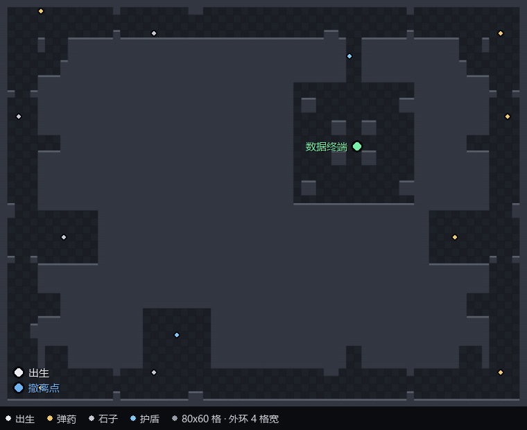

*(整张图俯视（`scripts/make_level_map.py` 烘的就是引擎自己那份地图数据）：一圈 4 格宽的外环、8 道闸把它切成 8 段，**只有一条 2 格宽的北辐条**通向中央 16×16 的金库，金库正中是数据终端。白点是出生点，绿点是终端，蓝点是撤离点 —— 注意出生和撤离在同一角：你得先绕到北边，再从北边原路绕回来。三个设备间（西/东/南）各自从外环开口、互不相通，只给掩体和补给，不给捷径。)*

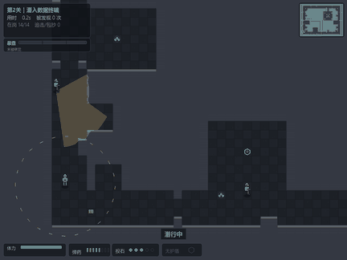

*(第二关的实跑录像，同样一帧没摆拍：`python scripts/record_demo.py --level 1` 直接调 `botrun.run()`，47.5 秒、被发现 2 次、护盾反杀 1 人、789 分 A 评级。它从西南角出发，沿西廊北上、过北廊两道闸、从北辐条南下进金库，摸完终端原路退回 —— 全程 218 格，比 v1.4 长了 40%。)*

### 第二关是机器人"审"出来的

这张图的第一版在纸面上看没问题：环、辐条、金库、8 道闸全对，连通性校验、门宽校验、最小割全部通过。然后把测试机器人放进去，连读三次死在同一格。三个问题都不是"看起来不对"能发现的：

1. **沿走廊扫的哨兵 = 一堵会移动的墙**。第一版 18 格的长往复让整段走廊永远被覆盖，机器人在闸门前卡了 200 秒寸步难行。改成第 1 关验证过的做法 —— **横跨走廊的短往复**（人不动位置，只转身），玩家才能掐着转身的节拍过去。
2. **2 格宽的辐条是死亡陷阱**。被看见后躲进辐条，追兵堵住唯一出口，必死。所以沿环的内墙挖了 8 个 3×3 壁龛，给玩家第三个动词：**躲进去等它走过去**（原来只有"绕"和"跑"）。
3. **目标点落在格点角上**。终端原来写在 `(52.0, 22.0)` —— 那是四个格子共用的角点。寻路以格中心为目标、容差 0.4，加上角点到格中心的 0.707，最坏会停在离终端 1.1 格的地方，而触发半径只有 0.8。表现为：机器人贴着终端站了 150 秒，状态始终是"潜入中"。现在 `test_w17` 会断言终端和撤离点必须落在格中心。

第 1 条和第 2 条是**关卡设计规则**，第 3 条是**坐标系约定** —— 三条都写进了 `scripts/test_w17.py`，对每一关自动生效，以后加第三关不用重记。

### 第三关：把墙拿走

前两关的答案都是同一个字：**等**（等门空、等它转身）。第三关故意不给这个答案 —— 中间是一个 56×40 的大厅，大厅里没有走廊，只有一片 2×2 的方柱，柱距 6 格、缝宽 4 格，**并且隔行错开 3 格**。

错位这件事是 v1.5 才有的，也是这一关真正的骨架：柱距 6 的正交网格横着有七条直街、竖着有九条直街，玩家可以沿任何一条走到头 —— 它看起来是柱林，走起来是空地（机器人 35 秒直线穿过去用的就是那条"正好在南北门连线上"的街）。隔行错开之后没有一条街是直的：你从一条缝往北走，走到下一排就撞上柱子，必须横移 3 格找下一个口。**蛇行是地形逼出来的，不是敌人逼出来的。**

于是玩法从"等"变成"选"：任意两根柱子之间都能过，但没有一条缝是"确定安全"的。你要决定的是**现在穿哪一条**，以及**要不要干脆冲过去**。出生点和撤离点也改摆对角（西南进、东北出），和前两关的"原路折返"相反：前两关考"记住来路"，这一关考"敢不敢横穿"。

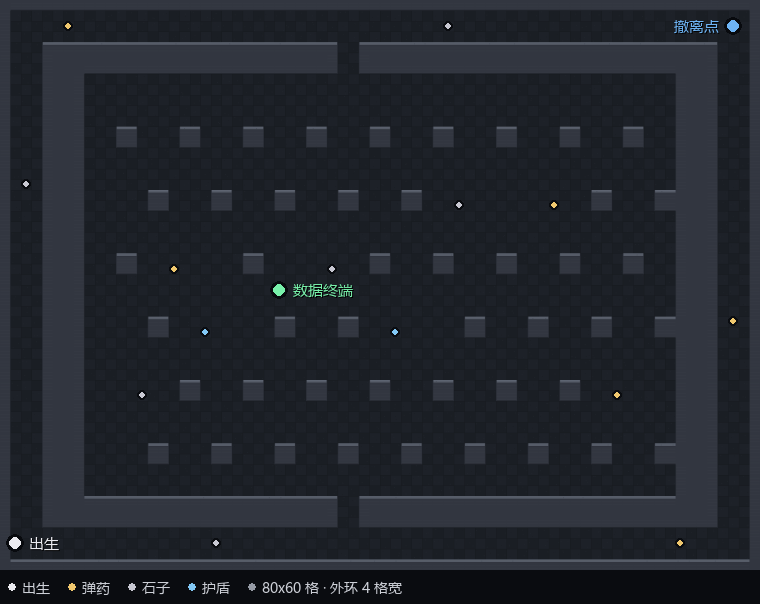

*(引擎数据烘出来的俯视图（`scripts/make_level_map.py --level 2`）：外面是一圈 3 格宽的服务廊，中间是 9 列 × 6 行的错位柱林。数据终端不在空场上，就在柱林中间的一个"格子"里 —— 四角都有柱子，进去要选一条缝。)*

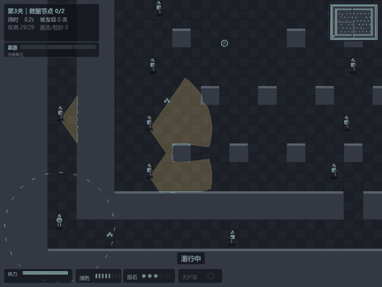

*(实跑录像：29.0 秒、被发现 1 次、0 击倒、991 分 A。注意它和前两关的区别 —— 它不是"等到窗口再走"，它是**一路在动**，用柱子把视线切断、用速度把追兵甩在身后。录这一局用 `--phase 1`：默认相位下的机器人会死在大厅北侧，同一张图换个相位就能过，这不是 bug，是相位锁定系统的天性。)*

#### 这一关是机器人逼着改了两轮的

第一版有**四道门**（东西南北各一个）。纸面上很合理："到处都能进，玩家自由"。机器人 34.3 秒通关 —— 四个口意味着随便挑一个都空着，大厅变成一条没人管的走廊。**四个门等于没有门**。砍到南北两道之后，"进哪一头"才重新变成一个要提前决定的事。

第二版我把柱距从 6 加到 8（缝从 4 格变 6 格），想让视线更压迫。结果还是 32 秒 —— 因为**开阔地的难度不来自"走不过去"，来自"走过去会被看见"**，而这个游戏的惩罚是"被发现"，不是"走不动"。所以这一关的定价方式和其他两关不同：它不是让你多等 20 秒，是让你在没有掩体的地方跑完最后 20 格。

第三版我往终端空场里补了两个哨兵，想逼玩家等一等 —— **结果快了 2 秒**（33.3 秒、只被看见 2 次、连补给都没捡）。哨兵一动，整张图的相位全变，机器人刚好撞进一个更宽的空档。这一版最后被回退了，它教的东西比它带来的 2 秒更值钱：**加人不是调难度的旋钮**，而且"改一个参数、跑一次、看结果"在这种相位锁定的系统里就是掷骰子（`botrun` 是确定性的，但确定性地偏）。

第四轮（v1.5）不再动人数，动的是**几何**：柱距 8 → 6，并且隔行错开 3 格。同一个机器人从 35.4 秒变成 29 秒胜 / 24 秒死（相位不同结果不同），但真正的变化不是秒数 —— 是**它没有一条直街可走了**。配合把追兵速度提到 4.4（等于玩家走路速度），这一关的失败不再来自"被看见"，而来自"看见了却跑不掉"。

评级基准因此定在 40 / 62 / 95 秒（三关累计 S 线 170 秒）。

## 手枪与重生：给玩家一件"有定价"的保命工具

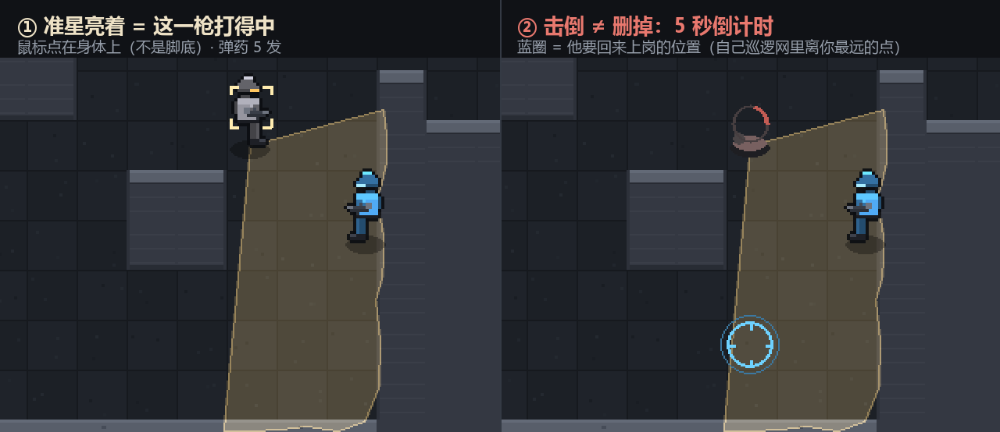

*(两张都是引擎实跑帧（`scripts/make_gun_figure.py` 生成）：左 = 鼠标压在哨兵身上，准星亮着；右 = 3.9 秒后，尸体上是倒计时，蓝圈是它要回来上岗的位置。)*

上一版玩家面对哨兵只有两种交互：等它转开、或者扔石子把它骗走。主动权全在 AI 手上。所以加了枪 —— 但它被四条约束钉在"工具"而不是"答案"的位置上：

| 约束 | 数值 | 为什么必须这样 |
|---|---|---|
| 弹药 | **5 发**起步，路上弹药包 +2（上限 8，见下章） | 图上有 21 个哨兵。枪不是清场工具，是"这几次机会用在哪个门" |
| 命中方式 | hitscan（射线步进 0.08 格），射程 12 格，判定半径 0.35 格 | 子弹做成实体就得处理"子弹追不上贴墙的哨兵"，射线求交又准又便宜 |
| 冷却 | 0.38 秒 | 防按住左键乱扫 |
| 枪声 | 半径 **9.5 格**，可疑度抬到 **0.62**（确认线 0.70），定位误差 0.35 格 | 消音器就是干这个的：声音传不远，但听到的人方向很确定 |
| 尸体目击 | 6.5 格内看见尸体的哨兵进入 **12 秒警戒**（原地张望、可疑度托底在起疑线以上） | 杀人有代价，但代价是"这片区域变敏感"，不是"有人冲过来堵你的路" |
| 复活 | **5 秒**，在**自己巡逻网里离玩家最远的点**，提前 1.3 秒亮预警环 | 打倒是"借 5 秒"，不是"删掉这个人" |
| 贴脸复活 | 3 格内给 0.9 秒苏醒延迟 | 不能在玩家脸上刷一个立刻能抓人的哨兵 |
| 计分 | 每次击倒 **−100 分**，每次被发现 **−45 分**，每秒 **−1.5 分**（超 90 秒后折半计）；S 档要求"零击倒 + 零被发现" | 清场流不能成为更优解 —— 分数应该来自"没被看见" |

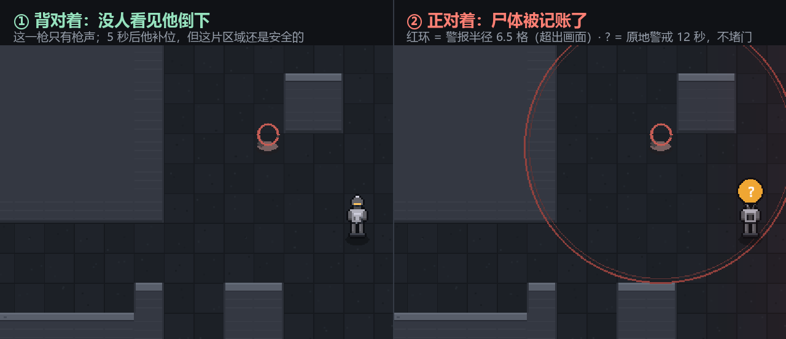

*(同样一枪、同一个位置，唯一区别是目击者背对还是正对（`scripts/make_body_figure.py`）。左边只有枪声；右边尸体被认领，红环扩散、目击者头顶亮起 `?` 并原地警戒 12 秒。)*

同一个机器人、同一张图的两种玩法：

| 玩法 | 用时 | 被发现 | 击倒 | 尸体暴露 | 得分 |
|---|---|---|---|---|---|
| 纯潜行（`--aware`） | 63.8s | 1 | 0 | 0 | **939** |
| 允许开枪（`--aware --armed --loot`） | 62.8s | **1** | 7 | 4 | **161** |

开枪这一版**连时间都买不到了**（差 1.0 秒，基本持平）：7 次击倒扣 700 分，4 具尸体被同僚认领后又让整段路变敏感，总分只有潜行局的六分之一。**枪能买时间（勉强），买不到分数**。

> 这张表是**必须每次重跑**的：v1.5 把追兵速度从 3.0 提到 3.4 之后，纯潜行局的"被发现次数"从 3 次掉到 1 次、总用时从 74.7 秒掉到 63.8 秒 —— 追兵变快，机器人反而更早开始躲，少走了几次回头路。**结论依赖它脚下那层 AI，也依赖那几个速度常数**，别把上一版的数字抄过来。

> 这句话在本项目里**翻过两次**：换成实心开挖的 θ 形地图之前它成立；守卫学会"翻角落"之后（每具尸体都是一支搜索队）它不成立了 —— 那时候枪连时间都买不到；听觉改成过地图之后它又成立了。**结论依赖它脚下那层 AI，所以每次动 AI 都要重跑一遍这张表**，而不是把上次的结论抄过来。

> **踩坑：第一版"尸体目击"是让哨兵跑过去看现场，结果带枪玩法 3 局全灭。**
> 原因很结构性：玩家开枪的位置几乎总是**一道门**，让目击者走过去等于自动把唯一的路堵死，而 5 秒后死者还会在别处补位 —— 于是"开枪 → 有人来堵门 → 5 秒后前后夹击"变成必死连锁。
>
> 改法不是删掉代价，而是**换一种代价**：目击者不移动，只在原地警戒 12 秒、转头张望、可疑度托底在起疑线以上。惩罚从"堵你的路"变成"这片区域短时间很敏感"，玩家能从暴露条和 `?` 读出来、能绕开，但不能再赖在这儿。
>
> 同一时期还发现机器人自己的策略是错的：它学会了"边跑边还击"，结果越跑人越多。改成"只在没人能看见目标位置时开枪"之后，带枪从 0/3 胜变成 3/3 胜 —— **机制教会了策略，这才是好机制该有的样子**。

> **踩坑：第一版玩家反馈"瞄着人打，一直打不死"。**
> 而单测全绿 —— 因为测试点的是敌人的中心坐标，玩家点的是**画面上的人**：
> 命中判定点在脚底 `(e.x, e.y)`，精灵却是脚底对齐往上画的（48px ≈ 1.5 格，身体中心在脚底上方 0.7 格）。
> 于是射线从它头顶飞过去，打在背后的岩体上。玩家唯一的结论是"这枪是坏的"。
>
> 修法不是放大判定半径（那会变成"打空气也能中"），而是**先认人、再开枪**：点在身体轮廓里就吸附到本体中心，然后照常走射线。吸附只解决"打的是谁"，不解决"能不能打到" —— 隔墙点人依然是墙（`test_w10::test_aim_snap_never_shoots_through_walls`）。
> 最后把这套规则变成可见的：**准星亮着 = 这一枪打得中**。判定和画面不一致时，错的永远是判定。顺带补了一个更隐蔽的洞：`can_see` 在"两者坐标完全重合"时为了躲除零返回了 `0.0`，等于"站在哨兵身上反而最安全" —— 这个边界是"敌人贴脸应该失败"的回归测试揪出来的。

## 沿途补给与护盾：让"绕路"变成一个真实决策

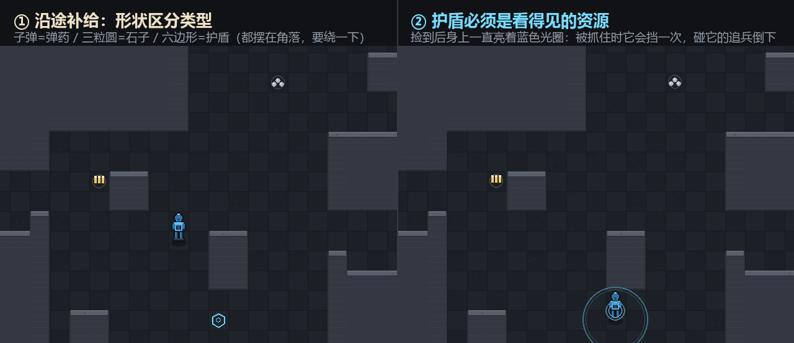

*(两张都是引擎实跑帧（`scripts/make_pickup_figure.py` 生成）：左 = 同一屏里三种点位靠形状区分 —— 子弹 = 弹药、三粒圆 = 石子、六边形 = 护盾；右 = 玩家走上护盾点，六边形消失、身上亮起蓝色光圈。)*

图上有 14 个补给点（弹药 ×6、石子 ×5、护盾 ×3），全部摆在**顺路拿不到、绕一下才拿得到**的位置。三种资源共用同一套克制逻辑：

| 资源 | 数值 | 为什么必须这样 |
|---|---|---|
| 弹药包 | +2 发，上限 8 | 枪的总预算从 5 变"5 + 路上捡的"，但上限 8 意味着最多续 3 发 —— 清场流依然不成立 |
| 石子堆 | +2 颗，上限 5 | 石子是"改路径"的工具，多两颗 = 多两次骗人机会，不改变单次噪音半径 |
| 护盾 | 最多 1 层，**不可叠加** | 能叠两层就等于无限复活；1 层 = 一次犯错的保险，不是免死金牌 |
| 护盾反杀 | 碰到你的哨兵倒下，动静半径 7.0 格、可疑度抬到 0.42 | 反杀同样计 −60 分。比枪声（9.5 格）安静，但不是无声 —— 附近哨兵会起疑 |

点位不是手摆的，是**用规则解出来的**：每个点距最近巡逻线 ≥3 格、距最近的门 ≥2.5 格、且要么周围可走邻格 ≥6（开阔易拿）要么距巡逻线 ≥8（深谷高风险高回报）。第一版把补给摆在巡逻线正中间，机器人 `--loot` 跑 3 局全灭 —— 绕路捡东西等于自己撞进巡逻网。**补给的价值必须由玩家自己判断"这一下绕路值不值"，点位本身不能替他做决定**。

护盾单独验证过（ dumb bot 直线冲）：不带护盾 33.2s 被抓；带护盾挡下一次、反杀一名哨兵、多活 1.2s —— 它买到的是**一次容错**，恰好是潜行游戏里最贵的东西。

同一机器人、同一张图，加上补给后的完整对照：

| 玩法 | 用时 | 被发现 | 击倒 | 得分 |
|---|---|---|---|---|
| 纯潜行（`--aware`） | 63.8s | 1 | 0 | **939** |
| 顺路捡补给（`--aware --loot`） | 63.8s | 1 | 0 | **939** |
| 带枪 + 补给（`--aware --armed --loot`） | 62.8s | 1 | 7 | 161 |

这一版三个数完全一样：机器人读补给的规则是"顺路才拿"，而 v1.5 之后它的最优路线本来就经过那几个点 —— **补给一次都没让它绕路**，也就没改变任何东西。这比"快 0.6 秒"更能说明问题：补给只影响收益，不替你选路线。绕不绕、绕哪一段，是玩家自己算的账，有时正确答案是"不捡"。

## 计分：把"分数"拆成能解释的两半

原来的计分只有一个数字（`1000 − 4×秒 − 90×被发现 − 60×击倒`），运行起来就暴露了三个问题，而且都是**只有一个总分看不出来**的那种：

1. **时间项决定了全部玩法**。4 分/秒意味着"快 30 秒"值 120 分 = 多被发现一次。于是最优解永远是"直线冲"，风格分只是装饰；
2. **失败局有分数**。结算页早就不显示分数了，但 `score()` 照样返回，脚本和存档都能看见 —— `score_table` 第一次跑就抓到"被抓的一局拿了全场最高的 827 分"；
3. **明细无处可看**。玩家看到一个 798 分，不知道它好在哪、差在哪。

改法是把它拆成两层，并且让每一层都能在结算页被读出来：

```
得分 = 基础分（效率） + 风格分（方式）
基础分 = 1000 − 1.5×秒（超 90 秒部分折半计） − 45×被发现 − 100×击倒
风格分 = 全身而退 +120 · 零击倒 +80 · 引开 ≥3 人次 +60 · 护盾反杀 +50 · 开枪未被目击 +30
         （在同一个哨兵面前被发现 ≥4 次，反向 −40）
```

四个关键改动，每个都对应上面一个症状：

- **时间项降权 + 封顶**：1.5 分/秒，超过 90 秒的部分只按 25% 计。快依然值钱（61 秒 vs 75 秒 = 21 分），但不再压死"稳"；
- **风格分改名并放宽**："全程未起疑"（峰值 < 0.35）改成"**全身而退**"（峰值 < 0.70，即一次都没被**确认**）。原因是一件事不能扣两次：基础分已经按"被发现次数"扣过了，风格分再要求"一次都别被看见"，等于同一件事罚两遍；
- **失败局在 `score()` 里直接返回 0**，不是只让结算页不显示 —— 只改显示层，存档和脚本依然会拿到那个数字；
- **明细进存档**：`records.json` 现在存 `style` 数组和 `style_total`；老存档没有这两个字段也能读（补空列表），字段类型坏了（`"80"` / `"abc"`）会被丢弃或归零。

| 玩法（`scripts/score_table.py`） | 用时 | 被发现 | 击倒 | 基础分 | 风格分 | 总分 |
|---|---|---|---|---|---|---|
| 静默流（`--aware`） | 63.8s | 1 | 0 | 859 | 80 | 939 |
| 补给流（`--aware --loot`） | 63.8s | 1 | 0 | 859 | 80 | **939** |
| 冒险流（`--loot --weight 2.5`） | 35.3s | 1 | 0 | — | — | **0（失败）** |
| 火力流（`--armed --loot`） | 62.8s | 1 | 7 | 161 | 0 | 161 |

*(冒险流这一版直接死了：它为了省时间把安全权重降到 2.5，35.3 秒就冲进追兵怀里 —— v1.5 的追兵速度 3.4 下，"赌一把"不再是一个划算的赌注。这行从"746 分的次优解"变成"0 分的失败局"，是这一版难度提升最直接的证据。)*

> **"谁排第一"会随着 AI 变，所以这里验的从来不是排名。**
> 第一版 `score_table` 写死了"稳的那一档必须第一"。当时机器人跑出来冒险流第一，我以为是权重歪了，开始调参 —— 调到"被发现 90 分/次"时冒险流依然第一，再往上加，静默流直接被扣成 0 分（它一局被发现 4 次）。停下来看数据才想明白：**那时候**的冒险档只被发现 3 次、还快 14 秒，按设计它就该赢。
>
> 后来守卫学会"翻角落"（见上面的 GOAP 一节），被咬的代价整体变贵：同一套权重下，静默流反超了 —— 冒险档多被咬两次，省下的 7 秒赔进了 90 分。再后来听觉改成过地图，名次又翻了一次（冒险档这次成了最低的潜行档：快 2 秒，却多被咬 3 次）。**同一份公式，名次跟着 AI 的能力三翻其面，而公式一个字没改**。
>
> 这正好说明为什么验收标准必须是"逐局对账"，而不是"谁排第一"：排名依赖机器人和 AI 的版本，公式才是设计意图。把"稳着走必须第一"写进断言，等于把一时的平衡当成永久的设计。
>
> 所以最后没有改排名，而是改了 `score_table` 验什么：不再验"谁第一"，改成**逐局对账** ——
> 用一套独立写的公式把"这一局的用时/发现/击倒应该值多少分"重新算一遍，和引擎返回的分数比。这条才真正抓得到"权重改了但公式没跟上"这类事故，而且不会因为机器人打得好而误报。
>
> 顺带在这轮调参里发现了真问题：时间项不封顶时，`weight=7` 和 `weight=4` 两种策略的分差全靠"快 7 秒"撑着，风格分形同虚设 —— 于是才有了上面的封顶。

## 可读性：把 AI 的内部状态画到它身上

潜行游戏最难的不是 AI 聪明，而是**玩家能不能读懂 AI 现在想干什么**。这一版把三个原本只在数字里的状态画到了世界里：

| 你以为看到的 | 实际看到 | 意思是 |
|---|---|---|
| 暴露条在涨，不知道躲谁 | 正在看你的哨兵**脚下一圈橙色弧** | 弧越长越危险，到确认线时换成红色四角括号（锁定） |
| 屏幕外有人，"那边是不是有人" | 边缘**小一号的暗黄箭头** | 起疑但还没确认的哨兵也会标出来 —— 只标追兵等于火烧起来才报警 |
| "任务失败"四个字，不知道为什么 | **"巡逻哨兵从你东边贴上来抓住了你 —— 它还没确认你的位置，是你在它眼皮底下走过去了"** | 谁、哪边、为什么，一句话说清 |

失败页也不再给分：得分衡量的是"完成任务的效率"，任务没完成就没有效率可言 —— 改成显示进度（刚开局 / 潜入途中 / 已拿到数据·回撤途中）。"被秒抓却拿 880 分"比 0 分更像 bug。这条规则现在写在 `world.score()` 里（失败直接返回 0），而不是只在结算页"不显示"。

## 巡逻：从"顶在墙上"到"真的在值班"

上一版修好了"哨兵被钉死在出生点"，但玩家一眼就看出了下一个问题：**很多敌人贴着墙不动**。根因很具体：

1. 巡逻用的是 `_move_toward(巡逻点)`，也就是**直线逼近**。掩体一挡，x / y 两个轴同时吃碰撞，哨兵就永远顶在墙上推 —— 表现是原地小幅抖动，看起来像坏了。
2. A* 的八方向允许**斜穿墙角**（对角移动只检查目标格）。对没有体积的点没问题，但半径 0.35 的圆，圆心正好会落在两个墙格夹出的角点上 —— 过不去。
3. `world.update()` 里 `for e in self.enemies: e.update(dt, self)` **写了两遍**（加"最后已知位置"逻辑时留下的重复循环）。所以哨兵实际移速是配置的 2 倍，可疑度也是双倍速上涨。

三处一起改：

| 改动 | 做法 |
|---|---|
| 巡逻改走路径 | 巡逻也走 A*（带 0.45s 重算节流），到点判定用"路径走完 或 距离 < 0.45 格" |
| 不许切角 | A* 对角移动要求两个正交邻格都可走；JPS 保留经典语义，对比时用 `corner_astar(..., corner_cut=True)` 对齐口径 |
| 到点站岗 | 每到一个巡逻点停 1.6 秒，朝向左右各扫 40°（视野锥跟着摆），"停下来张望"才是玩家能利用的时间窗 |
| 卡死自愈 | 0.5 秒位移 < 0.04 格 → 判定卡住：先强制重算路径，连续 3 次就换巡逻点 + 转 90°。几何修正永远会漏掉某种贴墙姿态，这层兜底才是"再也不会顶墙"的保证 |

顺带把"站岗环视"也算进了机器人的危险度地图（`_danger_map` 把 ±摆幅的锥体一起扫进去），否则它会按一个静止的锥体规划路线，刚好走进下一秒被扫到的格子。

**验证**：`scripts/diag_patrol.py` 跑 180 秒，21 个哨兵最长"原地不动"时间是 **1.6 秒**（正好等于站岗时长，没有一个卡住），单个哨兵 60 秒内走 90~110 格。这条也进了回归测试（`test_w7::test_no_enemy_stuck_at_wall`）。

**门控地图给巡逻加了一条硬规则：巡逻点必须离每道门 ≥3 格。** 这条是撞出来的：改成 2 格宽的门之后，机器人开局 8 秒就撞死在出生舱东门 —— 不是它不会绕，是某个哨兵的巡逻点正好贴在门内侧，2 格门 + 半径 0.35 格的身位 = 门被永久封死。现在 `test_w10::test_no_patrol_point_blocks_a_door` 逐个巡逻点量距离，21 个哨兵全部合规。**"门"这种窄结构不能和"会站在那儿的 NPC"共存而不做检查。**

## 美术：把"火柴人"换成程序化像素小人

之前的角色是"圆头 + 方身体 + 两根线段腿"，远看就是火柴人。重做时的三个决定：

1. **离线烘焙 + 缓存**：用 16×24 的美术像素网格画一次，按整数倍放大（最近邻，边缘硬朗），按 (配色, 朝向, 帧, 蹲姿) 缓存。运行时每个角色只花一次 blit —— 加了 40 多个绘制细节，渲染开销几乎没变（角色绘制依然是一次 blit 的量级）。
2. **1px 深色描边**：暗色地板上没有描边，人物会和背景糊在一起。描边是用剪影往四个方向各偏移 1px 涂深色实现的，对任意造型都生效。
3. **朝向线索塞进配色**：护目镜是唯一的亮色。玩家冷青、哨兵琥珀、进入追击变红 —— 不用看头顶标签，第一眼就知道谁在看你、朝哪看。背面没有护目镜，只有背包和背带。


*(上图由 `scripts/make_sprite_sheet.py` 生成：3 个朝向 × 4 帧走路 + 蹲姿 + 玩家/哨兵/追击/包抄四套配色。参考方框是一个 32px 的地面格。)*

造型取舍：头 6 宽、肩 8 宽、躯干 6 宽 —— **头不能和肩一样宽**，那是机器人的比例。正面不画"抱在腰前的枪"：3 个像素的空间里只会糊成一团灰块，改成大腿外侧的枪套 + 露出的枪柄，远看反而更像"带武器的人"。

## AI 行为指标（30 局取平均）

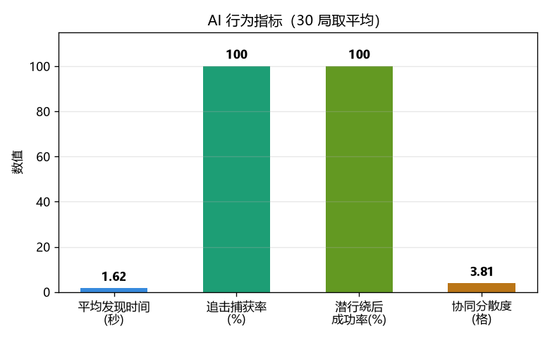

| 指标 | 数值 | 含义 |
|---|---|---|
| 平均发现时间 | 1.62 秒（4 格正对） | 不"秒发现"，有拟真的确认过程 |
| 追击捕获率 | 100%（2.99 秒） | 发现后能追上，不半途放弃 |
| 潜行绕后成功率 | 100% | 背后不被发现，感知有真实的方向性 |
| 协同分散度 | 3.80 格 | 多敌人不挤成一团，有真实的分工 |

> 发现时间是距离相关的：可疑度增速乘了距离衰减，4 格处约 1.62 秒确认，贴脸才接近"秒发现"。这比一个固定数字更接近真实哨兵的行为，也是玩家能"抢在确认前缩回掩体"的前提。
>
> 这组数字曾经是 0.78 秒 / 1.49 秒 —— 那是在 `world.update()` 里敌人被**更新了两遍**的 bug 下测出来的（双倍增速、双倍移速）。修掉之后数值翻倍，看起来"AI 变弱了"，实际是数值表第一次和配置对得上。
>
> 这组数字还差点变成"永远满分"：`benchmark_ai_metrics.py` 的几个指标共用一个 `Game`，而捕获率那一项的结尾是"玩家被抓住"——世界停在结算态、`update()` 直接 return。后面的"绕后成功率"和"协同分散度"因此跑在一个**冻结的世界**里：一个永远是 100%（可疑度不再增长，等于永远没被发现），另一个算出 0.00 格（没人还在追）。修法是每个指标先 `_restart()`，并且在"被抓"时也算绕后失败。**指标把失败记成成功，比没有指标更危险**——它会让后续所有结论建在假数据上。
>
> 另一处"AI 在作弊"的地方是听觉：以前听到脚步会直接写入玩家的真实坐标，哨兵隔着墙也能精确走到你站的那一格。现在只有**看见**才给精确位置，纯听觉只能给出带偏差的猜测（误差随距离 0.45~1.4 格）。这一条改完，机器人的成绩从 55.7 秒 / 3 次被发现变成 57.8 秒 / 1 次 —— 不是 AI 变笨了，是它终于不再偷看答案。

## 三代寻路：各有各的适用场景

| 算法 | 定位 | 单敌人(80×60) | 200 敌人 |
|---|---|---|---|
| A* | 基准，正确性参照 | 2.19ms | 449.17ms |
| JPS | 均匀代价开阔地图加速 | 1.24ms | 275.47ms |
| **流场** | **多敌人共享一次计算** | 7.43ms | **8.60ms** |

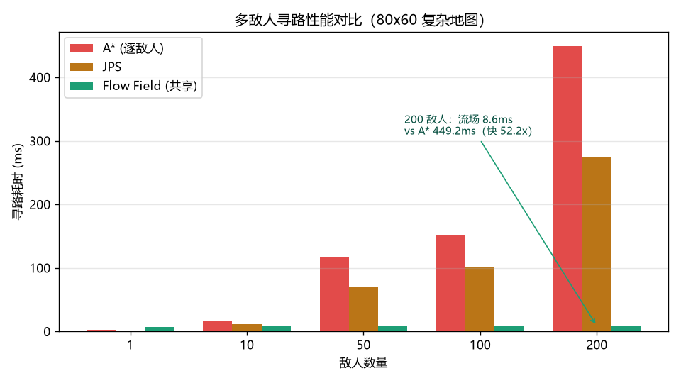

**关键结论（诚实 trade-off）**：流场在单敌人时反而不划算（全图 BFS 开销大），但敌人一多就反超 —— 200 敌人时比逐敌人 A* 快 **52 倍**。JPS 在 80×60 这种密集障碍图上只是"比 A* 快一点"（跳跃剪枝省下的扩展节点，被递归开销吃掉一部分），要到更大、更开阔的地图才拉开差距。**能讲清楚这个 trade-off，比"三个算法都很快"可信得多。**

> 数字取自 `benchmark_pathing.py`，**每个规模跑 3 轮取最小值**。取最小值而不是平均值，是因为 Python 的 GC 和系统调度会让单次测量抖 ±20%：同一份代码两次跑出 49.8x 和 54.8x，直接写进文档就是"数据不可复现"。取最小值等于剔除被系统打断的那几轮。

## 玩法设计：把 AI 的内部状态变成玩家能读到的信息

潜行游戏的乐趣建立在"信息不对称"上，但如果玩家完全读不到 AI 在想什么，就只剩试错。所以这版补了一整层**可读性**：

- **暴露度条**：全场最高可疑度，带 0.35（起疑）/ 0.70（锁定）两道阈值刻度
- **头顶气泡**：`?` = 起疑调查中，`!` = 已锁定并参与围堵
- **瞄准准星**：鼠标指着某个哨兵且中间没有墙时，四角准星框住它的身体 —— **有准星 = 这一枪打得中**
- **弹药 / 石子计数**：左下角一排子弹图标，开枪就灭一颗，不用心算还剩几发
- **倒地计数与倒计时**：状态栏显示"已倒地 N"，尸体头顶有 5 秒收缩环，复活落点提前 1.3 秒亮圈
- **常驻淡显视野锥**：只画玩家附近的敌人，让"哪里安全"可判断
- **屏幕边缘箭头**：追击中的敌人不在视野里时，指向它的方位（包抄才有被感知的可能）
- **红色边缘光**：被看着 → 呼吸式红光，且不遮挡视野
- **小地图**：静态墙体预渲染，只显示附近/已警觉的敌人（不是全图透视）

## 投石诱敌：给玩家一件能改变 AI 行为的工具

上一版的玩家面对哨兵只有一种交互 —— **等它自己转开**。主动权完全在 AI 手上，玩家能做的只是"躲得对不对"。所以补上了潜行游戏里最经典、也最便宜的一件工具：石子。


*(上图是真实引擎跑出来的两帧，不是手绘示意：`scripts/make_decoy_figure.py` 生成。左：石子刚出手，玩家在走路，噪音圈 5.8 格；右：0.75 秒后哨兵转身去查，玩家改蹲行，噪音圈缩到 3.6 格。)*

它不是"控制技能"，四条约束把它钉在一个合理的位置上：

| 约束 | 数值 | 为什么必须这样 |
|---|---|---|
| 听到 ≠ 看到 | 可疑度只抬到 **0.42**（确认阈值 0.70） | 石子只能制造"起疑"，绝不会直接把人卖了 |
| 落点是猜的 | 定位误差 **±0.75 格** | 声音只给"大概在那一片"，哨兵得自己搜 |
| 有资源上限 | 每局 **3 颗**、0.55 秒冷却 | 否则就成了"无限嘲讽"，玩家不需要再做取舍 |
| 追兵不吃饵 | 已进入追击 / 正看着你的哨兵直接跳过 | 视觉信息优先于听觉，不能靠扔石头甩锅 |

配套把**听觉本身**从黑箱变成了可见的几何：角色脚下有一圈虚线，半径就是当前能被听见的距离 —— 潜行 3.6 格 / 走路 5.8 格 / 冲刺 7.5 格（和 `Perception.can_hear` 用同一个函数，`test_w16` 会验"圈的边界正好是有声/无声的分界"）。玩家不用读文档，看一眼就知道"现在跑会不会招人"。

注意这圈虚线画的是**声音能传多远**，不是"这一圈里的人都会听见" —— 中间隔着墙，声音会被削掉一截（详见下一节）。

这里还顺手修了一个更隐蔽的谎：**听觉以前会给出玩家的真实坐标**。也就是说哨兵隔着墙听到脚步，就能精确走到你站的那一格 —— 这不叫听觉，叫声呐透视。现在只有"看见"才给精确位置，纯听觉只能得到带偏差的猜测，而且这个偏差对同一只哨兵是稳定的（不会出现每帧乱跳的抽搐式搜索）。

### 听觉：耳朵和眼睛用同一张地图

那圈虚线只说明"我喊得有多响"，没说明"谁听得见"。旧实现里这两件事是**不一致**的：
听觉按纯欧氏距离判定，视觉按 `raycast` 遮挡。同一套感知层，眼睛要打射线、耳朵却能透视。

于是有了这类场面：玩家站在走廊里，隔着一整片岩层（二十几格实体）被另一侧的哨兵听见 ——
因为两者的**直线**距离只有 3 格，而它们之间根本没有路。

改法是给声音也画一条路：从声源出发在网格上跑 Dijkstra，一步算欧氏步长（对角 √2），
**进入墙格额外加 3 格代价**。

| 情形 | 直线距离 | 传播代价 | 结果 |
|---|---|---|---|
| 空旷直走廊 | 5.0 | 5.0 | 和旧版一致（不会莫名变强/变弱） |
| 隔一格薄墙 | 3.0 | 6.0 | 还听得见，强度打折 |
| 隔五格厚岩 | 7.0 | ∞ | 听不见 |
| 回字形绕行 | 6.0 | 16.8 | 绕过去比穿过去便宜，就走绕的那条 |

所以它同时有两条性质：**薄墙能传、只是传不远**（声音会绕射，这不是 bug），
**厚岩传不过去**（要跨二十几格实体，怎么算都超半径）。这也解释了为什么这个模型比
"数穿过的墙"更值得写：回字形那个例子里，数墙会选穿墙（21 格），代价场会选绕行（16.8 格），
只有真的在图上搜最短路才做得出这个选择。

工程上有两件必须做的事：

- **代价场按"玩家所在格"缓存**。一帧里 18 个哨兵都要查一次，但玩家每跨一格才需要重建；
  80×60 的图上单次 0.13ms，跨格的那一帧也远小于预算。不缓存就变成每帧建 18 张图。
- **听觉半径只留一份公式**。`Player.noise_radius()`（屏幕上画的圈）和 `Perception.can_hear`
  （AI 真正用的半径）原来各写了一遍 `min(1.5, 0.55+0.6×噪音)`，是典型的"改一处忘一处"结构：
  调了系数，画面上的圈就不再是 AI 的圈，玩家看到的指南是假的。现在收成一个 `hearing_range()`。

石子落地的响动走同一套模型 —— 但它按"一次性事件"建场，不进逐帧循环。

石子和手枪不能互相替代，这也是它们能同时存在的原因：石子**不暴露自己**，但只能让人过去看（人数不变）；枪能真的让一个门卫离岗 5 秒，代价是枪声（9.5 格）和可能被认领的尸体。前者改路线，后者改时间。

## 性能：从"能跑"到"160 FPS 有余量"

| 优化 | 做法 | 效果 |
|---|---|---|
| 地图渲染 | 静态地图一次性烘焙成 2560×1920 Surface，每帧只 blit 可视区 | 每帧从 ~1300 次绘制调用 → 1 次 blit |
| 角色 | 像素精灵按 (配色, 朝向, 帧, 蹲姿) 预烘焙缓存，运行时一次 blit | 每个角色 40 多个绘制指令 → 1 次 blit |
| 字体 | 全项目字体缓存（原来每帧 `SysFont()` 20+ 次） | 消除每帧字体表查询 |
| 文本 | 内容不变就不重渲染（`TextCache`） | HUD 只在数值变化时才生成 Surface |
| 氛围光 | 全屏 alpha 遮罩拆成 4 条渐变边 | 2.48ms → 0.9ms |
| 视野锥 | 只画玩家 15 格内的敌人 + 逐角度撞墙截断 | 逻辑正确，开销 < 0.5ms |
| 结算页 | 遮罩 + 全部文字缓存 | 停留期间不再每帧重建 |

实测（1280×960，21 个哨兵 + 6 个贴身追击 + HUD + 小地图 + 准星 + 特效的完整一帧 = 逻辑 + 渲染）：**4.45ms/帧 ≈ 225 FPS**，60 FPS 下留 73% 余量。纯逻辑（21 个哨兵巡逻 + 行为树 + 协同）只要 **0.20ms/帧**（≈5000 FPS）。

> 视野锥的遮挡裁剪是"正确性 > 性能"的一次取舍：每帧多花约 0.4ms 做逐角度采样，换来的是**锥体不再穿墙**。之前那条不裁剪的扇形会让玩家误以为墙后也被盯着 —— 错误的信息比没有信息更糟。

## 从零实现的关键技术难点

1. **A\* 启发式必须用 octile 距离**（斜向 √2），用切比雪夫会找到次优路径。
2. **JPS 八方向极容易写错**（强迫邻居/跳点递归），最终采用"剪枝 + 递归跳跃"标准实现，并统一"对角穿墙角"规则保证与 A* 结果一致。
3. **流场用扁平数组存储**（索引 y*w+x），避免 Python dict 哈希开销，这是多敌人 60 FPS 的前提。
4. **协同分工的性能陷阱**：封路角色的"咽喉格"计算每帧 O(625×8)，一度把帧率拖到 21 FPS；改成地图构建时预计算缓存 + 分配节流后，帧率拉到 **1100+ FPS**。
5. **只给"参与者"分配角色**：一个目击者不该让全图敌人同时精确知道你在哪。改成"确认发现的敌人才参与协同 + 目击者只向 11 格内的队友广播（且只把对方抬到'起疑'）"。
6. **网格碰撞精度**：圆形碰撞用"圆心到墙格最近点距离"判定，避免四角包围盒导致的"贴墙角卡死"。
7. **共享对象的可变状态是坑**：警觉状态要提高视野，原实现临时改写共享 `Perception.view_range`，会污染其他敌人。改成把 `view_range` 作为参数传入，实例字段保持只读。
8. **流场不能拿玩家真实坐标建场**。原实现无论敌人看不看得见，都用 `player.pos` 建流场 = 给全图追兵开透视：只要被看见一次，绕到墙后也照样被精确追踪（实测被追 60 秒甩不掉）。改成朝"全队最后已知位置"搜索，且该位置在**敌人刷新完感知之后**才更新（放在之前会用到上一帧的视觉结果，等于延迟一帧的透视）。
9. **整数格点坐标 = 四格公共角点**。敌人配置写 `(10.0, 10.0)`，圆形碰撞算"圆心到墙格最近点距离"时恰好为 0，判定为一直在墙里，**18 个哨兵全部被钉死在出生点**——而所有测试照样全绿，因为测试从没检查过"敌人是否真的移动过"。现在有 W7 测试专门守这条。
10. **警觉必须是限时的**。拿数据后全图永久 +2 格视野 +0.6 追击速度，意味着横穿全图的返程必须全程硬扛，撤离阶段实际无解。改成 28 秒封锁（可看倒计时决定"等"还是"冲"）。
11. **敌人每帧被更新了两遍**。`world.update()` 里那段 `for e in self.enemies: e.update(dt, self)` 因为后来插入了"最后已知位置"的更新逻辑，变成了两个循环。后果是哨兵实际移速 2.2→4.4 格/s、可疑度双倍速上涨，而**所有测试照样全绿**（它们只断言"能追击""能捕获"，没有一条断言"速度符合配置"）。这类"数值表和行为对不上"的 bug，只能靠"打印实测值 vs 配置值"的体检脚本抓。
12. **八方向 A\* 默认允许斜穿墙角**。数学上没问题（目标格可走），物理上有问题：半径 0.35 的实体走对角时，圆心正好经过两个墙格夹出的角点，碰撞判定把两个轴同时挡住。所以寻路必须禁止切角，否则"路径存在"和"实体走得过去"是两回事。
13. **巡逻不能用直线逼近**。两个巡逻点之间的直线被掩体挡住时，`dx/dy` 两轴同时吃碰撞，实体就永久顶在墙上。看起来像"AI 卡住了"，实际上是移动原语用错了层级：巡逻也该走路径，直线只适合"目标就在眼前"的短距离修正。
14. **永远给移动加一层"卡死看门狗"**。几何修正永远会漏掉某种贴墙姿态，而一个顶着墙推 30 秒的哨兵会直接毁掉整张地图的可信度。现在的兜底是：0.5 秒位移 < 0.04 格 → 重算路径，连续 3 次 → 换目标 + 转 90°。
15. **演示脚本不该抄一份策略**。`record_demo.py` 早期直接复制了 `botrun.py` 的决策循环，后来 botrun 改进（把"站岗环视"算进危险度）而录像没跟上，两边的成绩就对不上了。现在录制脚本调用 `botrun.run(game=..., on_frame=...)`，演示与测量共用同一条代码路径。
16. **"听到"不能等于"看到"**。听觉原实现直接写玩家的真实坐标：哨兵隔着墙听一声脚步，就能精确走到你脚下 —— 这是伪装成听觉的透视。现在视觉给精确坐标，听觉只给带偏差的猜测（误差随距离放大），并且"正在查某个声音"的两秒内不会玩家的脚步声覆盖调查点。
17. **诱饵必须同时有"上限"和"代价"**。石子如果把可疑度直接推到确认阈值，它就是个免费的隐身；如果没有数量和冷却，它就是个无限嘲讽。现在它只制造"起疑"（0.42 < 0.70 确认线）、每局 3 颗、追兵和正看着你的哨兵不吃这套 —— 只有"它没在看你、你也不在它视野里"的时候才有用。
18. **状态气泡别压在角色身上**。`?` 气泡原本画在 `sy-50`、半径 16px，正好盖住哨兵的头和护目镜，远看是"一个橙色圆球在走"。抬高到 `sy-64`、收小一圈、再加一个小尖角指回角色，才读得出"这是它的想法"。
19. **路线数量是"挖"出来的，不是"绕"出来的**。空地加墙的图里，路是玩家走出来的，作者控制不了（想切断得先知道有多少条）；实心开挖之后路线数 = 挖了几条洞，可以直接用最大流 / 最小割算出来（当前 4 格）。把"很少的路径选择"从体感变成数字，是这一版最重要的结构决定。
20. **2 格门 + 会站岗的 NPC = 永久封路**。有个哨兵的巡逻点正好落在门内侧，机器人开局 8 秒就撞死在门口。而"地图连通性检查"永远发现不了它：格子是通的，人被堵住了。现在的硬规则是**任何巡逻点离任何门 ≥3 格**，并写成测试逐个量距离。
21. **命中判定点必须和精灵对齐**。判定在脚底、精灵画在脚底上方 1.5 格，玩家瞄着"看到的人"打，射线就从它头顶飞过去了；而单测点的是中心坐标，所以全绿。加上"瞄哪算哪"的吸附之后，规则变成一眼可见：有准星 = 打得中。**判定和画面不一致时，玩家只会认为功能坏了，不会认为是自己没瞄准。**
22. **"死亡"要把跨帧状态清干净**。只把 `alive` 置 False，复活后的哨兵会带着上一轮的追击目标直接奔向你 —— 那不是重生，是墓碑定位打击。`kill()` 里显式清掉角色、记忆、路径、调查计时，一个都不能漏。
23. **复活点不能原地，也不能"全图最远"**。原地复活等于在玩家刚走过的地方凭空刷人；全图最远点又会让"G4 的哨兵从 G7 冒出来"。折中是**在自己巡逻网里挑离玩家最远的点**，提前 1.3 秒亮预警环；实在离得太近（<3 格）再给 0.9 秒苏醒延迟。
24. **别用单次测量写性能数字**。同一份 benchmark 两次跑出 49.8x / 54.8x —— 写进文档就是"不可复现"。改成每个规模跑 3 轮取最小值（剔掉被 GC / 调度打断的那几轮），数字才站得住。
25. **"代价"要选对形式，不是选对大小**。给"开枪"加代价时，第一版选了"同僚跑过去查看尸体"，结果带枪玩法 3 局全灭：玩家开枪的位置几乎总是一道门，目击者走过去就把唯一的路堵死了。同一个代价换成"原地警戒 12 秒"（不移动、只把这片区域变敏感）之后，立刻变成 3 局全胜 —— **同样是惩罚，落在"位置"上就是死结，落在"时间/状态"上才是取舍。**
26. **抓捕必须要求"它知道你在附近"**。旧版只看距离，于是会出现"一个压根没注意到你的哨兵路过时顺手把你按住"，结算页上"被发现 0 次"和"任务失败"同时出现。加上知情条件（看得见 / 已起疑 / 在追）之后，还顺手揪出了 `can_see` 在距离为 0 时返回 `0.0` 的边界 bug —— 那个 bug 的意思是"站在哨兵身上最安全"。
27. **"闪退"是一种 bug，不是一种现象**。以前 `set_mode((1280, 960))` 是一行裸调用：笔记本 1366×768、远程桌面、没接显示器都会抛 `pygame.error`，异常冒泡到入口后进程直接死，用户只看到窗口消失。现在改成：入口捕获任何异常 → 写 `crash.log`（时间戳 + 版本 + 完整栈）→ 屏幕上显示异常类型和日志路径停 8 秒；`run.bat` 无论正常退出还是崩溃都停住并打出日志；窗口本身也按屏幕大小在 1280×960 → 640×480 之间挑一个放得下的 4:3 尺寸（用固定候选表，而不是按比例乘算 —— 乘完取整会把 4:3 切成 921×691 这种歪比例）。
28. **测试不许碰玩家的数据**。`records.py` 里写着"允许测试覆盖"，但没有任何测试真的去设置它 —— 于是 `test_gameplay` 里那局 0.1 秒的假通关拿了 1000 分，直接顶掉了玩家真实的最佳纪录，之后无论怎么打，结算页都显示"最佳 1000 分 / S 评级"且永远是"非新纪录"。约定只写在注释里是不够的：现在改成**入口自动隔离**，从 `scripts/` 启动就写系统临时目录，正式入口才写项目根。同理，存档是玩家唯一会手碰的外部数据，`load()` 对每一种字段都做类型规整（`"score": null` / `"六百"` / `[1,2]` 都不会让通关那一瞬间炸掉）。
29. **凡是"状态决定绘制参数"的特效，必须把生命周期逐帧扫一遍**。命中记号的颜色公式 `255*a + 30` 在 a≈1（刚命中的那一帧）算出 285，超出 pygame 通道上限 255，直接抛 `ValueError: invalid color`——**只在真打中人的那一帧触发**。3000 次随机压力测试没炸，因为随机坐标的枪几乎全打在墙上，从不产生 hitmark；单测又只断言了 `hit_marks` 列表状态，没走绘制路径。修法是逐通道夹取，并在健壮性测试里把 hitmark 的 age 从 0 扫到 life、每一步都真渲染一帧（`test_robustness::test_hitmark_renders_across_full_life`）。同理还有 `run.bat`：UTF-8 中文 + LF 行尾会让 cmd 把脚本读串、把 echo 行当命令执行——批处理必须纯 ASCII + CRLF，别以为"能看懂就行"。
30. **崩溃页面本身就是最佳测试工具**。第 29 条的 bug 存在了整整一天、躲过了所有测试，是玩家双击运行后崩溃页面直接把 `renderer.py:251` 和完整参数甩在屏幕上，一次定位。修完 bug 顺手把崩溃页面也当回归资产用：任何"复现不出来"的报错，先保证它能被看见。
31. **奖励不能替玩家做决定**。第一版补给点摆在巡逻线正中间（"路过频率高，容易被看见"），机器人 `--loot` 跑 3 局全灭：绕路捡东西 = 自己撞进巡逻网。改成规则求解（距巡逻线 ≥3 格、距门 ≥2.5 格）后，补给只能影响收益、不能制造死亡 —— 绕不绕路由玩家自己算。同理护盾 `SHIELD_CAP = 1`：叠两层就等于无限复活，而容错是潜行游戏里最贵的资源，无限容错等于没有失败。
32. **UI 重叠不能靠肉眼找**。玩家两次反馈"字叠在一起"，我两次都只修了最显眼的那处。第三次换了做法：写 `scripts/audit_ui.py`，换一块 Surface 子类当渲染目标，把 HUD 每一次 `blit` 的落点记下来两两求交 —— 一次扫出 4 处，包括"顶部 752px 的快捷键行居中后会压状态面板、右对齐又会压小地图"这种靠眼睛永远看不全的问题。**审计工具必须读真实渲染路径**：第一版审计脚本自己硬编码了坐标，改完 HUD 后结果一个字没变，给的是虚假安全感。顺带把这个断言塞进了 `test_w12`，以后改 HUD 会自动报警。
33. **淡入淡出要单独计时**。引导提示的 `alpha` 原来用 `age = life - left` 反推，第一帧 `age≈0.017s` 正好落进"淡入 0.3 秒"分支，alpha 算成 14 —— 文字几乎全透明，玩家只看到一块底板。这类 bug 的隐蔽性在于：**它只在显示的头几帧发生**，截图时机稍晚就看不见，测试也很难断言。修法是加一个独立的 `_tip_age` 计时器，并且底板透明度**不跟着文字走**（文字可以淡，底板一淡就等于没画）。
34. **"包含即父子"是个错误的等价**。审计脚本原来靠"矩形 A 完全包住矩形 B"来判断父子关系，于是"石子小圆点压住'投石'字样"永远查不出来 —— 因为小圆点被自己所在的面板包住了。正确的做法不是推测关系，而是**按来源分层记录**：每个 `_draw_*` 单独录一次，同一层内的相交才算重叠。同时补上一课：审计只记录 `blit` 是漏的，`pygame.draw.*` 直接画在画布上的进度条、图标、雷达点全都不可见 —— "暴露度条压住巡逻状态行"就藏在这个盲区里。现在 `draw_bar` 先画到独立 Surface 再 blit，既让审计看得见，也顺带省掉每帧三次直接在画布上的绘制。
35. **"只有一个总分"是一种设计债务**。把计分拆成"基础分 + 风格分"之后，第一件要做的事不是调权重，而是造一个能**否定自己**的工具（`scripts/score_table.py`）：让同一个机器人用四种策略打同一张图，把得分摆在一起看。它第一次运行就抓到了"被抓的一局拿了全场最高分"这个真 bug；接着又证明了"稳着走必须第一"这个我一开始写死的期望是错的 —— 机器人跑出来的"冒险"档更快也更干净，它就该赢。**工具的价值在于能推翻你的假设**，一个永远只会打勾的检查表不如没有。

36. **死代码不是免费的技术储备**。README 把 GOAP 和行为树并列写成"决策层"，但 `grep` 出来的事实是：除了测试，没有任何游戏代码调用它。这种代码比没有更糟 —— 它让文档说谎，而且一被追问就露馅。接线的做法是**只给它一件真需要搜索的活**：跟丢之后去查哪几处藏身点、按什么顺序查。落地时撞上一个经典坑：状态是 `frozenset`（只能加不能减），于是一个人能同时"站在所有去过的地方"，规划器给出**瞬移计划**。补上 STRIPS 的 delete list 才修好 —— 互斥谓词（位置）必须能被划掉。
    验收时也别只断"接了规划器"，要断"用上了规划器"：`test_w15` 用暴力枚举所有访问顺序算出最优脚程，再和规划器的输出比 —— 把规划器换成写死的顺序，这条立刻红。
37. **决策逻辑一旦读墙钟，模拟就不再可复现**。`Coordinator.assign` 用 `time.perf_counter()` 做 0.3 秒节流，无窗口跑测试时一帧只要几毫秒，墙钟推进得比模拟时间慢得多 —— 于是"节流什么时候到点"取决于当时的机器负载。后果是同一份代码跑两遍结果不同：`botrun` 时而通关时而被抓，`score_table` 的逐局对账跟着飘，我一度以为是搜查参数在捣鬼，把时间浪费在"调参"上。改成传模拟时间（`now=self.elapsed`）之后，三次 `botrun` 输出逐字节一致，**这才有资格谈调参**。
    同一批改动里的第二个教训：**难度调整必须一次只动一个旋钮**。搜查半径从 6 缩到 5 时机器人从 3/4 通关变 4/4，而把搜查速度从 1.25 倍降到 0.9 倍才是关键那一项 —— 两个一起动，就分不清是谁的功劳。

38. **同一层里，不同感官不能有两套地图**。视觉老老实实打 `raycast`，听觉却算直线距离 —— 于是"眼睛看不见、耳朵却能透视"。这种不对称不会让任何测试变红（每个感官单独看都"工作正常"），只会让玩家在结算页上看到一个无法理解的场面：隔着一整片岩层被发现，而中间根本没有路。
    修法不是给听觉加一道"是否有墙"的布尔判断（那样会在门缝、拐角处跳变），而是给它一条**代价**：声音沿图上的最短路传播，进一格墙加 3 格代价。这样薄墙能传但传不远、厚岩传不过去，中间还有连续的强度衰减可以喂给可疑度。
    顺带修掉一处更隐蔽的谎：屏幕上的"噪音圈"（`Player.noise_radius`）和 AI 真正用的半径（`Perception.can_hear`）原来是两份各写一遍的同一个公式。**画给玩家看的圈和 AI 用的圈必须是同一个函数**，否则调参那天起，玩家的指南就是假的 —— 现在由 `test_w16` 验"圈的边界正好是有声/无声的分界"。

## 运行

```bash
# 安装依赖（国内用清华镜像）
pip install -i https://pypi.tuna.tsinghua.edu.cn/simple pygame-ce numpy matplotlib pillow

# 运行游戏
python -m sneak_ai
python -m sneak_ai --level 3        # 直接从第 3 关开局（也支持 exe：潜行协议.exe --level 3）
# 或双击 run.bat
```

### 打包成 exe（给没装 Python 的人）

```bash
pip install pyinstaller
python build_exe.py                  # 产物：dist/潜行协议.exe（约 28 MB）
dist/潜行协议.exe --selfcheck        # 打完之后先自检，别靠人盯着屏幕验
```

三个**真跑打包时才现形**的坑，都写在代码里了：

1. **入口必须是根目录的 `launch.py`，不能直接打包 `sneak_ai/__main__.py`**。PyInstaller 把指定文件当顶层脚本执行，后者 `__package__` 是空串，`from . import constants` 当场 `ImportError: attempted relative import with no known parent package`——而且崩在**导入阶段**，连 `crash.log` 都来不及写，双击就是控制台闪一下。`python -m sneak_ai` 测一百次都测不出来，因为那条路 `__package__` 是正常的。
2. **存档必须写在 exe 旁边**，不能进 onefile 的临时解包目录（每次启动换一个、退出即删，等于"打完一局纪录没了"）。`_frozen_data_dir()` 把 `records` / `settings` 的路径锚到 exe 所在目录；`assets/` 则根本不用带，精灵和音效全是代码生成的。
3. **控制台输出不要用 emoji**。中文 Windows 的 cmd 是 GBK，`✅` 会抛 `UnicodeEncodeError`，于是"自检通过"那一行把自己搞成非零退出——看起来像打包失败。

`--selfcheck` 就是为这类"打包后才发作"的问题加的：跳过菜单直接开一局，跑 240 帧真实 `world.update` + 整帧 `_render`，断言"玩家真的动了、敌人真的动了"，退出码即结论。**菜单能显示不代表游戏能玩**，而"进了游戏才走到"的那条路径恰恰是打包最容易漏的。

**闪退了怎么办**：游戏不会"一闪了事"——任何未捕获的异常都会立刻推进项目根目录的
`crash.log`（时间戳 + Python/pygame 版本 + 完整调用栈），屏幕上也会把异常类型和
日志路径显示 8 秒而不是直接黑屏。`run.bat` 则改成**无论正常退出还是崩溃都停住**，
崩溃时还会直接把 `crash.log` 打在窗口里。把那个文件发过来就能定位。

## 测试与 benchmark

全部测试都在无窗口模式下跑（`SDL_VIDEODRIVER=dummy`），不需要显卡、不需要人看着。CI（`.github/workflows/ci.yml`）在 Python 3.11 和 3.13 上各跑一遍：16 个测试脚本 + UI 重叠审计 + 计分审计 + 关卡体检，任何一个返回非零就红。

> 审计类脚本（`audit_ui` / `audit_routes` / `audit_difficulty` / `score_table`）都带退出码，所以它们能当门禁用，而不只是"打印一堆数字给人看"。这一条是刻意设计的：**只要一项检查需要人来判断"这个数字算不算问题"，它就会在第三次改动之后被忽略**。

```bash
python scripts/smoke_test.py            # 核心算法冒烟（raycast / FOV / 地图）
python scripts/test_pathing.py          # 寻路正确性（A*/JPS 200 对路径一致）
python scripts/test_w3.py               # 决策层（GOAP/行为树/协同） + 性能
python scripts/test_gameplay.py         # 通关玩法状态机
python scripts/test_w6.py               # 调查行为/报警广播/体力/计分/渲染
python scripts/test_w7.py               # 关卡可玩性 + AI 诚实性（含"敌人真的会动"）
python scripts/test_w8.py               # 投石诱敌 + 听觉定位误差 + 噪音圈公式
python scripts/test_w10.py              # 关卡拓扑 / 手枪命中 / 敌人重生
python scripts/test_w11.py              # 沿途补给拾取 / 护盾挡抓反杀 / 噪音
python scripts/test_w12.py              # 主菜单 / 设置持久化 / 上下文引导 / UI 零重叠
python scripts/test_w14.py              # 计分公式（基础分+风格分）/ 失败零分 / 明细落存档
python scripts/test_w15.py              # GOAP 搜查计划：顺序最优性 / 藏身点判据 / 计划作废
python scripts/test_w16.py              # 听觉代价场：绕行 vs 穿墙 / 厚岩传不过去 / 场缓存
python scripts/test_w17.py              # 关卡抽象：注册表 / 每关连通与安全出生 / 目标点不串台
python scripts/test_w18.py              # 主循环：踩撤离点→过场→自动进第 2 关（喂 dt，不跑真实时钟）
python scripts/audit_ui.py              # UI 重叠体检：记录真实绘制落点并两两求交
python scripts/score_table.py           # 计分体检：四种玩法各跑一局，逐局和设计公式对账
python scripts/test_robustness.py       # 健壮性：崩溃留痕 / 存档容错 / 启动降级
python scripts/audit_routes.py          # 拓扑体检：最小割（= 路线数）/ 门宽 / 主弧长度
python scripts/audit_difficulty.py      # 难度体检：门窗口率 / 三条弧取舍 / 硬走对照
python scripts/diag_patrol.py 180        # 巡逻体检：谁卡墙、最长原地不动多久
python scripts/botrun.py --aware        # 机器人纯潜行通关（能赢就是"关卡有解"的证明）
python scripts/botrun.py --aware --level 1          # 指定关卡（0=哨站 1=环形枢纽）
python scripts/botrun.py --aware --armed --runs 3   # 允许开枪的对照（买时间要付分）
python scripts/shoot.py --level 1 --at 10,26        # 给某一关拍实跑截图（同一条渲染路径）
python scripts/make_level_map.py --level 1          # 把一关烘成整张俯视图（带目标点/补给标记）
python scripts/benchmark_pathing.py     # 寻路性能对比（每档 3 轮取最小值）
python scripts/benchmark_ai_metrics.py  # AI 行为指标统计
python scripts/make_charts.py           # 生成图表
python scripts/record_demo.py           # 录制演示 GIF（用同一套机器人策略跑通关）
python scripts/record_demo.py --level 1 # 录第 2 关 -> assets/demo_lv2.gif
python scripts/make_previews.py         # 重新生成两张 README 预览图
python scripts/make_sprite_sheet.py     # 生成角色精灵表（检查像素小人）
python scripts/make_decoy_figure.py     # 生成投石诱敌的对照图
python scripts/make_gun_figure.py       # 生成"瞄准 → 击倒"的对照图
python scripts/make_pickup_figure.py    # 生成"沿途补给 → 护盾生效"的对照图
python scripts/make_body_figure.py      # 生成"尸体被目击"的对照图
```

## 项目结构

```
sneak_ai/
├── sneak_ai/
│   ├── ai/            # 决策栈：行为树（选行为）、GOAP（排搜查路线）、协同分工
│   ├── audio/         # 程序化音效（numpy 合成，零素材）
│   ├── core/          # 关卡数据、网格地图（实心开挖）、世界、相机、地图视图、小地图、HUD、像素精灵
│   ├── entity/        # 玩家（三档移动+体力+投石+手枪）、敌人（行为树驱动+重生）、石子
│   ├── pathing/       # A* / JPS / 流场
│   ├── perception/    # 感知层（视觉锥 / 声音代价场 / 可疑度）
│   ├── debug/         # 可视化调试层（F1）
│   └── __main__.py    # 游戏主循环
├── assets/            # 图表、演示 GIF、预览图
├── scripts/           # 测试与 benchmark
└── run.bat            # Windows 一键启动
```

## 技术博客

设计取舍与踩坑记录见 [BLOG.md](BLOG.md)。

