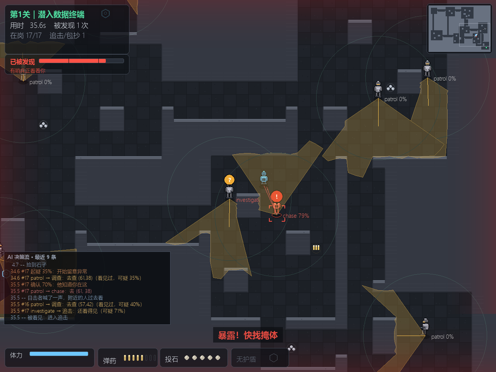
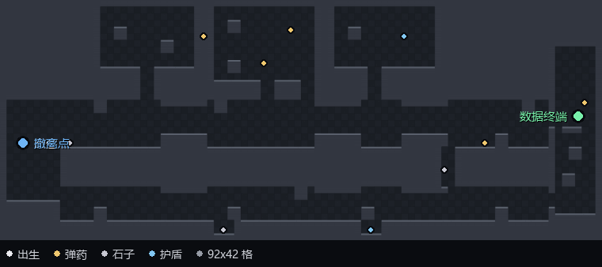
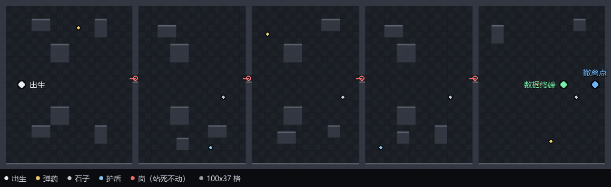
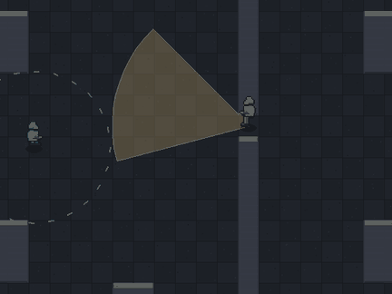
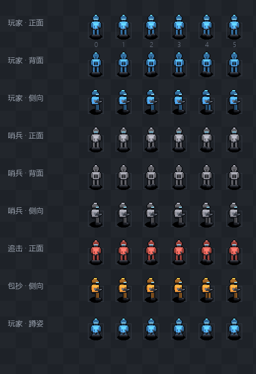
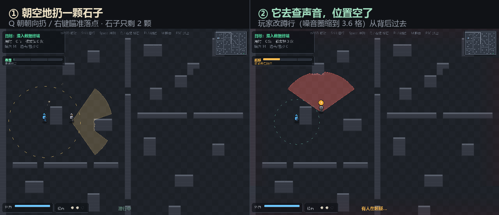

# 潜行协议 (Stealth Protocol)


从零手写游戏 AI 决策栈的 2D 潜行沙盒。五关连续潜入，目标是做出一套能在面试里讲出技术深度的 AI 系统，而不是调包跑 demo。

> **核心定位**：不用任何现成 AI 库（无 stable-baselines3、无现成行为树/寻路库），感知、决策、寻路、协同全部从零实现。每一个模块都能被面试官往深处追问。

> **不想装 Python？** [下载 Windows 免安装版](https://github.com/lxb0957/sneak_ai/releases/latest)（28 MB 单文件，双击即玩，存档 `records.json` 就写在 exe 旁边）。
> 用 macOS / Linux？**源码可以在三个平台跑**（`pip install -r requirements.txt && python launch.py`，中文字体走跨平台回退链），
> 但二进制只发 Windows —— 没签名的 mac 包双击会被 Gatekeeper 拦下，不如不发。
> 这条和另外两笔账（第 4 关的 25%、窄段两侧没有掩体）都写在 [docs/KNOWN_ISSUES.md](docs/KNOWN_ISSUES.md) 里，
> **每一条都附了"怎么复查"**：这份项目的"已知问题"不是传闻，是查过之后认下来的。

## 演示


上面这段 GIF 不是摆拍：它由 `scripts/record_demo.py` 录制，而录制脚本**直接调用** `scripts/botrun.py` 的 `run()` —— 和 README 里引用的成绩是同一条代码路径，没有任何写死的走位。这一局是 **66.3 秒通关、途中被看见 3 次并甩脱、一枪没开、顺手捡了 3 份补给、846 分（评级 A）**（结算页上的数字是引擎实跑值，没动过；录像略微加速播放，所以看起来比 66 秒短）。

> 为什么演示视频里不开枪：这一局是"**关卡不靠枪也有解**"的证明。同样的机器人允许开枪并顺路捡补给时是 **71.2 秒 / 被看见 2 次 / 打倒 2 人 / 603 分** —— 比不开枪**慢 4.9 秒、少拿 243 分**（少被看见那 1 次换不回两次击倒的 −200 分，还有 2 具尸体被同僚认领后整个小队进入搜索）。**枪能买时间，买不到分数 —— 而从 v1.8.6 起，它连时间也买不到了**：哨兵学会共享情报之后，开枪引来的那一圈人比省下的路更贵。

| 玩家视角（暴露 HUD / 小地图 / 状态气泡） | F1 AI 调试视图（视野锥 / 听觉圈 / 角色标签） |
|---|---|
|  |  |

按 **F1** 打开 AI 调试视图，能看到每个敌人的视野锥、听觉圈、行为标签（巡逻 / 调查 / 追击 / 包抄 / 封路）和实时可疑度。

左下角还会多一条**决策时间线**：谁、在第几秒、因为什么、改了什么主意。视野锥只能回答"他现在看得见什么"，而真正会被追问的是"他为什么突然回头" —— 那是一条跨好几秒的因果链，任何一张截图都讲不出来：

```
  3.5   --  石子落地
  3.5   #1  patrol → 调查：去查 (18,14)（听/被喊，可疑 45%）
  7.4   #1  确认 70%：他知道你在这
  7.4   #1  patrol → chase：去 (22, 17)
 11.2   #1  跟丢 70%：退回调查
 11.2   #1  chase → 调查：去查 (25,26)（看见过，可疑 70%）
 24.3   #2  搜了 9.0 秒没找到，回巡逻
```

同一份数据也能落盘，用来看"我是在第几关开始崩的"（屏幕上只留最近 9 条）：

```bash
python launch.py --trace run.jsonl        # 追加写，一行一条 JSON
python scripts/botrun.py --level 4 --trace bot.jsonl   # 机器人跑一局第 5 关（关卡号从 0 起）
```

事件只在**真的变化**时记（不是每帧），所以一局 200 秒只有一百多条。设计上最要紧的一条是它**只读**：`test_w26` 把记日志换成空操作再跑同一局，逐帧轨迹哈希必须一位不差。

## 操作

| 按键 | 作用 |
|---|---|
| WASD | 移动 |
| Shift | 潜行（噪音 ↓ 至 0.3，几乎听不见） |
| Space | 冲刺（速度 6.5，噪音 ×1.85，消耗体力） |
| **鼠标左键** | **开枪**：消音手枪，5 发，射程 12 格，冷却 0.38 秒 |
| **Q / 鼠标右键** | **投石**：Q 朝当前朝向扔，右键朝鼠标位置扔（每局 3 颗） |
| **E** | **拉总闸**（只在第 4 关，且要站到闸边上）：全图视野 45%、持续 10 秒，会响 |
| **Tab** | **整张地图**：一次看完整关的墙、目标、总闸位置和你在哪（打开时游戏暂停，图上不显示敌人） |
| F1 | AI 调试视图（视野锥 / 听觉圈 / 决策时间线） |
| M | 静音（跨局记住，`settings.json`） |
| **A**（菜单里） | **辅助模式**：敌方视野 ×0.82 / 追兵 ×0.88 / 封锁 ×0.60；**这一局不计任何纪录** |
| **← →** | 主菜单里**选关**（第 2 关起记本关最佳，不进总榜） |
| **Tab**（结算后） | **复盘**：逐关用时/被发现次数 + 关键时刻（第一次被谁看见、谁喊了人、最后怎么结束） |
| R | 结算后重开 |
| ESC | 回主菜单（菜单里再按退出） |

启动先进主菜单：一句话玩法说明 + 最佳纪录（分数 · 用时 · 评级 · **创下时间**）+ 操作摘要 + **选关**（← → 或点左右箭头），回车开局。

选关不是为了做难度菜单，是为了让第一次点开 exe 的人不必先连打四关才能看到第 5 关 —— 第 4 关的机器人胜率只有 25%，"必须先通关"等于把这一版真正做的东西藏在大多数人到不了的位置后面。开局后按"走到哪教到哪"的原则给上下文提示——走近补给点才告诉你它能干嘛，不搞开局弹一堆字的说明书式教学。

**但"能进"和"有成绩"是两件事**，所以存档里其实是两套纪录，口径不同：

| | 认什么 | 写在哪 | 界面上 |
|---|---|---|---|
| 整局纪录 | 从第 1 关起步、一路打到底 | 顶层字段（`score`/`time`/`levels`…） | 菜单「最佳纪录」、结算页「最佳纪录」 |
| 单关纪录 | 从第 N 关起步、且打的就是第 N 关 | `per_level["N"]` | 菜单选关行「本关最佳 812 分」、过场卡片「本关新纪录」 |

跳关的分数**进单关榜、不进总榜**：从第 3 关起步 35 秒就能"打完三关"，这条要是进总榜，就是一条永远刷不掉的假成绩。而单关榜只认**起步那一关**，是因为 `_carry` 会把前面的用时灌进新世界 —— 从第 1 关连打到第 3 关时，第 3 关的 `elapsed` 里含着一二关的时间，拿去和"直接挑战第 3 关"比，练习分永远低于正式分。那不是玩家退步，是两个项目不同。

补这条的原因很具体：以前跳关局**整局都不提交成绩**，一个卡在第 4 关（25% 胜率）的人跳过去练十遍、每遍都在进步，屏幕上一句话都没有。练习没有反馈，玩家就没有理由再点一次开始。

两套纪录写在同一个 `records.json` 里，所以两个写入口都做合并：破整局纪录时保留 `per_level`，破单关纪录时保留整局字段。这一处写错是**静默**的——不报错，只表现为"我刷的那些关怎么没了"，所以 `test_w29` 用两个方向各断言了一次。

窗口会按屏幕大小自动降级（1280x960 → 1152x864 → 1024x768 → 896x672 → 800x600），HUD、结算页与 Tab 全图在这四档尺寸 × 五个关卡（每组各 3 屏，共 60 组）下都做过"零重叠 + 全部落在窗口内"的审计（`scripts/audit_ui.py`）；屏幕比这还小时不要紧，字号优先缩、位置其次挪。

## 技术栈

- Python 3.11+ / pygame-ce（渲染）/ numpy（程序化音效）
- 零外部素材：像素美术与音效全部代码生成（无版权风险）

## 架构：每帧每个敌人都走一遍这条链路

```
感知层 → 记忆层 → 决策层（行为树）→ 执行层（流场 / A*）
```

| 层 | 模块 | 技术点 |
|---|---|---|
| 感知 | `perception/` | FOV 视觉锥（110°）+ DDA raycast 遮挡 + 听觉（按噪音分级、**声音过地图**）+ 可疑度累积 |
| 记忆 | `entity/enemy.py` | 最后已知位置（`_last_seen`）+ 调查环视超时 + 追击韧性 |
| 决策 | `ai/` | 行为树（Selector/Sequence/Blackboard）**真正驱动行为选择** + GOAP 规划器**排搜查路线** + 协同分工 |
| 执行 | `pathing/` | A* / JPS / 流场（Flow Field）三代寻路 + 协同包抄 |

### 行为树的三条分支（敌人每帧 tick 一次）

```
Selector
├── if role != PATROL      → engage      协同追击 / 包抄 / 封路
├── elif 起疑 or 搜索中     → investigate 去最后已知位置 + 按 GOAP 计划搜附近藏身点
└── else                   → patrol      按巡逻点走
```

> 这一版之前的"行为树驱动"名不副实（敌人里是 if/else，BT 模块只被测试用到）。这次把决策真正接到了 BT 上：加一条"调查"行为不需要动任何既有状态转移，只是在 Selector 里插一个分支 —— 这正是 BT 相对 FSM 的可组合性。

### GOAP：跟丢之后"先搜哪、后搜哪"由规划器算

行为树负责**选行为**，GOAP 负责**排顺序**，两者分工不重叠：

- 行为树是**反应式**的：角色一被协同分配器改掉，下一帧就必须切到 engage —— 这种抢占不需要"想"，需要的是优先级。
- GOAP 是**深思式**的：跟丢之后要去查几处、按什么顺序查，是一个小规模路径优化问题，
  写成 if/else 只能是"永远先查最近的箱子"，玩家两次就摸清了。

实现（`ai/search_plan.py`）：

1. 在最后已知位置周围找**藏身点**：从记忆点**看不见**（raycast 被挡）、且**至少三面贴墙**的格子。
   空旷地中间被排除，看得见的地方不用搜。
2. 把"起点 / 记忆点 / 每个藏身点"变成一组 `at_i`、`chk_i` 谓词，移动与搜查变成动作，
   目标是"每处都搜过"，交给 `goap.plan()` 在状态空间里搜。
3. 移动代价取曼哈顿距离 —— 顺序决策对距离误差不敏感，而真跑 A* 会在跟丢那一帧卡一下。

这里踩过一个坑：状态是 `frozenset`（只能加、不能减），于是 `at_A` 一旦成立就永远成立，
规划器会给出"在 A 搜完、走到 B、再在 A 搜一次"的**瞬移计划**。补上 STRIPS 的
**delete list**（动作的 `removes`）才修好 —— 位置这种互斥谓词必须能被划掉。

对应的验收方式也很硬：`test_w15` 用**暴力枚举所有访问顺序**算出最优脚程，
再和规划器的输出比。把规划器换成写死的顺序，这条断言立刻会红 ——
"接了规划器"和"用上了规划器"是两回事，只有前者能靠读代码相信。

### 共享情报：一个人看见，所有人都知道该往哪边搜

行为树和 GOAP 都是**一个人**的事。三个人一起去搜同一个箱子，在旧版里是常态：
每个人只知道"我在 (18,14) 看见过他"，于是三张搜查计划重叠成一张。

现在报警除了广播位置，还广播**目击位移方向**（`World.belief_heading`）：

1. **带方向的转述**：广播的是"他在 (18,14)，往东走"，不是"他在 (18,14)"。
   位移小于 0.5 格视为抖动，不更新方向 —— 否则原地卡住的玩家会被广播出一条假路线。
2. **扇形分工**：搜的人以信念点为心、沿这个方向按 `±0.55 rad`（约 32°）递增铺开，
   落点用 `_nearest_open` 吸附到可走格；整段圆弧都埋在墙里时退回 `find_hiding_spots`。
   这就是"他会往东跑"变成"三个人分别去东、东北、东南"。
3. **转述不压亲眼所见**：`note_belief` 只在自己还没亲眼见过玩家时才接收情报 —— 自己的眼睛永远优先。

> 这里踩的坑比 GOAP 那次更隐蔽：第一版每帧重分派搜索位，一局 56 秒刷出 **1673 条**"搜索位 →"，
> 分工变成了抖 —— 三个人每帧换地方，实际哪儿都没去。第二版改成"只给还没分到的人分派"，
> 又因为"看得见玩家 → 清空搜索位 → 下一帧再分派"打成了死循环。
> 真正的修法是**把不该分派的人先剔出去**：看得见玩家的哨兵目标是玩家本人，不是猜位置；
> 剩下的人只在信念点挪动超过 3 格时整片重铺。同一局从 1673 条降到 82 条。

**还有一个代价，是尺子替我发现的。** 加完共享情报，五关 96 局重测，第 5 关从 51.0% 掉到
**32.3%**（区间 [24,42]，与改动前的 [41,61] 不重叠 —— 不是噪声）。原因不是"AI 变强了"这么含糊：
那一关的设计动词是"让守着门的那个人走开"，七个哨兵里有五个是**固定岗**，全部难度来自
"他站在那儿，你只能骗他"。一旦固定岗能接队友的坐标，他就自己被叫走了，五道闸变成五条空走廊。

所以这条逻辑的适用条件是**固定岗不接转述、也不拿搜索位**（`Enemy.is_fixed_post`，判据就是
"只有一个巡逻点"）。加完之后第 5 关回到 **52.1%**（[42,62]，与改动前的 [41,61] 重合）；
前四关没有固定岗，这个规则对它们逐字节无影响 —— 第 4 关重测 25.0%，连死点坐标都没变。

`test_w27` 守住七条：报警带方向、转述不覆盖亲眼所见、扇形四点互不相同且随朝向旋转、
只有一个人搜时不分工、看得见人的不分派、1 秒 60 帧只分派一次、固定岗不接转述。
`scripts/ab_level.py` 则可以随时把这条逻辑单独关掉做同种子配对对照
（`--off belief` / `--off fan` / `--off post`），用来回答"这 7 个点是它造成的，还是抽签"。
拿它量这一条的结果：L5 打开 50/96 = 52.1%、关掉（= 出问题那版）31/96 = 32.3%，两批 96 局区间不重叠；
64 局配对再查一次是翻盘 **11:20**、p = 0.15 —— 不一致的对数只有 31 个，**检验力不够**，
硬证据是那两批独立的 96 局，不是这个小样本配对。


## 关卡设计：把"路线很少"变成能算出来的数字

上一版的难度是"空地 + 掩体"堆出来的：玩家永远可以贴边走，视锥再密也只是"绕远一点"，实际路线几十条。这一版把结构反转了 —— **先填满岩体，再挖出房间和走廊**。路线数量不再由"玩家怎么绕"决定，而由"我挖了几条洞"决定：

| 指标（`scripts/audit_routes.py`） | 当前值 | 判读 |
|---|---|---|
| 最小割 = 互不重叠路线数 | **4 格** | 想切断关卡必须同时堵住 4 个格子；"空地撒欢"的图这里会是几十 |
| 门 | **20 道，全是 2 格宽** | 2 格 = 一次只够一个人过；哨兵站在门内侧，你就只能等 |
| 最短路线 | **235 格（233 步），穿 18 道门** | 去程走北弧 10 道、回程走南弧 8 道 —— 一趟要卡 18 次时机 |
| 两段腿 | 去程 118 步 / 回程 115 步 | 几乎等长：回程少走 3 步的便宜，被南弧多绕的两道门吃掉 |

拓扑是 θ 形：出生舱 S → 终端舱 T，中间只有三条并行弧（北弧 / 南弧 / 中间一条竖井捷径 X1），最后并回同一个终端舱。走哪条都要付"等门"的代价，只是价钱不同。

难度指标也跟着换了一次，原因写在 `audit_difficulty.py` 的 docstring 里：旧的"无影通路率"要求**同一瞬间所有门都空着**，当时的判断是它在门控关卡里会接近 0%（实测 38%，这个判断本身就不准）——它测的不是玩家体验。现在测的是**门窗口**：

| 指标（`scripts/audit_difficulty.py`） | 当前值 | 判读 |
|---|---|---|
| 门窗口率（20 道门平均） | **81%**，最紧的门最长窗口 **2.8 秒**（G7 南门） | 人穿 2 格门约 0.5 秒；窗口 < 1 秒的门就是"过不去" |
| 北弧 / 南弧 / 捷径 | 79% / 83% / 85% | 近路门多而紧、远路门少而松 —— 取舍是有定价的 |
| 无视野硬走对照 | **87%** 的时间在别人视锥里（峰值同时被 6 人盯着） | 不会绕路就是送，地图没放水 |
| 整条无影路线 | **38%** | 只作参考：它要求"所有门同时空着"，实测这种时刻并不罕见，所以不能当可解性判据（能一波冲到底 ≠ 好过关，路上还有 21 个会移动的人） |

> **这四行数字在文档里挂了很久没更新，而且我一开始差点把它算到 v1.8.6 头上。**
> 上一版 README 写的是 65% / 2.0 秒 / 55%·74%·85% / 0%，用同一份脚本重跑却是现在这组。
> 用 `ab` 的办法验了一下：关掉"共享情报 + 分工搜索"再跑一遍，**四个数字一字不差**
> （81% / 2.8s / 79%·83%·85% / 38%）—— 因为门窗口只由**巡逻站位**决定，
> 和"跟丢之后怎么分工"无关。真正的变化发生在更早的几版：地图和巡逻网改过，
> 而 README 里的数字没跟着重跑。
> 教训：**"跑一次就知道"的数字最容易被当成结论抄进文档**，然后一直错到有人重跑。
> （对照里唯一变的是①的暴露率：87% → 46%，峰值 6 人 → 3 人 —— 那才是这条 AI 逻辑真正影响到的地方。）

机器人（`scripts/botrun.py`）在新地图上的成绩：**66.3 秒通关、被看见 3 次并甩脱、0 击倒、846 分**，`assets/demo.gif` 就是它的实跑录像。它只看得懂"当前视野锥"，不会读门窗口表，所以每次都是硬等 —— 人类玩家读到"这道门有 2 秒空档"能走得更快。


*(橙线是机器人这一局的真实轨迹（`scripts/make_level_map.py --level 0 --path` 跑一遍再画上去）：0 秒从出生舱出、沿西侧那条 2 格宽长竖廊南下，到中段折向东，**28 秒**摸到东南角的数据终端；回程走南侧另一条廊道，**66.3 秒**绕回出生舱旁边的撤离点。橙色线在中段分成两股，就是它去程和回程走了两条平行廊道 —— 不是原路折返。)*

> 这一版最贵的一课写在"技术难点"里：**路线数是挖出来的**。旧图加 18 个哨兵还是能贴边绕，因为空地里的"路"是玩家走出来的，不是作者画的。结构反转之后，"再多给几条路"变成一件需要显式决定的事 —— 而"不给路"才是把难度交到关卡设计手里的前提。

## 五关：把"一关"抽象成"关卡"

上面那张图在很长一段时间里就是整个游戏 —— 因为"一关"不是数据，是散在 `world.py` 里的四份模块级常量加 `constants.py` 里的两个全局坐标。想加第二关，得同时改地图、巡逻、补给、目标点、评级阈值、存档字段，漏一处就是"第二关的终端画在第一关的坐标上"。

所以先做抽象：`core/levels.py` 里一关 = `Level(地图构建器, 巡逻, 补给, 门闸, 终端, 撤离点, 出生点, 评级基准)`。**不搞随机生成** —— 五张图仍然逐格手写，因为手写的图有作者意图（哪道门该紧、哪段廊该空），生成器给不了。抽象只解决一件事：换图不改代码，只换数据。

| | 第 1 关 · 哨站 | 第 2 关 · 环形枢纽 | 第 3 关 · 柱林中庭 | 第 4 关 · 配电所 | 第 5 关 · 查验站 |
|---|---|---|---|---|---|
| 空间 | θ 形：两条弧 + 一条捷径 | 一圈外环 + **一条辐条** + 中央金库 | 一圈 3 格服务廊 + 56×40 错位柱林 | **一条 74 格直廊** + 平行回程廊 + 北侧支路 | **一条 95 格大厅**，被四道关闸切成五段 |
| 走廊宽 | 2~3 格（只能侧身） | 4 格（能贴对面墙走） | 服务廊 3 格，大厅里**没有走廊** | 7 格，三段收窄到 **4 格** | 大厅 25 格，关闸只有 **1 格** |
| 视线 | 短，门会切断 | 长，能看穿整段廊 | 中，但没有一条直街 | **极长**，一条廊从头看到尾 | 长，而且门里那个人**正对着你** |
| 难点 | 等门窗口 | 跟着巡逻兵的后背走 | 选哪条"缝"穿过去，以及什么时候冲 | **自己造窗口**：拉总闸把全场视野压到 45% | **让他走开**：门里的岗不会自己离开，只能骗 |
| 门 / 闸 | 20 道 | 8 道闸 + **1 个金库入口** | **2 道门** | 8 道门 + **2 个总闸** | **4 道 1 格闸**，每道一个人 |
| 最小割 | 4 格 | **2 格**（金库单入口） | 3 格（两道门 + 服务廊） | 4 格（4 个入口） | 1 格（**堵住任意一道闸就断**） |
| 数据节点 | 1 个 | 1 个 | **2 个**（东南 / 西北） | 1 个 | 1 个 |
| 最短路线 | 235 格（233 步） | 218 格（107+109） | **192 格**（64+60+65，三段腿） | 176 格（单程 87 步，原路折返） | 95 格（88+5，**只能往前**） |
| 哨兵 / 补给 | 17 / 14 | 13 / 12 | **29** / 14 | 11 / 10 | 7 / 9（5 个固定岗） |
| 追兵速度 | 3.4（走路能甩开） | 4.0（得冲刺） | 4.4（和走路一样快） | **4.5**（比走路快） | 3.8（**能跑掉**：这关罚的是"骗错"，不是"被看见"） |
| 拿数据后警报 | 4.0 速 / 8.0 视 / 20 秒 | 4.3 / 8.5 / 30 秒 | 4.6 / 9.0 / 40 秒 | **4.9 / 9.5 / 45 秒** | 4.2 / 10.0 / 40 秒 |
| 机器人胜率（96 局采样） | **77.1%** · 均时 67.9 秒 | 77.1% · 56.8 秒 | 50.0% · 43.6 秒 | 24.0% · 55.1 秒 | 70.8% · **94.4 秒** |
| 　└ 95% 区间 | 68~84% | 68~84% | 40~60% | 17~33% | 61~79% |

> **「最短路线」和「最小割」的口径只有一处**：`scripts/audit_routes.py` 量的是 `LEVELS` 注册表，路线 = 出生 → 依次摸完所有数据节点 → 撤离，经过的格子数（格 = 步 + 段数）。
> 这两行以前是手记的，于是各关口径不一、改完地图也不跟着变：第 3 关写着 238（改图前的旧数，真实 192）、第 5 关写着"4 道闸所以最小割 4"（真实是 1 —— 堵住任意一道闸，这一关就断了）。
> 现在 `scripts/test_w31.py` 直接读这张表跟脚本对账，改图不改表会红。

> **这张表怎么读**：数字来自 `scripts/measure_levels.py`（96 局、跨关同种子配对、Wilson 区间）。
> **第 1 关和第 2 关并列**（77.1% vs 77.1%，配对翻盘 17:17，McNemar p=1.000）—— 前两关统计上分不出高低。
> 台阶在第 **2 关 → 第 3 关**：77.1% → 50.0%，差 **27.1 个点**，差值 95% 区间 **[+14%, +39%]**，
> 配对翻盘 37:11，p=0.000；再往下一级是 **第 3 关 → 第 4 关**：50.0% → 24.0%，差 26.0 个点，
> 区间 [+12%, +38%]，p=0.001。所以难度是一道**两级台阶**，不是一条平滑斜线。
> 判"分不出高低"只认**差值区间跨零**，不认"两个边际区间重叠" —— 那是这个项目自己踩过的误读
> （详见下面的 v1.8.2 注）。
> **第 5 关 70.8% 不是笔误，也不是"最后一关最简单"**：它比第 4 关高 46.9 个点（区间不重叠，是量出来的差），
> 但它考的东西和第 4 关不在一条轴上 —— 第 4 关是"顶住一条 74 格直廊"（拼耐力，机器人输得多），
> 第 5 关是"算准那 3 秒窗口"（拼时机，而机器人的计时是帧级的，人做不到这么准）。
>
> **这版数字为什么整体比上一版高一截**（L1 67.7→77.1、L2 69.8→77.1、L5 52.1→70.8，L3/L4 反而略降）：
> v1.8.11 把视线几何从"固定步长采样"换成精确网格步进，旧实现会整格跳过墙 ——
> 8 格内 **1.29% 的视线能"隔墙看见"**。判定变准之后，敌人不再看得见它本来不该看见的地方，
> 机器人自然赢得更多。**这是修 bug 的副作用，不是设计放水**（详见 BLOG 第 50 章）。
> 值得注意的是**第 4 关几乎没动**（25.0→24.0）：那一关的瓶颈从来不是"被看见得太早"，
> 而是"看见之后跑不掉"，这次正好又验了一遍 A1 那条结论。
> 所以 **52% 是这一关的上限，不是平均手感**：机器人把这一关玩成了教科书，人会被自己的反应速度拖住。
> 它的均时 103.7 秒也是五关最长 —— 时间不花在走路上，花在"等他回岗"。
> 另外这是唯一开 `loot` 测量的一关（五颗石头换五道闸，不捡补给量到的是"没带够弹药有多难"）；口径不同这一点写在下面。
> **v1.8.6 的一行变化**：这一版让哨兵共享情报、分工搜索，五关全部重测 —— 第 1 关 75.0→67.7、
> 第 2 关 71.9→69.8、第 3 关 49.0→54.2、第 4 关 25.0→25.0（连死点坐标都没变）、第 5 关 51.0→52.1。
> 只有第 5 关真的被这条逻辑碰坏过（32.3%，见下面「共享情报」），修法是"固定岗不接转述"。
> **第 4 关的 25% 是"只会跑"的下限，不是关卡缺陷。** 为了把它推上去一档，试了九种改法：
> 降追兵（19.8%）、黑灯加长到 12 秒（14.6%）、主廊加断线柱（0%）、
> 窄段下加逃生井（25.0%）、开补给（17.7%）、体力 +20%（17.7%）、
> 修好 7 块被收窄段吞掉的掩体里的 3 块（20.8%）、去掉一个窄段（24.0%）、
> 机器人逃跑改"躲掩体"（0%，48 局配对翻盘 0:13，p=0.0002）—— **没有一次比不动更好**。
> 规律是同一个：这一关的死因不是"缺资源"，是"跑"本身。满体力冲刺 100/34 = 2.94 秒，
> 相对追兵的速度差 2.0 格/秒，合起来 **5.9 格 < 视野半径 6.5 格** ——
> "被看见之后拉出视野"在这个游戏里数学上不成立；而跑动的噪音还会把更多人引过来。
> **后来把败局按时间线切开（`scripts/diag_level4.py`），25% 的来源就只剩一句话：
> 96 局里"一次都没被发现"的局是 0 局。**
> 第一次被看见的中位时间是 **7.3 秒**（出生点到第一个窄段还不到一半），
> 整局 **60%~70% 的时间耗在 FLEE 上** —— 胜利的局也一样。所以这个数字量的不是
> "走廊有多窄"，是"警报响了以后能撑多久"；而"撑"这件事被上面那个 5.9 < 6.5 封死了。
> 败局的位置也印证了这点：一半死在 x>60（**最后四分之一**，含数据舱那 9 局），
> 拿到数据的 59 局里只有 24 局活着回来 —— **回程才是第二道生死关**，不是进门。
> 也就是说这个数字该读成**"只会跑、不会停、不会蹲"的机器人策略上限**，不是人的难度。
> 那"改尺子"有没有用？**试过了，没用。** 给机器人加了两个旋钮：往前看几格（`--look`，默认 6）/
> 危险度超过多少就停（`--hold`，默认 0.25），同种子配对 96 局（`scripts/ab_look.py`）：
> look 6→9 首次被发现 7.3→8.3 秒、胜率 17.7%（p=0.27）；look 6→12 首次被发现 **7.3→10.0 秒**、
> 胜率 27.1%（p=0.86）；look=12 且 hold 降到 0.15 → 28.1%（p=0.73）。
> **"晚 2.7 秒被发现"这件事真的做到了，胜率一点没动** —— 这条否证比任何解释都有用：
> 那 75% 不来自"被看见得太早"，而来自"被看见之后无路可走"。
> 两个旋钮的默认值一格没动（`test_w34` 钉住加参数之前的基线逐字段相同），
> 所以上面所有历史数字仍然可比。要真动这一关，得动"被看见之后还有什么可做"。
> **这一条已经结账，不再是待办**：结论、证据、复查命令、以及"非要改要付什么"，
> 都写在 [docs/KNOWN_ISSUES.md](docs/KNOWN_ISSUES.md) 的 A1（BLOG 第 46、47、48 章）。
> 第 1 关那 7.3 个点又用**同种子配对**查了一遍（`scripts/ab_level.py`，同一批 96 局跑两遍）：
> 关掉新逻辑 73/96 = 76.0%、打开 65/96 = 67.7%，翻盘 **17:9**（约 2:1 朝"变难"的方向），
> 但 McNemar 精确检验 **p = 0.17** —— 方向一致、强度不够。这一条只能记成
> "**看起来更难了，96 局钉不住**"，不能记成"变难了"，更不能记成"没变"。
> 另外那 76.0% 和表里的 75.0% 差 1 局：把两个函数换成空操作**不等于**坐时光机回到上一版，
> A/B 的"关"是"新版减去两个调用"，不是"旧版"。
> 之前几版 README 里那些小数点后一位的数字（92% / 58% / 42% / 25%）是单批 12~16 局量出来的，
> 单批之间的波动有 ±10 个点 —— 那不是精度，那是把噪声写成了结论。

五关是**一次连续行动**：用时、被发现、击倒、剩余弹药跨关延续，最后一关打完才结算成绩与评级；评级基准按"已打的关数"累计（五关 S 线 293 秒），否则越往后越容易拿 S。中途失败只重开**当前关**，但已经耗掉的时间留着 —— 罚时间、不罚进度。

> **v1.5 把难度整体抬了一档，动作在两根轴上，不在"多放几个人"上：**
> ① **结构**：第 2 关金库的四条辐条砍到一条（四个入口等于没有入口，机器人 46 秒穿过去时连金库里的两个人都没碰），第 3 关的柱林从正交网格改成**隔行错开 3 格**（原来横竖都是直街，等于空地加装饰）。
> ② **威胁**：追兵速度原来是全局 3.0，而玩家走路 4.4 —— **走就比追兵快 47%，"被发现"等于没被发现**。现在它是一根关卡参数：3.4 / 4.0 / 4.4，最后一关和走路一样快，被发现就只剩"冲刺 + 找柱缝"这一条路，而冲刺要花体力。
>
> 判断标准也换了：不再看"机器人跑多少秒"（单次成绩只是某一个相位下的数，BLOG 经验 31），而是看 `scripts/audit_phases.py` 的**相位胜率**——同一张图换哨兵初始相位跑十二局，胜率落在 30%~80% 才算"有压力但过得去"。

> **v1.6 只改第 3 关，改的是一件比"难度"更基本的事：这一关的失败是不是只发生在一个地方。**
> 十二相位扫描暴露的问题不是"太简单"，是**死法太集中**：机器人八次运行里有四次死在**同一格**（北服务廊 x=48 那个横穿走廊的哨兵），胜负由开局相位的奇偶直接决定。那不是难度曲线，是一个卡口。
> 于是：① 一个数据终端 → **两个数据舱**（东南 / 西北），路线从"一条对角线"变成"Z 字"，横穿大厅两次；② **拿到第一份数据就拉响警报**，第二份是在封锁状态下拿的 —— 前半段安静、后半段被追，一关里有两截不同的节奏；③ 那个横穿撤离走廊的哨兵改成**沿墙走**，"会移动的门"变回"会移动的视野"；④ 巡逻横带从"覆盖 90%"退回"每条带一个窗口"，窗口位置每条都不一样 —— 难度从"堵"变成"算"。
> 顺带修了**测量工具本身**：原来的相位旋钮是"巡逻下标 + k"，而每个哨兵只有两个巡逻点，`k` 的奇偶就把相位定死了 —— 所谓"6 相位"其实只有 2 种局面，胜率只可能是 0% / 50% / 100%。现在改成沿巡逻线段**连续插值**，12 个相位就是 12 种局面（代价是第 1 关的量出来变难了：25%，而那个 67% 是两种局面里赢一种的假象）。

> **v1.7 修的是 v1.6 结尾自己留下的债：第 1 关比后两关都难（25% / 58% / 58%）。**
> 教学关不该是最难的一关。查下来三个原因，没有一个跟"人放多了"有关：
> ① **四处"假门"**：B3 走廊和 A1/A4/A5 三条短廊，都是 3 格宽。里面各有一个哨兵只巡 3 格 —— 那不是"会移动的视野"，是一道**钉死在路中间的门**：玩家想过去只能等，而它几乎不离开原位，等于等不到。12 个相位里，4 局死在拿到数据之前（全在 B3），后面几局则卡在另外三条短廊。删掉这四处，胜率 25% → **92%**。
> ② **这三条短廊根本放不进"会走动的人"**：A1/A4/A5 都是 9 格长、3 格宽，而规则要求巡逻点离门 ≥3 格 —— 两端各去掉 3 格，中间只剩 3 格。**一个 3 格宽的短廊里，要么放一个钉死的门，要么不放人。** 选后者：压力由两端房间里的人提供，走廊本身留给"承诺跑"。
> ③ **警报是三关共用的全局常量**：拿数据后全图 8.5 视野 + 4.3 追击 + 30 秒。而第 1 关路程最长（235 格）、还要原路折返 —— 也就是说**教学关背了最重的惩罚**。现在它像追兵速度一样是关卡参数：教学关 4.0/8.0/20（追兵仍慢于走路，警报只是"该走了"），末关 4.6/9.0/40（比走路快，封锁期内只能冲刺）。
>
> 还有一个只有逐个相位跑才会发现的事实：第 1 关**去程在 12 个相位里全是 29 秒上下，一秒不差**。去程根本不受相位影响，难度全在回程，而且大约 1/3 的败局死在"拿到数据后 0.5 秒"——终端在 T 舱东南死角，摸完必须原地返回，而哨兵 y=50 那条巡逻线正好横在返回路上。给终端加了一根遮挡柱（把 2×2 的柱子拉成 2×3），"摸完必死"才变成"摸完要绕"。
>
> 结果：**92% / 58% / 42%**。这是三关第一次有像样的梯度（原来是 25 / 58 / 58 倒挂），而且第 1 关那 1 次失败也不是"卡在某一格"——12 局全部拿到了数据。
>
> 这个坑现在有断言了：`test_w17::test_no_patrol_pinned_in_a_narrow_corridor` 遍历所有关，把"3 格以内窄廊 + 巡逻段 ≤3 格"判为违规（量的是两个数，不是"看起来窄不窄"）。

> **v1.8 加的不只是第 4 关，是一个新动词。**
> 前三关的玩法说到底只有一个动作：**等**。等视锥转开、等门窗口、等巡逻兵背对你。所有的难度旋钮（人更多、路更少、追兵更快）都只是在调"要等多准"。
> 第 4 关给的是第二个动作：**造**。墙上有两个总闸，按下去全图照明掉到 45%、视野从 6.5 格压到 2.9 格、持续 10 秒 —— 你可以自己造一个窗口出来。代价同时到达：**拉闸会响**（半径 9 格，附近的人会往配电间走）、**一次性**（灯亮了也按不动第二次）。
> 于是这张图的核心决策变成"什么时候把灯关掉"：去程在配电间按一个、从东侧竖井出去（哨兵往里涌、你往外走）；回程在数据舱里按第二个，趁黑把最后 20 格跑完。
>
> **这一关的调参过程比结果更值得记，因为每一次失败都不是"数值不够"。**
> ① 第一版是一条 74 格长、全程 7 格宽的大马路 —— 机器人 **3/3、41 秒、A 级**。根因不是"人少"，是 7 格宽里玩家永远能从哨兵侧面 2 格绕过去（视锥半角 55°，正侧方 90° 在锥外）。**"能绕"就等于"能过"**。改成三段收窄的"串珠"（7 格宽 → 4 格）之后，横着走的哨兵才真的变成一道会移动的门。
> ② 收窄到 **3 格**反而过不去了（0/3，全部死在第一个窄段中段）：3 格宽里贴墙也只能和哨兵保持 1 格横向距离，那是"挤"，不是"难"。4 格才对。
> ③ 第一次相位扫描 **1/12**，其中 7 例死在同一个坐标 —— 配电间竖井口。原因是原来的配电间巡逻正好从竖井头顶横过去。这是第 1 关"钉死的门"换了张脸又出现一次：**任何"唯一入口 + 正对着它的视野"都是卡口**。
> ④ 把哨兵挪开之后还是 0/12，死点变成数据舱北门，9 例都是"拿到数据立刻被抓"。两个原因叠加：拿了数据必然拉警报，而这条直廊**没有一根柱子**可供躲藏。解法不是加人也不是减人：给数据舱加一道隔墙（挡视线、不挡路），再给它**第二个总闸** —— 回程也需要一个属于自己的动作。
> ⑤ 最后是参数敏感度：黑灯 14 秒 = 58%，11 秒 = 38%，10 秒 = **31%**，9 秒 = 12%。**一个"感觉差不多"的时长参数，在 9~14 秒之间能把胜率从 12% 拉到 58%。** 这类参数只能扫出来，算不出来。
>
> 顺带修了尺子：机器人原来严格走 A* 的格中心，在窄廊里等于每次迎面撞上哨兵，于是"窄段"在数据里永远是必死段。加了 `_hug_wall`（窄廊里往远离哨兵的一侧贴墙）之后，同一张图的胜率从 0/3 变成 3/3 —— **那是尺子不会走路，不是关卡太狠**。这条值得单独写下来：测量工具的缺陷，比关卡的缺陷更难发现，因为它看起来像"关卡的结论"。
>
> 现在这套机制有 10 条断言守着（`scripts/test_w19.py`）：黑灯必须真的缩短 `view_range`、必须产生噪音但只到"起疑"、必须是一次性的、必须站到跟前才能按、必须自己到点恢复、前三关不许有这个机制。

> **v1.8c 又是修尺子，而且这次的 bug 更丢人：`--runs 16` 从来没有"跑 16 局"。**
> 机器人是确定性的，`--runs 16` 只是把**同一条轨迹**重复了 16 遍 —— 16 局的输出连一个字节都不差，"胜率 16/16"是一个样本被报了 16 次。之前所有"16 局里赢 4 局"的说法都只有 1 个样本的分量。
> 修法：给 botrun 加一条真正的随机轴（`--jitter 1`）—— 每个哨兵在自己巡逻回路的随机位置、随机驻留相位、机器人随机开局反应时间，第 i 局用 `seed+i` 保证失败可复现。默认 `--jitter 0` 仍然是那条被记录下来的确定性基线，所以历史数字和 CI 的计分审计一分没动。
> 顺带发现第二件事：**相位扫描对多点巡逻的哨兵是失效的**。`audit_phases` 只敢插值两点巡逻（多点巡逻相邻两点之间可能隔墙），而全项目唯一有多点巡逻的正是第 1 关 —— 那批哨兵在 12 相位的扫描里**一动没动**。现在三处摆位（`botrun` 随机采样 / `audit_phases` 相位扫描 / `record_demo` 录像旋钮）合并成同一个 `_place_enemy`，沿整条回路均分、并沿"起点→落点"逐格验地板。
> 于是难度数字全部重测，**两条独立的轴第一次对上了**（下面的数字被 v1.8d 的 96 局采样取代了，留在这里是为了记录当时"两条轴对齐"这件事本身）：

| 关卡 | 相位扫描（16 相位） | 随机采样（40 局） |
|---|---|---|
| 第 1 关 哨站 | 14/16 · **88%** | 35/40 · **88%** |
| 第 2 关 环形枢纽 | 7/16 · 44% | 20/40 · 50% |
| 第 3 关 柱林中庭 | 5/16 · 31% | 19/40 · 48% |
| 第 4 关 配电所 | 4/16 · **25%** | 11/40 · **28%** |

> 两头很稳：第 1 关是教学关，第 4 关最难。中间两关在两条轴上先后顺序一致（第 2 关 ≥ 第 3 关），但差距只有 2~13 个百分点 —— 说"58% vs 42%"那种清晰梯度是没有的，那个差距是尺子给的，不是关卡给的。
> 尺子本身现在也有断言了（`scripts/test_w20.py`，9 条）：同种子必须复现、不同种子必须分叉（防止有人把随机轴改回确定性）、`phase=0` 必须还等于 66.3 秒 / 846 分、摆位不许把人塞进墙里、多点巡逻必须能动、**没有哨兵封死必经走廊**（封门实验：把它的巡逻线当墙，出生点到终端的最短路不许变长）、**没有重复或只隔 1 格的巡逻线**；另外还有一条专门钉住测量工具自己的数学（Wilson 区间随样本收紧、差值区间不跨零、McNemar 的已知取值）。

> **v1.8d：这批 40 局的数字还是太小，而且它指错了地方。**
> 把采样加到 **每关 96 局、跨关同种子配对**（`scripts/measure_levels.py`，带 Wilson 区间）之后，第 1 关从 88% 掉到 75%，第 2 关 47%，第 3 关 49% —— **第 3 关反超了**，两个区间重度重叠。也就是说"第 2 关 ≥ 第 3 关"这个顺序本身也是噪声。
> 于是这次不看胜率，改看**死点分布**（同一批 96 局，把阵亡坐标画到地图上）。两个真问题立刻露出来，都不是"太难"或"太简单"：
> ① **出生点的门**：第 3 关出生点 (5,54) 在南廊最西端，而进大厅唯一的门洞在 x=36 —— 玩家出门必须先向东走 30 格，正好撞上 `(14,53)-(14,55)` 那个**横切 3 格宽走廊**的哨兵。96 局里 (15,55) **一格吃掉 9 次阵亡**（占败局 17%）。这和这一关北廊早就修过的缺陷是同一个：3 格宽的廊里横着走的人不是"会移动的视野"，是一道焊死的门。改成沿南墙走之后死在那一格的次数归零。
> ② **南门洞前的双层岗哨**：y=47 和 y=48 两条巡逻线相隔 **1 格**，都压在门洞（x=36~37）上，再加 y=43 一道，等于进门就是三层禁区 —— 门口三格吃掉 34% 的败局。**两道相隔 1 格的巡逻线不会变成"更密"，只会变成"一整块等不到窗口的禁区"**。删掉 y=47 那条短的，保留 y=48 那条长的（3 格覆盖，门洞在 2 格外）。
> 修完这两处，第 3 关从 44.8% 涨到 60.4% —— 这才是它的真实难度。想再压回去时发现了一件反直觉的事：**收紧横带覆盖率（75% → 82%）只让它掉 1 个百分点**（60.4 → 59.4），机器人会等窗口，4 格窗口和 9 格窗口对它没差别；真正能动 8 个点的是**把东南数据舱正下方那条窗口从 4 格堵到 2 格**（59.4 → 49.0），也就是"必须站出去摸终端"的那一格。
> ③ **改的时候多出来一个人**：上面那行改动里不小心写了两个 `(48,48),((48,48),(64,48))` —— 第 3 关悄悄变成 30 个哨兵，两个完全同线同步。它藏了两天、没让任何测试变红、只让胜率掉了 2 个点。现在有断言守着：同一关不许有**完全重合**的巡逻线，也不许有**相隔 1 格**的平行线（②那个教训的通用化）。

> **v1.8.2 只改第 2 关，改的是一处一直在扣分、但从没被任何断言抓住的缺陷。**
> 96 局复现的基线是 **46.9%**，死点里 `(33,5)` / `(33,6)` 两格吃掉 8 局（占全部败局的 16%）。位置很说明问题：北廊从 x=20 到 x=59 那一段，是进金库的**唯一**通道（南/东/西三条辐条 v1.5 全封了），而 x=33 那个哨兵的巡逻线 `(33,4)-(33,7)` 正好**跨满 4 格宽的整个截面**。中段 30 格没有任何可以停一下的地方，被撞见就只剩"跑"，而 4 格直廊跑不过 6.5 格视锥。
>
> 中间试过两个"看起来更聪明"的改法，都失败了，而且失败得有价值：
> ① **在北廊中段加两处壁龛**（哨兵两侧各一个，往内墙挖 3 格）→ **44.8%**，比改之前还低一点。原因不是壁龛没用，是**没有人会为了躲一个人而停下来**：机器人和玩家都会继续走，掩体只在"已经决定躲"之后才产生价值。
> ② **把巡逻线收成 2 格**（`(33,4)-(33,5)`，只守北半，理论上留出贴南墙的确定路线）→ **55.2%**，只涨 8 个点。原因是**收短 = 转身周期减半 = 单位时间扫过这个截面的次数翻倍**：截面看着窄了，被盖住的时间一点没少。把 x=13 那条也收短之后是 **51.0%** —— 比只改一处更低，同一个道理。
> ③ 最后能动的只有一种：**删掉它**（14 人 → 13 人）→ **71.9%**。
>
> 结论写下来是反直觉的：**在 4 格宽走廊里，一条满跨的巡逻线不是"会移动的视野"，是一道周期性盖满整个截面的门。** 这种门不能收窄、不能加掩体、不能靠"等得更准"过去 —— 它只能减少数量。这和 v1.7 第 1 关那四处"钉死的门"、v1.8d 第 3 关那道南廊横切是同一种东西，只是它们的走廊更窄（2~3 格），所以被断言抓到了；这里是 4 格，判据的 `w <= 3` 刚好放过它。
>
> 顺带记一笔判据的边界：`test_w20` 的封门实验（把巡逻线当墙堵上，看路程变不变长）**抓不到这一处**，因为它只对 3 格以内的窄廊生效。4 格宽走廊里这类哨兵是第 2 关的设计语言（横跨只转身、不推进），全判违规就没图了 —— 所以这条只能靠死点分布发现，不能靠静态规则。这也是为什么 `measure_levels.py` 现在把"单格吃掉多少败局"和胜率一起打印：**胜率告诉你难不难，死点告诉你错在哪。**

换关是**自动**的：踩到撤离点 → 屏幕压暗、显示「第 N 关完成 / 下一关 · 柱林中庭」→ 1.6 秒后自己进下一关。不需要按键，也不弹结算页（半路弹结算会把一次连续行动切成两段互不相干的小局）。这 1.6 秒里世界是冻结的：哨兵不动，用时也不涨。

*(这段过场曾经有个玩一次就能发现的 bug：计时器被设成 1.6 秒，却**没有任何地方递减它** —— 卡片永久停住、输入被吞、永远进不了第 2 关，而 CI 全绿，因为机器人在"胜利"那一刻就 `return` 了，没有任何测试走过后面那 1.6 秒。修法不只是补一行递减，而是把主循环拆出 `Game.step(dt)` 让测试能喂帧：`test_w18` 现在真的踩撤离点、喂 3 秒帧，断言"1 秒时还在卡片、2 秒时已在第 2 关"、"过场期间敌人不动且用时不变"。)*


*(整张图俯视（`scripts/make_level_map.py` 烘的就是引擎自己那份地图数据）：一圈 4 格宽的外环、8 道闸把它切成 8 段，**只有一条 2 格宽的北辐条**通向中央 16×16 的金库，金库正中是数据终端。白点是出生点，绿点是终端，蓝点是撤离点 —— 注意出生和撤离在同一角：你得先绕到北边，再从北边原路绕回来。三个设备间（西/东/南）各自从外环开口、互不相通，只给掩体和补给，不给捷径。)*


*(第二关的实跑录像，同样一帧没摆拍：`python scripts/record_demo.py --level 1 --phase 0.2` 直接调 `botrun.run()`，**53.7 秒、被发现 2 次、一枪没开、909 分 A 评级**。它从西南角出发，沿西廊北上、过北廊两道闸、从北辐条南下进金库，摸完终端原路退回 —— 全程 218 格，比 v1.4 长了 40%。同一关的相位 0.25 在 v1.8.6 之后会被打死（56.6 秒、被发现 5 次），所以这一段录的是 0.2：**相位决定哨兵开局站在哪，换一条走位就是一个新局面**，这也是下面"机器人审出来的"那条方法的另一半。)*

### 第二关是机器人"审"出来的

这张图的第一版在纸面上看没问题：环、辐条、金库、8 道闸全对，连通性校验、门宽校验、最小割全部通过。然后把测试机器人放进去，连读三次死在同一格。三个问题都不是"看起来不对"能发现的：

1. **沿走廊扫的哨兵 = 一堵会移动的墙**。第一版 18 格的长往复让整段走廊永远被覆盖，机器人在闸门前卡了 200 秒寸步难行。改成第 1 关验证过的做法 —— **横跨走廊的短往复**（人不动位置，只转身），玩家才能掐着转身的节拍过去。
2. **2 格宽的辐条是死亡陷阱**。被看见后躲进辐条，追兵堵住唯一出口，必死。所以沿环的内墙挖了 8 个 3×3 壁龛，给玩家第三个动词：**躲进去等它走过去**（原来只有"绕"和"跑"）。
3. **目标点落在格点角上**。终端原来写在 `(52.0, 22.0)` —— 那是四个格子共用的角点。寻路以格中心为目标、容差 0.4，加上角点到格中心的 0.707，最坏会停在离终端 1.1 格的地方，而触发半径只有 0.8。表现为：机器人贴着终端站了 150 秒，状态始终是"潜入中"。现在 `test_w17` 会断言终端和撤离点必须落在格中心。

第 1 条和第 2 条是**关卡设计规则**，第 3 条是**坐标系约定** —— 三条都写进了 `scripts/test_w17.py`，对每一关自动生效，以后加第三关不用重记。

> **v1.8.2 又在这一关修了第四处，但它不属于上面三条里的任何一条。** 北廊 x=33 那个哨兵满跨 4 格宽的整个截面，而北廊是进金库的唯一通道 —— 96 局里 `(33,5)`/`(33,6)` 两格吃掉 16% 的败局。它**不违反任何静态规则**（4 格宽走廊里横跨是这一关的设计语言），所以封门实验的判据 `w <= 3` 直接放过了它；只能从死点分布里看出来。修法也很反直觉：加掩体没动（44.8%）、把巡逻线收短只涨 8 个点（55.2%，收短等于扫描频率翻倍），最后是**删掉它**（71.9%）。详见 BLOG 第 36 章。

### 第三关：把墙拿走

前两关的答案都是同一个字：**等**（等门空、等它转身）。第三关故意不给这个答案 —— 中间是一个 56×40 的大厅，大厅里没有走廊，只有一片 2×2 的方柱，柱距 6 格、缝宽 4 格，**并且隔行错开 3 格**。

错位这件事是 v1.5 才有的，也是这一关真正的骨架：柱距 6 的正交网格横着有七条直街、竖着有九条直街，玩家可以沿任何一条走到头 —— 它看起来是柱林，走起来是空地（机器人 35 秒直线穿过去用的就是那条"正好在南北门连线上"的街）。隔行错开之后没有一条街是直的：你从一条缝往北走，走到下一排就撞上柱子，必须横移 3 格找下一个口。**蛇行是地形逼出来的，不是敌人逼出来的。**

于是玩法从"等"变成"选"：任意两根柱子之间都能过，但没有一条缝是"确定安全"的。你要决定的是**现在穿哪一条**，以及**要不要干脆冲过去**。出生点和撤离点也改摆对角（西南进、东北出），和前两关的"原路折返"相反：前两关考"记住来路"，这一关考"敢不敢横穿"。


*(引擎数据烘出来的俯视图（`scripts/make_level_map.py --level 2`）：外面是一圈 3 格宽的服务廊，中间是 9 列 × 6 行的错位柱林。**两个数据舱**分别摆在东南和西北的柱缝里 —— 一个离出生点近、一个离撤离点近，中间隔着整片柱林。)*


*(实跑录像：**53.0 秒、被发现 1 次、0 击倒、955 分 A**。注意它和前两关的区别 —— 它不是"等到窗口再走"，它是**一路在动**；而且这一局明明白白分成两截：**24.5 秒**摸到东南舱（途中被看见一次，警报从此响着），**39.7 秒**拿到西北舱，**53.0 秒**撤离 —— 后 28.5 秒全程在被封锁的状态下跑。录这一局用 `--phase 0.083`：默认相位下的机器人 19.4 秒就被按死在第一个数据舱旁边（0 个节点），换一个相位就能过 —— 这不是 bug，是相位锁定系统的天性。)*

#### 这一关是机器人逼着改了两轮的

第一版有**四道门**（东西南北各一个）。纸面上很合理："到处都能进，玩家自由"。机器人 34.3 秒通关 —— 四个口意味着随便挑一个都空着，大厅变成一条没人管的走廊。**四个门等于没有门**。砍到南北两道之后，"进哪一头"才重新变成一个要提前决定的事。

第二版我把柱距从 6 加到 8（缝从 4 格变 6 格），想让视线更压迫。结果还是 32 秒 —— 因为**开阔地的难度不来自"走不过去"，来自"走过去会被看见"**，而这个游戏的惩罚是"被发现"，不是"走不动"。所以这一关的定价方式和其他两关不同：它不是让你多等 20 秒，是让你在没有掩体的地方跑完最后 20 格。

第三版我往终端空场里补了两个哨兵，想逼玩家等一等 —— **结果快了 2 秒**（33.3 秒、只被看见 2 次、连补给都没捡）。哨兵一动，整张图的相位全变，机器人刚好撞进一个更宽的空档。这一版最后被回退了，它教的东西比它带来的 2 秒更值钱：**加人不是调难度的旋钮**，而且"改一个参数、跑一次、看结果"在这种相位锁定的系统里就是掷骰子（`botrun` 是确定性的，但确定性地偏）。

第四轮（v1.5）不再动人数，动的是**几何**：柱距 8 → 6，并且隔行错开 3 格。同一个机器人从 35.4 秒变成 29 秒胜 / 24 秒死（相位不同结果不同），但真正的变化不是秒数 —— 是**它没有一条直街可走了**。配合把追兵速度提到 4.4（等于玩家走路速度），这一关的失败不再来自"被看见"，而来自"看见了却跑不掉"。

第五轮（v1.6）是玩家一句"还是太简单"逼出来的，但真正被改掉的不是难度，是**失败的位置**。把十二个相位的阵亡点摊开看：八次运行、四次死在**同一格**（北服务廊 x=48），胜负由相位奇偶决定 —— 那是卡口，不是曲线。于是：

- **一个终端 → 两个数据舱**（东南 (56,41) / 西北 (20,17)）。路线从"一条对角线"变成"Z 字"：出生西南 → 东南舱 → 横穿大厅 → 西北舱 → 出北门 → 撤离东北。路程 131 → **192 格**（三段腿：64+60+65 步）。
- **拿第一个就拉警报**。前半段是安静的潜行，后半段是在封锁（视野 8.5 / 追击 4.3）下跑完另一半 —— 一关里有两截完全不同的节奏，而不是"一条更长的同款走廊"。
- 那个**横穿撤离走廊**的哨兵改成沿墙走。3 格宽的走廊里横着走的人是一道"会移动的门"，过不过得去看你到的那半秒它在哪一端，这是纯粹的运气；沿墙走之后它变回"会移动的视野"，可以等它朝前、从背后过去。
- 巡逻横带从"覆盖 90%"退回"每条带一个窗口"。覆盖率降了，但窗口位置每条都不一样，玩家过一条带就得横移一段，横移本身又暴露在下一条带的视野里 —— **难度从"堵"变成"算"**。

结果（十二相位）：7/12 胜、均时 39.6 秒，五次阵亡分散在**五个不同的格子**（三个在数据舱门口、两个在撤离路上）—— 这是和 v1.5 最本质的差别，v1.5 是"四次死在同一格"。

评级基准因此定在 45 / 68 / 100 秒。

### 第四关：把灯关掉

前三关教的是同一个字：**等**。第四关把第二个动词塞给玩家 —— **造**。



*(92×42 的配电所。左边是出生/撤离合一的装卸区，中间一条 **74 格长的主干廊**笔直通到东端的数据舱，南边一条平行的回程廊，三条北向支路分别通向北库、北库和配电间。图上那些"细腰"就是收窄段：主干廊从 7 格压到 4 格，一共三段。绿点是数据终端，蓝点是撤离点 —— 同一头进出，单程 88 格。)*

核心机制只有一句话：**墙上有两个总闸，按下去全图敌人视野掉到 45%（6.5 → 2.9 格），持续 10 秒。**

- **代价一：会响**。半径 9 格内的人朝配电间走 —— 你拉完往东，他们往西来。
- **代价二：一次性**。灯亮了也按不动第二次。它因此是"一个决定"，不是"一个循环技能"。
- **两个闸**：配电间一个（去程，拉完从东侧竖井出来，不必原路退回）、数据舱一个（回程，趁黑跑完最后 20 格）。

结果：**4/16 胜、均时 53.6 秒**，阵亡点分散在七个不同的格子 —— 没有一个"必死的那一格"。（这组数字在 v1.8c 换了尺子之后重测过：随机采样 40 局是 11/40 = 28%，和第 1 关的 88% 之间隔着 60 个百分点，是前四关里唯一一段毫无争议的落差。）

这一关的五轮返工（大马路 → 串珠 → 竖井卡口 → 数据舱卡口 → 时长扫描）全写在 BLOG 第 29 章；其中最贵的一课不是关卡，是**尺子**：机器人原来严格走 A* 的格中心，在窄廊里等于每次迎面撞上哨兵 —— 加了"贴墙走"之后，同一张图从 0/3 变 3/3。

### 第五关：让守着门的那个人走开





*上面这段不是摆拍：录制脚本调的是 `scripts/botrun.py` 里同一个机器人，只是多传了一个 `--clip 2,9` 的时间窗 —— 一局要 90 秒，README 只需要讲清"扔石头 → 他走开 → 你过去"这三秒。*

第四关的动词是**造**（自己造一个窗口）。第五关换第三个：**骗**。

前三关和第四关，威胁是**会动**的 —— 巡逻的人会转身、会走开、会进入黑灯。你所有的技巧都是"在他动的时候找缝"。第五关把这个人钉死：每道关闸只有 **1 格**宽，岗就站在那一格里，面朝来路，从头到尾不离开。

> **这不是"堵门"，这是岗位。** 1 格门里，玩家身体（半径 0.35）能站的范围只有中线 ±0.15 格 —— 他站在那儿，你连贴墙挤过去的物理空间都没有（`test_w24` 用这条算出来的差值做断言）。

所以"等"字诀在这里第一次彻底失效：**你等不到他走开，只能让他走开**。手段是全局早就有的那件工具 —— 石子（Q / 右键）。扔到他侧后方的空地，他走过去查看（实测离岗 5 格、耗时 3 秒），那 3 秒就是你的门。

这一关的几何只有一句话：**一条 95 格大厅，四道关闸切成五段，一路向东，不折返。**

| 段 | 房间做什么用 |
|---|---|
| R1（教学） | 第一道闸前留出最大的空地 —— 第一次投石不该被柱子挡住 |
| R2 / R3 / R4 | 中线两侧各一根 3×3 大柱：被发现之后有地方绕，不是死盒子 |
| R5（数据室） | 数据舱在最里面，门口还有一个岗。拿完数据往东 5 格就是撤离点 |

调这一关花了整轮最多的时间，而**每一次失败都不是"数值不够"**：

1. **岗站不住**。单点巡逻本该是"原地站岗"，实测 14 秒原地转了 231° —— 因为 `_start_dwell` 每次都把摆动的**极值**当成新基准，基准每 1.6 秒单向漂 40°。改成"只在换岗点时更新基准"，他才是真的站住了（`test_w24` 第一条断言守这个）。
2. **岗堵不死**。第一版门是 2 格，岗站一侧：另一侧永远留着 0.65 格的缝，玩家侧身就过去了。试过把抓判定从 0.6 提到 0.75 —— 第 5 关确实堵住了，**但第 2 关从 72% 掉到 5%**，前四关的难度全压在那一格上。最后改的是门：**1 格**，岗站正中。抓判定一格没动。
3. **引不开**。石头射程原来是 7 格，而岗的视野 6.5 格 —— 站在视野外的人，够得着的只有"自己和他之间那条线"，侧向一个点都投不到（两个圆的交集是条缝）。射程提到 **8.5**，这条缝才张开成一片扇形，"往他侧面扔"才成为一个选项。
4. **被发现就是连锁死**。第一版追兵 4.6（比走路快），而这一关每道闸都是死路：被发现 → 无处可去 → 必死。机器人 26 秒连死三次，死法完全一样。把追兵降到 **3.8**（低于走路 4.4）之后，"被看见"重新变成一个可以挽回的错误 —— 这一关该罚的是"骗错了、扔偏了"，不是"被看见过"。
5. **流动哨把主难点盖住了**。第一版四个房间各一个南北纵贯的巡逻兵，机器人过完第一道闸就被逼进逃跑，然后一路冲到第二道闸前面撞死。减到两个、只走**南半区**，房间的主路重新变回"你和岗"的对话。
6. **尺子不会用新动词**。机器人第一版站在 11 格外 HOLD 到超时 —— 它不知道"够不着就该往前走两步"。补了"提前投石"（看到固定岗、还在射程内就先扔）和"前蹭"（只在前方确实有固定岗、且还够不着时才挪），它才学会了这一关的动作。前蹭那条最初对所有关卡生效，第 1 关当场从 75% 掉到 62% —— 尺子的每一个新动作都要问一句"它在别的图上会做什么"。
7. **岗走回来时不朝来路**。这一关的几何前提是"他面朝你"，可环视基准取的是"他到点时朝哪儿"—— 被骗到西北看一眼再走回来，基准就成了东南 +45°，视野锥正好盖住你刚过去的那条走廊东侧。修完前 96 局里 **41% 的败局死在第二道闸前同一格**；修法是给 Enemy 一个 `post_facing`，**每次回岗重新面朝来路**（`test_w24` 守这条）。修完之后这一关先掉到 0/24 —— 那是修对了：原来能过，靠的是"他恰好朝着别处"这个 bug。
8. **机器人还是不会玩这一关**。修完朝向，它开始成批死在门格里 —— 它认为"那一格的视野是空的（他背对着我）"，于是从站着人的门格**穿过去**。三个新动作补齐，每一个都只用"单点巡逻"当开关，前四关一格没动：**人也是墙**（危险度地图给岗所在格记 3.0，视锥最大才 1.0）、**离岗且朝我走来就往后让**（`BACK` 模式，判据是"他重新站回岗位上"）、**朝终点逃命在这一关等于朝下一个岗逃命**（有固定岗的图改找掩体，`_safe_path`）。第二条第一版写成"只要他离岗就后退"，结果是个死循环：扔石头 → 他走开 → 我后退 → 他回岗 → 再扔 —— **200 秒、5 颗石头、一扇门没过、一次没死**。所以判据改成"他离岗**并且**视锥朝着我"，`test_w24` 也改成判**进度**（90 秒内必须过第一道闸）：**"不会死"不等于"会玩"。**

结果：**机器人 96 局 70.8%**（95% 区间 61~79%，胜局均时 94.4 秒 —— 仍是五关最长）。这是五关里唯一需要开 `loot` 测量的一关：五颗石子换五道闸，不捡补给量到的是"没带够弹药有多难"，不是关卡难度。战死 12 局 / 卡死 16 局；战死里最多的两格各占 17% 和 8%，但分母只有 12，**不是"必死的那一格"**（v1.8.2 之前那种一格吃掉 17%、分母几十局的情况才叫卡口）。

> 70.8% 比第 4 关的 24.0% 高 46.9 个点，看着像"最后一关最简单"。不是：两关考的轴不同 —— 第 4 关拼耐力（在一条 74 格直廊里顶着视野走），第 5 关拼时机（等一个 3 秒的窗口）。机器人是帧级计时，人做不到那么准，所以**这个 70.8% 是上限，不是人的平均手感**。
> 数字口径也补了一处：`measure_levels.py` 原来把"超时"和"战死"都算进败局，于是第 5 关第一版那 38 局"死在 `(39,21)`"其实是**站在第二道闸前 200 秒没动**（一次没死）。现在两者分开打印 —— 一格吃掉多少战死叫**死点**（关卡卡口），吃掉多少次超时叫**卡点**（尺子不会走），修法完全不同。

这一关的完整返工过程写在 BLOG 第 37 章。

## 手枪与重生：给玩家一件"有定价"的保命工具


*(两张都是引擎实跑帧（`scripts/make_gun_figure.py` 生成）：左 = 鼠标压在哨兵身上，准星亮着；右 = 3.9 秒后，尸体上是倒计时，蓝圈是它要回来上岗的位置。)*

上一版玩家面对哨兵只有两种交互：等它转开、或者扔石子把它骗走。主动权全在 AI 手上。所以加了枪 —— 但它被四条约束钉在"工具"而不是"答案"的位置上：

| 约束 | 数值 | 为什么必须这样 |
|---|---|---|
| 弹药 | **5 发**起步，路上弹药包 +2（上限 8，见下章） | 图上有 17 个哨兵。枪不是清场工具，是"这几次机会用在哪个门" |
| 命中方式 | hitscan（射线步进 0.08 格），射程 12 格，判定半径 0.35 格 | 子弹做成实体就得处理"子弹追不上贴墙的哨兵"，射线求交又准又便宜 |
| 冷却 | 0.38 秒 | 防按住左键乱扫 |
| 枪声 | 半径 **9.5 格**，可疑度抬到 **0.62**（确认线 0.70），定位误差 0.35 格 | 消音器就是干这个的：声音传不远，但听到的人方向很确定 |
| 尸体目击 | 6.5 格内看见尸体的哨兵进入 **12 秒警戒**（原地张望、可疑度托底在起疑线以上） | 杀人有代价，但代价是"这片区域变敏感"，不是"有人冲过来堵你的路" |
| 复活 | **5 秒**，在**自己巡逻网里离玩家最远的点**，提前 1.3 秒亮预警环 | 打倒是"借 5 秒"，不是"删掉这个人" |
| 贴脸复活 | 3 格内给 0.9 秒苏醒延迟 | 不能在玩家脸上刷一个立刻能抓人的哨兵 |
| 计分 | 每次击倒 **−100 分**，每次被发现 **−45 分**，每秒 **−1.5 分**（超 90 秒后折半计）；S 档要求"零击倒 + 零被发现" | 清场流不能成为更优解 —— 分数应该来自"没被看见" |


*(同样一枪、同一个位置，唯一区别是目击者背对还是正对（`scripts/make_body_figure.py`）。左边只有枪声；右边尸体被认领，红环扩散、目击者头顶亮起 `?` 并原地警戒 12 秒。)*

同一个机器人、同一张图的两种玩法（都捡补给，只差一把枪）：

| 玩法 | 用时 | 被发现 | 击倒 | 尸体暴露 | 得分 |
|---|---|---|---|---|---|
| 纯潜行（`--aware --loot`） | 73.2s | 3 | 0 | 0 | **835** |
| 允许开枪（`--aware --armed --loot`） | 71.2s | **2** | 2 | 2 | **603** |

开枪这一版**只买到 2 秒**：快 2.0 秒、少 232 分、还留了两具尸体。被发现次数从 3 压到 2 次，代价是 2 次击倒（−200 分）加两具尸体被同僚认领后整队进入搜索。**枪不是时间机器，也不是分数机器；它是一台"用确定的大额罚分，换取不确定的小额容错"的机器。**

> 这张表是**必须每次重跑**的：v1.5 把追兵速度从 3.0 提到 3.4 之后，纯潜行局的"被发现次数"从 3 次掉到 1 次、总用时从 74.7 秒掉到 63.8 秒 —— 追兵变快，机器人反而更早开始躲，少走了几次回头路。**结论依赖它脚下那层 AI，也依赖那几个速度常数**，别把上一版的数字抄过来。

> 这句话在本项目里**翻过三次**：换成实心开挖的 θ 形地图之前它成立；守卫学会"翻角落"之后（每具尸体都是一支搜索队）它不成立了 —— 那时候枪连时间都买不到；听觉改成过地图之后它又成立；v1.8.6 让哨兵共享情报之后，带枪只比纯潜行快 2.0 秒，而分数低了 232 分 —— **又摆回"买不到分数、只买回一点点时间"那一侧**。**结论依赖它脚下那层 AI，所以每次动 AI 都要重跑一遍这张表**，而不是把上次的结论抄过来。

> **踩坑：第一版"尸体目击"是让哨兵跑过去看现场，结果带枪玩法 3 局全灭。**
> 原因很结构性：玩家开枪的位置几乎总是**一道门**，让目击者走过去等于自动把唯一的路堵死，而 5 秒后死者还会在别处补位 —— 于是"开枪 → 有人来堵门 → 5 秒后前后夹击"变成必死连锁。
>
> 改法不是删掉代价，而是**换一种代价**：目击者不移动，只在原地警戒 12 秒、转头张望、可疑度托底在起疑线以上。惩罚从"堵你的路"变成"这片区域短时间很敏感"，玩家能从暴露条和 `?` 读出来、能绕开，但不能再赖在这儿。
>
> 同一时期还发现机器人自己的策略是错的：它学会了"边跑边还击"，结果越跑人越多。改成"只在没人能看见目标位置时开枪"之后，带枪从 0/3 胜变成 3/3 胜 —— **机制教会了策略，这才是好机制该有的样子**。

> **踩坑：第一版玩家反馈"瞄着人打，一直打不死"。**
> 而单测全绿 —— 因为测试点的是敌人的中心坐标，玩家点的是**画面上的人**：
> 命中判定点在脚底 `(e.x, e.y)`，精灵却是脚底对齐往上画的（48px ≈ 1.5 格，身体中心在脚底上方 0.7 格）。
> 于是射线从它头顶飞过去，打在背后的岩体上。玩家唯一的结论是"这枪是坏的"。
>
> 修法不是放大判定半径（那会变成"打空气也能中"），而是**先认人、再开枪**：点在身体轮廓里就吸附到本体中心，然后照常走射线。吸附只解决"打的是谁"，不解决"能不能打到" —— 隔墙点人依然是墙（`test_w10::test_aim_snap_never_shoots_through_walls`）。
> 最后把这套规则变成可见的：**准星亮着 = 这一枪打得中**。判定和画面不一致时，错的永远是判定。顺带补了一个更隐蔽的洞：`can_see` 在"两者坐标完全重合"时为了躲除零返回了 `0.0`，等于"站在哨兵身上反而最安全" —— 这个边界是"敌人贴脸应该失败"的回归测试揪出来的。

## 沿途补给与护盾：让"绕路"变成一个真实决策


*(两张都是引擎实跑帧（`scripts/make_pickup_figure.py` 生成）：左 = 同一屏里三种点位靠形状区分 —— 子弹 = 弹药、三粒圆 = 石子、六边形 = 护盾；右 = 玩家走上护盾点，六边形消失、身上亮起蓝色光圈。)*

图上有 14 个补给点（弹药 ×6、石子 ×5、护盾 ×3），全部摆在**顺路拿不到、绕一下才拿得到**的位置。三种资源共用同一套克制逻辑：

| 资源 | 数值 | 为什么必须这样 |
|---|---|---|
| 弹药包 | +2 发，上限 8 | 枪的总预算从 5 变"5 + 路上捡的"，但上限 8 意味着最多续 3 发 —— 清场流依然不成立 |
| 石子堆 | +2 颗，上限 5 | 石子是"改路径"的工具，多两颗 = 多两次骗人机会，不改变单次噪音半径 |
| 护盾 | 最多 1 层，**不可叠加** | 能叠两层就等于无限复活；1 层 = 一次犯错的保险，不是免死金牌 |
| 护盾反杀 | 碰到你的哨兵倒下，动静半径 7.0 格、可疑度抬到 0.42 | 反杀同样计 −60 分。比枪声（9.5 格）安静，但不是无声 —— 附近哨兵会起疑 |

点位不是手摆的，是**用规则解出来的**：每个点距最近巡逻线 ≥3 格、距最近的门 ≥2.5 格、且要么周围可走邻格 ≥6（开阔易拿）要么距巡逻线 ≥8（深谷高风险高回报）。第一版把补给摆在巡逻线正中间，机器人 `--loot` 跑 3 局全灭 —— 绕路捡东西等于自己撞进巡逻网。**补给的价值必须由玩家自己判断"这一下绕路值不值"，点位本身不能替他做决定**。

护盾单独验证过：`botrun --dumb` 直线冲，**33.0 秒被抓**（`looted=1`，但那一路它根本没绕去拿护盾 —— 所以这个数字是"没有护盾"的对照组）；机制层面由 `test_w11` 钉住 —— 捡到后 `shield == 1`、上限 1 层不可叠加、被抓时护盾消耗掉而哨兵倒下。它买到的是**一次容错**，恰好是潜行游戏里最贵的东西。

同一机器人、同一张图，加上补给后的完整对照：

| 玩法 | 用时 | 被发现 | 击倒 | 得分 |
|---|---|---|---|---|
| 纯潜行（`--aware`） | 66.3s | 3 | 0 | **846** |
| 顺路捡补给（`--aware --loot`） | 73.2s | 3 | 0 | 835 |
| 带枪 + 补给（`--aware --armed --loot`） | 71.2s | 2 | 2 | 603 |

补给这一版**是亏的，但账变小了**：多花 6.9 秒、少拿 11 分，被看见的次数一样（都是 3 次）。上一版它多花 3.9 秒、多被看见 2 次、少拿 96 分 —— 差别来自 v1.8.6 之后哨兵会共享情报：绕去捡补给多走的那几格，遇上的是一支会互相喊话的小队，不是几个各自为战的岗。**这正是"补给只影响收益、不替你选路线"最实在的样子：同一套规则、同一张图，换一套 AI，捡补给就从"明显亏"变成"几乎打平"——但依然是亏，因为路线不是它替你选的。**

## 计分：把"分数"拆成能解释的两半

原来的计分只有一个数字（`1000 − 4×秒 − 90×被发现 − 60×击倒`），运行起来就暴露了三个问题，而且都是**只有一个总分看不出来**的那种：

1. **时间项决定了全部玩法**。4 分/秒意味着"快 30 秒"值 120 分 = 多被发现一次。于是最优解永远是"直线冲"，风格分只是装饰；
2. **失败局有分数**。结算页早就不显示分数了，但 `score()` 照样返回，脚本和存档都能看见 —— `score_table` 第一次跑就抓到"被抓的一局拿了全场最高的 827 分"；
3. **明细无处可看**。玩家看到一个 798 分，不知道它好在哪、差在哪。

改法是把它拆成两层，并且让每一层都能在结算页被读出来：

```
得分 = 基础分（效率） + 风格分（方式）
基础分 = 1000 − 1.5×秒（超 90 秒部分折半计） − 45×被发现 − 100×击倒
风格分 = 全身而退 +120 · 零击倒 +80 · 引开 ≥3 人次 +60 · 护盾反杀 +50 · 开枪未被目击 +30
         （在同一个哨兵面前被发现 ≥4 次，反向 −40）
```

四个关键改动，每个都对应上面一个症状：

- **时间项降权 + 封顶**：1.5 分/秒，超过 90 秒的部分只按 25% 计。快依然值钱（61 秒 vs 75 秒 = 21 分），但不再压死"稳"；
- **风格分改名并放宽**："全程未起疑"（峰值 < 0.35）改成"**全身而退**"（峰值 < 0.70，即一次都没被**确认**）。原因是一件事不能扣两次：基础分已经按"被发现次数"扣过了，风格分再要求"一次都别被看见"，等于同一件事罚两遍；
- **失败局在 `score()` 里直接返回 0**，不是只让结算页不显示 —— 只改显示层，存档和脚本依然会拿到那个数字；
- **明细进存档**：`records.json` 现在存 `style` 数组和 `style_total`；老存档没有这两个字段也能读（补空列表），字段类型坏了（`"80"` / `"abc"`）会被丢弃或归零。

| 玩法（`scripts/score_table.py`） | 用时 | 被发现 | 击倒 | 基础分 | 风格分 | 总分 |
|---|---|---|---|---|---|---|
| 静默流（`--aware`） | 66.3s | 3 | 0 | 766 | 80 | **846** |
| 冒险流（`--loot --weight 2.5`） | 65.5s | 2 | 0 | 812 | 80 | 892 |
| 补给流（`--aware --loot`） | 73.2s | 3 | 0 | 755 | 80 | 835 |
| 火力流（`--armed --loot`） | 71.2s | 2 | 2 | 603 | 0 | 603 |

*(v1.7 中途删完 B3 那个哨兵时，这四行一度只差 45 分，`score_table` 直接打了一行警告："分差塌缩"。等把 A1/A4/A5 三处也清干净，分差回到 163 分。**现在是 289 分**（最高 892 / 最低 603）—— v1.8.6 让哨兵会互相喊话之后，火力流掉得最狠：多打两枪换来的不只是 −200 分，还有整支小队进入搜索。**难度塌下来的时候，流派会跟着一起塌 —— 但反过来，它们也是最好的探针：如果四种打法打成平手，说明这张图上已经没有值得冒险的地方了。**)*

> **"谁排第一"会随着 AI 变，所以这里验的从来不是排名。**
> 第一版 `score_table` 写死了"稳的那一档必须第一"。当时机器人跑出来冒险流第一，我以为是权重歪了，开始调参 —— 调到"被发现 90 分/次"时冒险流依然第一，再往上加，静默流直接被扣成 0 分（它一局被发现 4 次）。停下来看数据才想明白：**那时候**的冒险档只被发现 3 次、还快 14 秒，按设计它就该赢。
>
> 后来守卫学会"翻角落"（见上面的 GOAP 一节），被咬的代价整体变贵：同一套权重下，静默流反超了 —— 冒险档多被咬两次，省下的 7 秒赔进了 90 分。再后来听觉改成过地图，名次又翻了一次（冒险档这次成了最低的潜行档：快 2 秒，却多被咬 3 次）。**同一份公式，名次跟着 AI 的能力三翻其面，而公式一个字没改**。
>
> 这正好说明为什么验收标准必须是"逐局对账"，而不是"谁排第一"：排名依赖机器人和 AI 的版本，公式才是设计意图。把"稳着走必须第一"写进断言，等于把一时的平衡当成永久的设计。
>
> 所以最后没有改排名，而是改了 `score_table` 验什么：不再验"谁第一"，改成**逐局对账** ——
> 用一套独立写的公式把"这一局的用时/发现/击倒应该值多少分"重新算一遍，和引擎返回的分数比。这条才真正抓得到"权重改了但公式没跟上"这类事故，而且不会因为机器人打得好而误报。
>
> 顺带在这轮调参里发现了真问题：时间项不封顶时，`weight=7` 和 `weight=4` 两种策略的分差全靠"快 7 秒"撑着，风格分形同虚设 —— 于是才有了上面的封顶。

## 可读性：把 AI 的内部状态画到它身上

潜行游戏最难的不是 AI 聪明，而是**玩家能不能读懂 AI 现在想干什么**。这一版把三个原本只在数字里的状态画到了世界里：

| 你以为看到的 | 实际看到 | 意思是 |
|---|---|---|
| 暴露条在涨，不知道躲谁 | 正在看你的哨兵**脚下一圈橙色弧** | 弧越长越危险，到确认线时换成红色四角括号（锁定） |
| 屏幕外有人，"那边是不是有人" | 边缘**小一号的暗黄箭头** | 起疑但还没确认的哨兵也会标出来 —— 只标追兵等于火烧起来才报警 |
| "任务失败"四个字，不知道为什么 | **"巡逻哨兵从你东边贴上来抓住了你 —— 它还没确认你的位置，是你在它眼皮底下走过去了"** | 谁、哪边、为什么，一句话说清 |

失败页也不再给分：得分衡量的是"完成任务的效率"，任务没完成就没有效率可言 —— 改成显示进度（刚开局 / 潜入途中 / 已拿到数据·回撤途中）。"被秒抓却拿 880 分"比 0 分更像 bug。这条规则现在写在 `world.score()` 里（失败直接返回 0），而不是只在结算页"不显示"。

## 复盘：把一局的因果留到局后

局中能读到 AI 在想什么（视野锥、脚边橙弧、F1 的决策时间线），但一局打完只剩四个数：用时、被发现、击倒、得分。它们回答不了两个最想问的问题 ——**我是从哪一关开始崩的**，**崩之前发生了什么**。

这两件事的数据一直都在：`_carry` 记着每关带过来的用时和计数，`ai/trace.py` 记着整局的决策流。问题是 trace 只喂给 F1 面板和 `--trace` 日志，两个都是给开发者看的。复盘页（结算后按 **Tab**）把它们摊开给玩家：

```
逐关                          关键时刻
关卡      用时    本关发生      48.4s  被看见 → 转入追击
哨站      66.9 秒  没被发现过   48.4s  目击者喊了一声，附近的人都过来了
环形枢纽  53.7 秒  被发现 2     57.9s  目击者喊了一声，附近的人都过来了
回廊      87.4 秒（未完成）被发现 4 · 石子 2   66.9s  抵达撤离点
```

两处都踩过坑，而且都是**不会报错**的那种：

1. **逐关必须报增量**。第 3 关的世界里 `elapsed` 含着一二关的时间（`_carry` 故意灌进去的，否则结算页的"累计用时"会变成"只算最后一关"）。直接显示会得到一张单调递增的假表格：66 秒 → 120 秒 → 174 秒，玩家第一反应是"我越打越慢"。差别只在一个减法，两种写法都跑得通，只有把表印出来看才发现。
2. **同一帧的事件要靠优先级排**。trace 的 `t` 按帧推进，不是按事件：一个 16 毫秒的帧里，"目击者喊人"（广播在敌人更新前）和"被看见"（追击判定在后）时间戳完全相同。照原序显示就是"他们先喊了一声，然后才看见我"——因果讲反了。所以同一时刻内按 被看见 → 喊人 → 尸体被发现 → 拉闸 → 结局 排，排序放在 `debrief.key_events()` 里，逐关和整局两个出口都吃到。

版式也不共用结算页的偏移量：结算页行数固定，复盘页的行数随"打了几关、抓到几个瞬间"变，钉死偏移迟早撞上第四条。所以先渲染所有块、量完总高度，再从垂直中心往上铺 —— `test_w30` 直接对布局出的矩形两两求交，叠字也算红。

## 辅助模式：能玩完，但成绩不算数

第 4 关的机器人胜率是 25%（95% 区间 17~35%），五关里唯一的断崖：追兵 4.5 比玩家走路 4.4 还快，被看见基本等于死。有人在那里卡三四十局就不玩了 —— 而这一版真正想让人看到的是第 5 关。

> 为什么最后是用"辅助模式"而不是"把关卡改简单"：为了把那一关推上去一档，试过九种改法（降追兵、加长黑灯、加掩体、加支路、开补给、加体力、少一个窄段……），**没有一种比不动更好**，原因见上面难度表那段和 BLOG 第 46 章。

所以主菜单里加了 **A：辅助模式**。它只调三个旋钮，**全部作用在敌人身上**：

| 旋钮 | 平时 | 辅助 | 玩家感受到的差别 |
|---|---|---|---|
| 敌人视野 | ×1.00 | **×0.82** | 同一根柱子后面能多藏半步，不用把相机贴到屏幕边算视野锥 |
| 追兵速度 | 关卡值 | **×0.88** | 第 4 关 4.5 → 3.96，低于走路 4.4 —— **被看见之后真的有"跑掉"这条路** |
| 封锁时长 | 关卡值 | **×0.60** | 拿完数据后的 45 秒压到 27 秒，是"该走了"而不是"等死吧" |

玩家的速度、体力、弹药一发不动。这不是"把游戏调简单 20%"，是**把那条断崖填平，让后面的内容能被看到**；手感一致，关掉辅助不需要重新学走路。

它到底有没有用，是量出来的，不是推的。`scripts/measure_assist.py` 让开/关两组**共用同一批 60 个开局种子**（开局相位是第 4 关败局的大头），只比较同一局翻没翻盘：

```
关辅助   42/60 = 70.0%  95%CI[57.5%,80.1%]  胜局均时  60.7s
开辅助   59/60 = 98.3%  95%CI[91.1%,99.7%]  胜局均时  71.9s
翻盘  只有辅助赢 18 局 / 只有关着赢 1 局   McNemar p = 7.6e-05
```

两处容易读错的地方：

- **胜局均时反而变长**（60.7 → 71.9 秒）不是"打得更慢"。多出来的 18 局原本是"被看见 → 死"，现在变成"被看见 → 跑掉 → 绕远路躲回去 → 通关"。填的是"活下来"，不是"变快"。
- **70% 不能跟上面那个 25% 并排比。** 两个数都是机器人量的，但不是一把尺子：25% 是 `measure_levels.py` 的难度基线（不带枪、前四关不捡补给），这里量的是"辅助对一局完整玩法的影响"（带枪、捡补给）。同一关两把尺子差 45 个点，说明的不是辅助太强，是口径不同。能并排的只有那两行 —— 同种子、同配置，只差一个 A 键。

代价必须写清楚：**辅助模式下这一局不计任何纪录** —— 整局榜和单关榜都不写，但复盘照记（那是给自己看的，不是排名）。这句话出现在三个地方：菜单底栏、HUD 目标行开头的「辅助」角标、结算页第一行「辅助模式 · 开 · 不计纪录」。只在代码里不计、界面上不说，等于让玩家以为游戏吞了他的成绩。

两个实现上的坑：

1. **视野系数只能有一个入口**。黑灯已经有一个全局系数（`World.visibility_scale` → 每帧下发到 `enemy.vis_scale`），辅助再开一条乘法链就会出现"判定缩小了、视锥没缩小"或者反过来 —— 两种都会让玩家完全无法判断"这根柱子到底遮不遮得住"。所以辅助的系数直接乘进同一个属性，感知和绘制吃的是同一个数。
2. **`settings.json` 要按键合并**。这个文件里已经有 `muted` / `assist` / `taught` 三个键，整份覆盖会让"按 A 开辅助"顺手把玩家上次关掉的音效打开 —— 那是另一种"我记得我关了"。`test_w32` 用 `muted=True` 当被踩掉的标记（用 False 会假绿：缺省也是 False）。

## 新手引导：把新动词放在正确的时机

这一版的教学原则是"走到哪教到哪"：走近补给点才说它能干嘛，站到总闸前才说按 E。这条原则没问题，问题是它**只覆盖了捡到的东西**，没覆盖"这一关需要你自己想起来做的那件事"。

最典型的是第 4 关：字幕写着"走不动的时候，去把灯关掉"，那是设计意图，不是操作说明 —— 第一次来的人读完仍然不知道按什么。第 5 关早就踩过同一个坑（开场不点名 Q，玩家在第一道 1 格闸前站到超时，以为关坏了），当时补了一句；第 4 关漏了。

现在开场句由 `core/tutorial.py` 的 `intro_for(level)` 生成，规则是**只点名这一关独有的东西**：

| 关卡 | 开场句补的那一句 | 为什么必须有 |
|---|---|---|
| 第 3 关 | 两个舱都要摸 | 摸完第一个会以为该撤了（撤离点不亮） |
| 第 4 关 | 按 E 拉总闸：全场视野减半 | 直廊里"等"等不出窗口，这一关的动词是拉闸 |
| 第 5 关 | Q 扔石头，把他引开 | 1 格闸里站着一个不会走开的人 |

基础操作（WASD / Shift / 左键）不重复念 —— 它们在菜单里，开局再念一遍等于把玩家的第一眼浪费在他已经知道的事情上。**唯一例外是第 1 关**：它本身就是教学关，那句"前往绿色标记的数据终端 —— 蹲下移动更安静"是这一关的全部内容。

另外三条**通用**动词以前从没在游戏里说过（只写在菜单那三行小字里，而菜单正是玩家按得最快的一屏）：被看见怎么办、体力空了怎么办、拿到第一份数据之后该干嘛。现在它们按条件触发，并且**记进存档的 `taught` 列表** —— 同一个提示每局都弹，等于教玩家无视屏幕底部的字：

| 触发 | 提示 |
|---|---|
| 第一次被发现 | 被看见了：Shift 蹲进掩体，断掉视线他就会回去搜 —— 硬跑跑不过 |
| 体力第一次耗尽 | 体力空了：站着不动会回满 —— 冲刺是用来脱身的，不是用来赶路的 |
| 拿到第一份数据、还有节点没摸 | 数据到手，警报会响 —— 这时候该往撤离点走，不是继续摸补给 |

文案与条件都是纯函数（`core/tutorial.py` 不 import pygame），所以 `test_w33` 能直接断言"第 4 关那句话里必须有 E"、"说过一次之后第二局不许再说"，不需要开窗口跑一局。

## 巡逻：从"顶在墙上"到"真的在值班"

上一版修好了"哨兵被钉死在出生点"，但玩家一眼就看出了下一个问题：**很多敌人贴着墙不动**。根因很具体：

1. 巡逻用的是 `_move_toward(巡逻点)`，也就是**直线逼近**。掩体一挡，x / y 两个轴同时吃碰撞，哨兵就永远顶在墙上推 —— 表现是原地小幅抖动，看起来像坏了。
2. A* 的八方向允许**斜穿墙角**（对角移动只检查目标格）。对没有体积的点没问题，但半径 0.35 的圆，圆心正好会落在两个墙格夹出的角点上 —— 过不去。
3. `world.update()` 里 `for e in self.enemies: e.update(dt, self)` **写了两遍**（加"最后已知位置"逻辑时留下的重复循环）。所以哨兵实际移速是配置的 2 倍，可疑度也是双倍速上涨。

三处一起改：

| 改动 | 做法 |
|---|---|
| 巡逻改走路径 | 巡逻也走 A*（带 0.45s 重算节流），到点判定用"路径走完 或 距离 < 0.45 格" |
| 不许切角 | A* 对角移动要求两个正交邻格都可走；JPS 保留经典语义，对比时用 `corner_astar(..., corner_cut=True)` 对齐口径 |
| 到点站岗 | 每到一个巡逻点停 1.6 秒，朝向左右各扫 40°（视野锥跟着摆），"停下来张望"才是玩家能利用的时间窗 |
| 卡死自愈 | 0.5 秒位移 < 0.04 格 → 判定卡住：先强制重算路径，连续 3 次就换巡逻点 + 转 90°。几何修正永远会漏掉某种贴墙姿态，这层兜底才是"再也不会顶墙"的保证 |

顺带把"站岗环视"也算进了机器人的危险度地图（`_danger_map` 把 ±摆幅的锥体一起扫进去），否则它会按一个静止的锥体规划路线，刚好走进下一秒被扫到的格子。

**验证**：`scripts/diag_patrol.py` 跑 180 秒，17 个哨兵**没有一个卡住**，最长"原地不动"时间是 **1.6 秒**（正好等于站岗时长），单个哨兵 60 秒内走 48~110 格。这条也进了回归测试（`test_w7::test_no_enemy_stuck_at_wall`）。

**门控地图给巡逻加了一条硬规则：巡逻点必须离每道门 ≥3 格。** 这条是撞出来的：改成 2 格宽的门之后，机器人开局 8 秒就撞死在出生舱东门 —— 不是它不会绕，是某个哨兵的巡逻点正好贴在门内侧，2 格门 + 半径 0.35 格的身位 = 门被永久封死。现在 `test_w10::test_no_patrol_point_blocks_a_door` 逐个巡逻点量距离，每一关的哨兵全部合规。**"门"这种窄结构不能和"会站在那儿的 NPC"共存而不做检查。**

## 美术：把"火柴人"换成程序化像素小人

之前的角色是"圆头 + 方身体 + 两根线段腿"，远看就是火柴人。重做时的三个决定：

1. **离线烘焙 + 缓存**：用 16×24 的美术像素网格画一次，按整数倍放大（最近邻，边缘硬朗），按 (配色, 朝向, 帧, 蹲姿) 缓存。运行时每个角色只花一次 blit —— 加了 40 多个绘制细节，渲染开销几乎没变（角色绘制依然是一次 blit 的量级）。
2. **1px 深色描边**：暗色地板上没有描边，人物会和背景糊在一起。描边是用剪影往四个方向各偏移 1px 涂深色实现的，对任意造型都生效。
3. **朝向线索塞进配色**：护目镜是唯一的亮色。玩家冷青、哨兵琥珀、进入追击变红 —— 不用看头顶标签，第一眼就知道谁在看你、朝哪看。背面没有护目镜，只有背包和背带。



*(上图由 `scripts/make_sprite_sheet.py` 生成：3 个朝向 × 4 帧走路 + 蹲姿 + 玩家/哨兵/追击/包抄四套配色。参考方框是一个 32px 的地面格。)*

造型取舍：头 6 宽、肩 8 宽、躯干 6 宽 —— **头不能和肩一样宽**，那是机器人的比例。正面不画"抱在腰前的枪"：3 个像素的空间里只会糊成一团灰块，改成大腿外侧的枪套 + 露出的枪柄，远看反而更像"带武器的人"。

## AI 行为指标（30 局取平均）


| 指标 | 数值 | 含义 |
|---|---|---|
| 平均发现时间 | 1.62 秒（4 格正对） | 不"秒发现"，有拟真的确认过程 |
| 追击捕获率 | 100%（2.64 秒） | 发现后能追上，不半途放弃 |
| 潜行绕后成功率 | 100% | 背后不被发现，感知有真实的方向性 |
| 协同分散度 | 3.81 格 | 多敌人不挤成一团，有真实的分工 |

> 发现时间是距离相关的：可疑度增速乘了距离衰减，4 格处约 1.62 秒确认，贴脸才接近"秒发现"。这比一个固定数字更接近真实哨兵的行为，也是玩家能"抢在确认前缩回掩体"的前提。
>
> 这组数字曾经是 0.78 秒 / 1.49 秒 —— 那是在 `world.update()` 里敌人被**更新了两遍**的 bug 下测出来的（双倍增速、双倍移速）。修掉之后数值翻倍，看起来"AI 变弱了"，实际是数值表第一次和配置对得上。
>
> 这组数字还差点变成"永远满分"：`benchmark_ai_metrics.py` 的几个指标共用一个 `Game`，而捕获率那一项的结尾是"玩家被抓住"——世界停在结算态、`update()` 直接 return。后面的"绕后成功率"和"协同分散度"因此跑在一个**冻结的世界**里：一个永远是 100%（可疑度不再增长，等于永远没被发现），另一个算出 0.00 格（没人还在追）。修法是每个指标先 `_restart()`，并且在"被抓"时也算绕后失败。**指标把失败记成成功，比没有指标更危险**——它会让后续所有结论建在假数据上。
>
> 另一处"AI 在作弊"的地方是听觉：以前听到脚步会直接写入玩家的真实坐标，哨兵隔着墙也能精确走到你站的那一格。现在只有**看见**才给精确位置，纯听觉只能给出带偏差的猜测（误差随距离 0.45~1.4 格）。这一条改完，机器人的成绩从 55.7 秒 / 3 次被发现变成 57.8 秒 / 1 次 —— 不是 AI 变笨了，是它终于不再偷看答案。

## 三代寻路：各有各的适用场景

| 算法 | 定位 | 单敌人(80×60) | 200 敌人 |
|---|---|---|---|
| A* | 基准，正确性参照 | 2.19ms | 449.17ms |
| JPS | 均匀代价开阔地图加速 | 1.24ms | 275.47ms |
| **流场** | **多敌人共享一次计算** | 7.43ms | **8.60ms** |


**关键结论（诚实 trade-off）**：流场在单敌人时反而不划算（全图 BFS 开销大），但敌人一多就反超 —— 200 敌人时比逐敌人 A* 快 **52 倍**。JPS 在 80×60 这种密集障碍图上只是"比 A* 快一点"（跳跃剪枝省下的扩展节点，被递归开销吃掉一部分），要到更大、更开阔的地图才拉开差距。**能讲清楚这个 trade-off，比"三个算法都很快"可信得多。**

> 数字取自 `benchmark_pathing.py`，**每个规模跑 3 轮取最小值**。取最小值而不是平均值，是因为 Python 的 GC 和系统调度会让单次测量抖 ±20%：同一份代码两次跑出 49.8x 和 54.8x，直接写进文档就是"数据不可复现"。取最小值等于剔除被系统打断的那几轮。

## 玩法设计：把 AI 的内部状态变成玩家能读到的信息

潜行游戏的乐趣建立在"信息不对称"上，但如果玩家完全读不到 AI 在想什么，就只剩试错。所以这版补了一整层**可读性**：

- **暴露度条**：全场最高可疑度，带 0.35（起疑）/ 0.70（锁定）两道阈值刻度
- **头顶气泡**：`?` = 起疑调查中，`!` = 已锁定并参与围堵
- **瞄准准星**：鼠标指着某个哨兵且中间没有墙时，四角准星框住它的身体 —— **有准星 = 这一枪打得中**
- **弹药 / 石子计数**：左下角一排子弹图标，开枪就灭一颗，不用心算还剩几发
- **倒地计数与倒计时**：状态栏显示"已倒地 N"，尸体头顶有 5 秒收缩环，复活落点提前 1.3 秒亮圈
- **常驻淡显视野锥**：只画玩家附近的敌人，让"哪里安全"可判断
- **屏幕边缘箭头**：追击中的敌人不在视野里时，指向它的方位（包抄才有被感知的可能）
- **红色边缘光**：被看着 → 呼吸式红光，且不遮挡视野
- **小地图**：静态墙体预渲染，只显示附近/已警觉的敌人（不是全图透视）

## 投石诱敌：给玩家一件能改变 AI 行为的工具

上一版的玩家面对哨兵只有一种交互 —— **等它自己转开**。主动权完全在 AI 手上，玩家能做的只是"躲得对不对"。所以补上了潜行游戏里最经典、也最便宜的一件工具：石子。



*(上图是真实引擎跑出来的两帧，不是手绘示意：`scripts/make_decoy_figure.py` 生成。左：石子刚出手，玩家在走路，噪音圈 5.8 格；右：0.75 秒后哨兵转身去查，玩家改蹲行，噪音圈缩到 3.6 格。)*

它不是"控制技能"，四条约束把它钉在一个合理的位置上：

| 约束 | 数值 | 为什么必须这样 |
|---|---|---|
| 听到 ≠ 看到 | 可疑度只抬到 **0.42**（确认阈值 0.70） | 石子只能制造"起疑"，绝不会直接把人卖了 |
| 落点是猜的 | 定位误差 **±0.75 格** | 声音只给"大概在那一片"，哨兵得自己搜 |
| 有资源上限 | 每局 **3 颗**、0.55 秒冷却 | 否则就成了"无限嘲讽"，玩家不需要再做取舍 |
| 追兵不吃饵 | 已进入追击 / 正看着你的哨兵直接跳过 | 视觉信息优先于听觉，不能靠扔石头甩锅 |

配套把**听觉本身**从黑箱变成了可见的几何：角色脚下有一圈虚线，半径就是当前能被听见的距离 —— 潜行 3.6 格 / 走路 5.8 格 / 冲刺 7.5 格（和 `Perception.can_hear` 用同一个函数，`test_w16` 会验"圈的边界正好是有声/无声的分界"）。玩家不用读文档，看一眼就知道"现在跑会不会招人"。

注意这圈虚线画的是**声音能传多远**，不是"这一圈里的人都会听见" —— 中间隔着墙，声音会被削掉一截（详见下一节）。

这里还顺手修了一个更隐蔽的谎：**听觉以前会给出玩家的真实坐标**。也就是说哨兵隔着墙听到脚步，就能精确走到你站的那一格 —— 这不叫听觉，叫声呐透视。现在只有"看见"才给精确位置，纯听觉只能得到带偏差的猜测，而且这个偏差对同一只哨兵是稳定的（不会出现每帧乱跳的抽搐式搜索）。

### 听觉：耳朵和眼睛用同一张地图

那圈虚线只说明"我喊得有多响"，没说明"谁听得见"。旧实现里这两件事是**不一致**的：
听觉按纯欧氏距离判定，视觉按 `raycast` 遮挡。同一套感知层，眼睛要打射线、耳朵却能透视。

于是有了这类场面：玩家站在走廊里，隔着一整片岩层（二十几格实体）被另一侧的哨兵听见 ——
因为两者的**直线**距离只有 3 格，而它们之间根本没有路。

改法是给声音也画一条路：从声源出发在网格上跑 Dijkstra，一步算欧氏步长（对角 √2），
**进入墙格额外加 3 格代价**。

| 情形 | 直线距离 | 传播代价 | 结果 |
|---|---|---|---|
| 空旷直走廊 | 5.0 | 5.0 | 和旧版一致（不会莫名变强/变弱） |
| 隔一格薄墙 | 3.0 | 6.0 | 还听得见，强度打折 |
| 隔五格厚岩 | 7.0 | ∞ | 听不见 |
| 回字形绕行 | 6.0 | 16.8 | 绕过去比穿过去便宜，就走绕的那条 |

所以它同时有两条性质：**薄墙能传、只是传不远**（声音会绕射，这不是 bug），
**厚岩传不过去**（要跨二十几格实体，怎么算都超半径）。这也解释了为什么这个模型比
"数穿过的墙"更值得写：回字形那个例子里，数墙会选穿墙（21 格），代价场会选绕行（16.8 格），
只有真的在图上搜最短路才做得出这个选择。

工程上有两件必须做的事：

- **代价场按"玩家所在格"缓存**。一帧里 18 个哨兵都要查一次，但玩家每跨一格才需要重建；
  80×60 的图上单次 0.13ms，跨格的那一帧也远小于预算。不缓存就变成每帧建 18 张图。
- **听觉半径只留一份公式**。`Player.noise_radius()`（屏幕上画的圈）和 `Perception.can_hear`
  （AI 真正用的半径）原来各写了一遍 `min(1.5, 0.55+0.6×噪音)`，是典型的"改一处忘一处"结构：
  调了系数，画面上的圈就不再是 AI 的圈，玩家看到的指南是假的。现在收成一个 `hearing_range()`。

石子落地的响动走同一套模型 —— 但它按"一次性事件"建场，不进逐帧循环。

石子和手枪不能互相替代，这也是它们能同时存在的原因：石子**不暴露自己**，但只能让人过去看（人数不变）；枪能真的让一个门卫离岗 5 秒，代价是枪声（9.5 格）和可能被认领的尸体。前者改路线，后者改时间。

## 性能：从"能跑"到"160 FPS 有余量"

| 优化 | 做法 | 效果 |
|---|---|---|
| 地图渲染 | 静态地图一次性烘焙成 2560×1920 Surface，每帧只 blit 可视区 | 每帧从 ~1300 次绘制调用 → 1 次 blit |
| 角色 | 像素精灵按 (配色, 朝向, 帧, 蹲姿) 预烘焙缓存，运行时一次 blit | 每个角色 40 多个绘制指令 → 1 次 blit |
| 字体 | 全项目字体缓存（原来每帧 `SysFont()` 20+ 次） | 消除每帧字体表查询 |
| 文本 | 内容不变就不重渲染（`TextCache`） | HUD 只在数值变化时才生成 Surface |
| 氛围光 | 全屏 alpha 遮罩拆成 4 条渐变边 | 2.48ms → 0.9ms |
| 视野锥 | 只画玩家 15 格内的敌人 + 逐角度撞墙截断 | 逻辑正确，开销 < 0.5ms |
| 结算页 | 遮罩 + 全部文字缓存 | 停留期间不再每帧重建 |

实测（1280×960，21 个哨兵 + 6 个贴身追击 + HUD + 小地图 + 准星 + 特效的完整一帧 = 逻辑 + 渲染）：**4.45ms/帧 ≈ 225 FPS**，60 FPS 下留 73% 余量。纯逻辑（21 个哨兵巡逻 + 行为树 + 协同）只要 **0.20ms/帧**（≈5000 FPS）。

> 视野锥的遮挡裁剪是"正确性 > 性能"的一次取舍：每帧多花约 0.4ms 做逐角度采样，换来的是**锥体不再穿墙**。之前那条不裁剪的扇形会让玩家误以为墙后也被盯着 —— 错误的信息比没有信息更糟。

**下面三轮都在 v1.8.11 这一版里**，分三段是因为它们查的坐标系不同（重复计算的静态数据 / 视线几何 / 每帧固定开销），结论也各归各的。

### 第二轮：把"每 0.5 秒一次的顿挫"消掉

上一轮的优化都在**渲染**上，而这一轮去量了别的地方，发现真正的浪费在**重复计算静态数据**：流场每 0.5 秒重建一次，每次要对全场格子 × 8 个方向调 `is_walkable`（80×60 的图就是 3.8 万次），单次 8~18ms —— 追击时每半秒就有一帧超出 16.7ms 的预算，能看出规律的顿挫。而墙在运行期**一格都不会变**。

| 改动 | 做法 | 效果（三轮交替取中位） |
|---|---|---|
| 邻接表缓存 | `GridMap.neighbors8()` 把"谁能走到谁"算一次存下来，随 `set_wall/set_floor` 失效 | 流场重建 L3 **17.96ms → 4.05ms** |
| 流场 BFS | 不再逐格调 `is_walkable`，直接遍历现成的邻接表元组 | L1 8.13ms → 1.63ms |
| 碰撞判定 | 候选格从固定 3×3 改成"按半径算"（半径 0.3 时只有 1~2 格宽），并把"玩家 / 敌人各一份"的几何合并成 `circle_hits_wall`，两种口径用 `inset` 参数表达 | 每帧 78 次 × 9 格 → 1~4 格 |
| 掩体可达性 | 空地总数只数一次；可达性用计数版 BFS（不建元组集合） | 建图 L1 **45.2ms → 14.8ms**、L3 **131ms → 43.6ms** |
| 启动 | 只初始化 display/font/mixer，跳过 `pygame.init()` 里的 `joystick.init()` | `Game()` **402ms → 237ms**（170ms 全花在枚举一个没人读的输入设备） |

副作用是测量工具也快了：机器人单局 **3.07s → 2.25s**（L1）、**1.79s → 1.27s**（L4），一次 96 局的难度实测从 ~5 分钟降到 ~3.5 分钟；整帧 p95 从 **9.07ms → 5.91ms**（第 3 关）。

> **这类优化的全部风险在一件事上：结果不能变。** 快 30% 但让某只哨兵在某条走廊里偏了一格，README 里所有历史数字（胜率、最短路线、难度表）就会静默失效 —— 而且不会崩、不会报错、不会有任何断言变红。所以 `test_w36` 不做"跑起来没异常"这种检查，而是**逐值对拍**：邻接表 vs 暴力枚举逐格比、流场 vs 旧实现逐元素比、碰撞判定 2.8 万组坐标比、可达格数 vs `flood_floor` 每关比，外加**五关地形 sha256 与 v1.8.9 完全一致**、`test_w34` 钉住的机器人基线逐字段不变。

### 第三轮：去优化视野锥，捡回一个"隔墙看见"

按"每帧耗时"排完序，第一名是 `draw_vision_cones`（1.63ms/帧，占渲染 45%），其中 `vision_polygon` 用 0.25 格定步长往前探、撞墙即停。想换成标准网格步进，按规矩先对拍 —— 结果最大偏差 **7.638 格**。7.6 格不可能是量化误差（步长才 0.25），追下去发现：**射线切过墙的角点时，旧实现会整格跳过那一面墙**。

同样的事在判定层更严重：`raycast_blocks`（`Perception.can_see` 的遮挡判定）用的是 0.5 格步长。五张真图、8 格内 1864 对视线，**1.29% 的视线"隔墙看见"，而旧实现从不多判墙 —— 纯粹漏检**。

修法不是修两处采样，是把几何抽成一份 `dda_hit_t`，判定和显示都调它；格角口径与 `neighbors8(corner_cut=False)` 统一（对角任一为墙就算挡住，不许从墙角零宽缝里看过去）。

| | 之前 | 之后 |
|---|---|---|
| 单条射线 `raycast_blocks` | 1.45 μs | 1.39 μs（持平） |
| 单个视野锥（21 条射线） | 89.5 μs | **38.6 μs（-57%）** |
| 整帧 p50（L1 / L4） | 3.51 / 3.34 ms | 3.42 / 3.23 ms（噪声内） |
| 隔墙看见（8 格内视线对） | 1.29% | **0** |

**这一轮收益的 95% 在正确性上，不在速度上。** 判定变准之后五关难度整体上移（L1 67.7→77.1、L2 69.8→77.1、L5 52.1→70.8），唯独第 4 关从 25.0 只动到 24.0 —— 又一次证明它的瓶颈不是"被看见得太早"（`docs/KNOWN_ISSUES.md` A1 的第 4 条证据）。`test_w37` 把这次修的四处钉死：步进 vs 0.002 格细采样一条不漏、撞墙距离对得上、五个历史漏检案例必须判"挡住"、**锥体多边形盖住的地方 == `can_see` 看得见的地方**（623 对逐对相符）。

### 第四轮：砍掉"和画面内容无关"的每帧固定开销

第三轮把视线几何修好之后，再量一遍，第一名的位置没变：`draw_vision_cones` 还是 0.95ms/帧。但这次拆开看，原因换了 —— 几何只占 0.06ms，剩下的是**和锥体数量无关的固定开销**：

| 拆项 | 每帧 | 说明 |
|---|---|---|
| `fx.fill()` 全屏清零 | 0.14ms | 1280×720 的 SRCALPHA 表面 |
| `screen.blit(fx, ..., BLEND_RGBA_ADD)` 整屏 | **0.40ms** | 加法混合，不做 SIMD |
| 几何 `vision_polygon` | 0.06ms | 平均只有 1.2 个锥体在范围内 |
| 多边形填充 + 描边 | 0.06ms | |

也就是说：**画面上一个锥体都没有的帧，也在付 0.54ms**。而"附近 15 格内没有敌人"在五关里都很常见（第 1 关开局整段没有）。

| 改动 | 做法 | 效果 |
|---|---|---|
| 视野锥只贴包围盒 | 先收集所有锥体算联合包围盒，`fill` 之后 `screen.blit(fx, rect.topleft, area=rect)`；一个锥体都没有就直接返回 | L3 **0.955 → 0.539ms**、L4 **0.955 → 0.342ms**、零锥体帧 **0.54 → 0** |
| HUD 面板缓存成品 | 面板内容只由"尺寸 + 透明度"决定，与画在哪无关 → 整张缓存，每帧只剩一次 blit | HUD 六块面板：`draw_panel` 从 0.235ms/帧降到近似 0 |
| 进度条复用表面 | ratio 每帧变，成品不能缓存；但尺寸固定，复用同一张、清空重画 | 省掉每帧两次 Surface 分配 |
| 光点贴图缓存 | 按 (颜色, alpha) 缓存 4×4 贴图（alpha 只有 181 档、颜色两种） | 同屏 120 个光点时每帧 0.33 → 0.03ms |

整帧（五关各 600 帧，新旧交替三轮取 p50 中位）：

| | L1 | L2 | L3 | L4 | L5 |
|---|---|---|---|---|---|
| 改前 p50 | 2.50ms | 2.65ms | 3.44ms | 2.56ms | 2.74ms |
| 改后 p50 | **1.18ms** | **1.53ms** | **2.34ms** | **1.75ms** | **1.19ms** |
| 　└ 变化 | -53% | -42% | -32% | -32% | -57% |
| 改前 p95 | 4.25ms | 4.80ms | 6.40ms | 4.78ms | 3.64ms |
| 改后 p95 | **2.61ms** | **2.59ms** | **4.77ms** | **3.74ms** | **2.37ms** |

> **两个"看起来更快、实测更慢"的写法，都试过、都没采用**：
> ① 把多边形坐标平移到包围盒局部再画 —— `pygame.draw.polygon` 的栅格化对平移**不是**不变的，同样 4 个顶点，局部坐标画出来少了 19062 个像素（顶点附近整片没填）。
> ② 用 `fill(color, rect)` 只清包围盒 —— 0.154ms，反而比全屏 `fill()` 的 0.115ms 慢，因为全屏是连续内存 memset，按行 stride 清要逐行走。
>
> 这一轮的验证方式和上一轮一样：`test_w38` 对每个改动**逐字节对拍旧写法**（面板 15 组尺寸×透明度、进度条含"由满到空"的残留、视野锥五关 120 帧），外加五关各 200 帧的**整屏 sha256 完全一致**。

**顺带修掉一个真 bug**：目标点周围的漂浮光点原来是在 `draw_goal()` 里推进并绘制的，而 `draw_goal()` 会为**每一个**未取走的数据终端调一次。第 3 关有两个终端 —— 于是同一批光点每帧被推进两次、绘制两次：飘移速度翻倍、寿命减半，而且玩家取走一个终端之后，同屏光点会突然慢一半。这不是调参能救的，是调用位置错了：`draw_goal()` 只管撒，`draw_goal_particles()` 一帧推进绘制一次。发现方式就是清点：改动前后各跑 60 帧数同屏光点，别的关 42 个，第 3 关只有 40 个。

## 从零实现的关键技术难点

1. **A\* 启发式必须用 octile 距离**（斜向 √2），用切比雪夫会找到次优路径。
2. **JPS 八方向极容易写错**（强迫邻居/跳点递归），最终采用"剪枝 + 递归跳跃"标准实现，并统一"对角穿墙角"规则保证与 A* 结果一致。
3. **流场用扁平数组存储**（索引 y*w+x），避免 Python dict 哈希开销，这是多敌人 60 FPS 的前提。
4. **协同分工的性能陷阱**：封路角色的"咽喉格"计算每帧 O(625×8)，一度把帧率拖到 21 FPS；改成地图构建时预计算缓存 + 分配节流后，帧率拉到 **1100+ FPS**。
5. **只给"参与者"分配角色**：一个目击者不该让全图敌人同时精确知道你在哪。改成"确认发现的敌人才参与协同 + 目击者只向 11 格内的队友广播（且只把对方抬到'起疑'）"。
6. **网格碰撞精度**：圆形碰撞用"圆心到墙格最近点距离"判定，避免四角包围盒导致的"贴墙角卡死"。
7. **共享对象的可变状态是坑**：警觉状态要提高视野，原实现临时改写共享 `Perception.view_range`，会污染其他敌人。改成把 `view_range` 作为参数传入，实例字段保持只读。
8. **流场不能拿玩家真实坐标建场**。原实现无论敌人看不看得见，都用 `player.pos` 建流场 = 给全图追兵开透视：只要被看见一次，绕到墙后也照样被精确追踪（实测被追 60 秒甩不掉）。改成朝"全队最后已知位置"搜索，且该位置在**敌人刷新完感知之后**才更新（放在之前会用到上一帧的视觉结果，等于延迟一帧的透视）。
9. **整数格点坐标 = 四格公共角点**。敌人配置写 `(10.0, 10.0)`，圆形碰撞算"圆心到墙格最近点距离"时恰好为 0，判定为一直在墙里，**18 个哨兵全部被钉死在出生点**——而所有测试照样全绿，因为测试从没检查过"敌人是否真的移动过"。现在有 W7 测试专门守这条。
10. **警觉必须是限时的**。拿数据后全图永久 +2 格视野 +0.6 追击速度，意味着横穿全图的返程必须全程硬扛，撤离阶段实际无解。改成 28 秒封锁（可看倒计时决定"等"还是"冲"）。
11. **敌人每帧被更新了两遍**。`world.update()` 里那段 `for e in self.enemies: e.update(dt, self)` 因为后来插入了"最后已知位置"的更新逻辑，变成了两个循环。后果是哨兵实际移速 2.2→4.4 格/s、可疑度双倍速上涨，而**所有测试照样全绿**（它们只断言"能追击""能捕获"，没有一条断言"速度符合配置"）。这类"数值表和行为对不上"的 bug，只能靠"打印实测值 vs 配置值"的体检脚本抓。
12. **八方向 A\* 默认允许斜穿墙角**。数学上没问题（目标格可走），物理上有问题：半径 0.35 的实体走对角时，圆心正好经过两个墙格夹出的角点，碰撞判定把两个轴同时挡住。所以寻路必须禁止切角，否则"路径存在"和"实体走得过去"是两回事。
13. **巡逻不能用直线逼近**。两个巡逻点之间的直线被掩体挡住时，`dx/dy` 两轴同时吃碰撞，实体就永久顶在墙上。看起来像"AI 卡住了"，实际上是移动原语用错了层级：巡逻也该走路径，直线只适合"目标就在眼前"的短距离修正。
14. **永远给移动加一层"卡死看门狗"**。几何修正永远会漏掉某种贴墙姿态，而一个顶着墙推 30 秒的哨兵会直接毁掉整张地图的可信度。现在的兜底是：0.5 秒位移 < 0.04 格 → 重算路径，连续 3 次 → 换目标 + 转 90°。
15. **演示脚本不该抄一份策略**。`record_demo.py` 早期直接复制了 `botrun.py` 的决策循环，后来 botrun 改进（把"站岗环视"算进危险度）而录像没跟上，两边的成绩就对不上了。现在录制脚本调用 `botrun.run(game=..., on_frame=...)`，演示与测量共用同一条代码路径。
16. **"听到"不能等于"看到"**。听觉原实现直接写玩家的真实坐标：哨兵隔着墙听一声脚步，就能精确走到你脚下 —— 这是伪装成听觉的透视。现在视觉给精确坐标，听觉只给带偏差的猜测（误差随距离放大），并且"正在查某个声音"的两秒内不会玩家的脚步声覆盖调查点。
17. **诱饵必须同时有"上限"和"代价"**。石子如果把可疑度直接推到确认阈值，它就是个免费的隐身；如果没有数量和冷却，它就是个无限嘲讽。现在它只制造"起疑"（0.42 < 0.70 确认线）、每局 3 颗、追兵和正看着你的哨兵不吃这套 —— 只有"它没在看你、你也不在它视野里"的时候才有用。
18. **状态气泡别压在角色身上**。`?` 气泡原本画在 `sy-50`、半径 16px，正好盖住哨兵的头和护目镜，远看是"一个橙色圆球在走"。抬高到 `sy-64`、收小一圈、再加一个小尖角指回角色，才读得出"这是它的想法"。
19. **路线数量是"挖"出来的，不是"绕"出来的**。空地加墙的图里，路是玩家走出来的，作者控制不了（想切断得先知道有多少条）；实心开挖之后路线数 = 挖了几条洞，可以直接用最大流 / 最小割算出来（当前 4 格）。把"很少的路径选择"从体感变成数字，是这一版最重要的结构决定。
20. **2 格门 + 会站岗的 NPC = 永久封路**。有个哨兵的巡逻点正好落在门内侧，机器人开局 8 秒就撞死在门口。而"地图连通性检查"永远发现不了它：格子是通的，人被堵住了。现在的硬规则是**任何巡逻点离任何门 ≥3 格**，并写成测试逐个量距离。
21. **命中判定点必须和精灵对齐**。判定在脚底、精灵画在脚底上方 1.5 格，玩家瞄着"看到的人"打，射线就从它头顶飞过去了；而单测点的是中心坐标，所以全绿。加上"瞄哪算哪"的吸附之后，规则变成一眼可见：有准星 = 打得中。**判定和画面不一致时，玩家只会认为功能坏了，不会认为是自己没瞄准。**
22. **"死亡"要把跨帧状态清干净**。只把 `alive` 置 False，复活后的哨兵会带着上一轮的追击目标直接奔向你 —— 那不是重生，是墓碑定位打击。`kill()` 里显式清掉角色、记忆、路径、调查计时，一个都不能漏。
23. **复活点不能原地，也不能"全图最远"**。原地复活等于在玩家刚走过的地方凭空刷人；全图最远点又会让"G4 的哨兵从 G7 冒出来"。折中是**在自己巡逻网里挑离玩家最远的点**，提前 1.3 秒亮预警环；实在离得太近（<3 格）再给 0.9 秒苏醒延迟。
24. **别用单次测量写性能数字**。同一份 benchmark 两次跑出 49.8x / 54.8x —— 写进文档就是"不可复现"。改成每个规模跑 3 轮取最小值（剔掉被 GC / 调度打断的那几轮），数字才站得住。
25. **"代价"要选对形式，不是选对大小**。给"开枪"加代价时，第一版选了"同僚跑过去查看尸体"，结果带枪玩法 3 局全灭：玩家开枪的位置几乎总是一道门，目击者走过去就把唯一的路堵死了。同一个代价换成"原地警戒 12 秒"（不移动、只把这片区域变敏感）之后，立刻变成 3 局全胜 —— **同样是惩罚，落在"位置"上就是死结，落在"时间/状态"上才是取舍。**
26. **抓捕必须要求"它知道你在附近"**。旧版只看距离，于是会出现"一个压根没注意到你的哨兵路过时顺手把你按住"，结算页上"被发现 0 次"和"任务失败"同时出现。加上知情条件（看得见 / 已起疑 / 在追）之后，还顺手揪出了 `can_see` 在距离为 0 时返回 `0.0` 的边界 bug —— 那个 bug 的意思是"站在哨兵身上最安全"。
27. **"闪退"是一种 bug，不是一种现象**。以前 `set_mode((1280, 960))` 是一行裸调用：笔记本 1366×768、远程桌面、没接显示器都会抛 `pygame.error`，异常冒泡到入口后进程直接死，用户只看到窗口消失。现在改成：入口捕获任何异常 → 写 `crash.log`（时间戳 + 版本 + 完整栈）→ 屏幕上显示异常类型和日志路径停 8 秒；`run.bat` 无论正常退出还是崩溃都停住并打出日志；窗口本身也按屏幕大小在 1280×960 → 640×480 之间挑一个放得下的 4:3 尺寸（用固定候选表，而不是按比例乘算 —— 乘完取整会把 4:3 切成 921×691 这种歪比例）。
28. **测试不许碰玩家的数据**。`records.py` 里写着"允许测试覆盖"，但没有任何测试真的去设置它 —— 于是 `test_gameplay` 里那局 0.1 秒的假通关拿了 1000 分，直接顶掉了玩家真实的最佳纪录，之后无论怎么打，结算页都显示"最佳 1000 分 / S 评级"且永远是"非新纪录"。约定只写在注释里是不够的：现在改成**入口自动隔离**，从 `scripts/` 启动就写系统临时目录，正式入口才写项目根。同理，存档是玩家唯一会手碰的外部数据，`load()` 对每一种字段都做类型规整（`"score": null` / `"六百"` / `[1,2]` 都不会让通关那一瞬间炸掉）。
29. **凡是"状态决定绘制参数"的特效，必须把生命周期逐帧扫一遍**。命中记号的颜色公式 `255*a + 30` 在 a≈1（刚命中的那一帧）算出 285，超出 pygame 通道上限 255，直接抛 `ValueError: invalid color`——**只在真打中人的那一帧触发**。3000 次随机压力测试没炸，因为随机坐标的枪几乎全打在墙上，从不产生 hitmark；单测又只断言了 `hit_marks` 列表状态，没走绘制路径。修法是逐通道夹取，并在健壮性测试里把 hitmark 的 age 从 0 扫到 life、每一步都真渲染一帧（`test_robustness::test_hitmark_renders_across_full_life`）。同理还有 `run.bat`：UTF-8 中文 + LF 行尾会让 cmd 把脚本读串、把 echo 行当命令执行——批处理必须纯 ASCII + CRLF，别以为"能看懂就行"。
30. **崩溃页面本身就是最佳测试工具**。第 29 条的 bug 存在了整整一天、躲过了所有测试，是玩家双击运行后崩溃页面直接把 `renderer.py:251` 和完整参数甩在屏幕上，一次定位。修完 bug 顺手把崩溃页面也当回归资产用：任何"复现不出来"的报错，先保证它能被看见。
31. **奖励不能替玩家做决定**。第一版补给点摆在巡逻线正中间（"路过频率高，容易被看见"），机器人 `--loot` 跑 3 局全灭：绕路捡东西 = 自己撞进巡逻网。改成规则求解（距巡逻线 ≥3 格、距门 ≥2.5 格）后，补给只能影响收益、不能制造死亡 —— 绕不绕路由玩家自己算。同理护盾 `SHIELD_CAP = 1`：叠两层就等于无限复活，而容错是潜行游戏里最贵的资源，无限容错等于没有失败。
32. **UI 重叠不能靠肉眼找**。玩家两次反馈"字叠在一起"，我两次都只修了最显眼的那处。第三次换了做法：写 `scripts/audit_ui.py`，换一块 Surface 子类当渲染目标，把 HUD 每一次 `blit` 的落点记下来两两求交 —— 一次扫出 4 处，包括"顶部 752px 的快捷键行居中后会压状态面板、右对齐又会压小地图"这种靠眼睛永远看不全的问题。**审计工具必须读真实渲染路径**：第一版审计脚本自己硬编码了坐标，改完 HUD 后结果一个字没变，给的是虚假安全感。顺带把这个断言塞进了 `test_w12`，以后改 HUD 会自动报警。
33. **淡入淡出要单独计时**。引导提示的 `alpha` 原来用 `age = life - left` 反推，第一帧 `age≈0.017s` 正好落进"淡入 0.3 秒"分支，alpha 算成 14 —— 文字几乎全透明，玩家只看到一块底板。这类 bug 的隐蔽性在于：**它只在显示的头几帧发生**，截图时机稍晚就看不见，测试也很难断言。修法是加一个独立的 `_tip_age` 计时器，并且底板透明度**不跟着文字走**（文字可以淡，底板一淡就等于没画）。
34. **"包含即父子"是个错误的等价**。审计脚本原来靠"矩形 A 完全包住矩形 B"来判断父子关系，于是"石子小圆点压住'投石'字样"永远查不出来 —— 因为小圆点被自己所在的面板包住了。正确的做法不是推测关系，而是**按来源分层记录**：每个 `_draw_*` 单独录一次，同一层内的相交才算重叠。同时补上一课：审计只记录 `blit` 是漏的，`pygame.draw.*` 直接画在画布上的进度条、图标、雷达点全都不可见 —— "暴露度条压住巡逻状态行"就藏在这个盲区里。现在 `draw_bar` 先画到独立 Surface 再 blit，既让审计看得见，也顺带省掉每帧三次直接在画布上的绘制。
35. **"只有一个总分"是一种设计债务**。把计分拆成"基础分 + 风格分"之后，第一件要做的事不是调权重，而是造一个能**否定自己**的工具（`scripts/score_table.py`）：让同一个机器人用四种策略打同一张图，把得分摆在一起看。它第一次运行就抓到了"被抓的一局拿了全场最高分"这个真 bug；接着又证明了"稳着走必须第一"这个我一开始写死的期望是错的 —— 机器人跑出来的"冒险"档更快也更干净，它就该赢。**工具的价值在于能推翻你的假设**，一个永远只会打勾的检查表不如没有。

36. **死代码不是免费的技术储备**。README 把 GOAP 和行为树并列写成"决策层"，但 `grep` 出来的事实是：除了测试，没有任何游戏代码调用它。这种代码比没有更糟 —— 它让文档说谎，而且一被追问就露馅。接线的做法是**只给它一件真需要搜索的活**：跟丢之后去查哪几处藏身点、按什么顺序查。落地时撞上一个经典坑：状态是 `frozenset`（只能加不能减），于是一个人能同时"站在所有去过的地方"，规划器给出**瞬移计划**。补上 STRIPS 的 delete list 才修好 —— 互斥谓词（位置）必须能被划掉。
    验收时也别只断"接了规划器"，要断"用上了规划器"：`test_w15` 用暴力枚举所有访问顺序算出最优脚程，再和规划器的输出比 —— 把规划器换成写死的顺序，这条立刻红。
37. **决策逻辑一旦读墙钟，模拟就不再可复现**。`Coordinator.assign` 用 `time.perf_counter()` 做 0.3 秒节流，无窗口跑测试时一帧只要几毫秒，墙钟推进得比模拟时间慢得多 —— 于是"节流什么时候到点"取决于当时的机器负载。后果是同一份代码跑两遍结果不同：`botrun` 时而通关时而被抓，`score_table` 的逐局对账跟着飘，我一度以为是搜查参数在捣鬼，把时间浪费在"调参"上。改成传模拟时间（`now=self.elapsed`）之后，三次 `botrun` 输出逐字节一致，**这才有资格谈调参**。
    同一批改动里的第二个教训：**难度调整必须一次只动一个旋钮**。搜查半径从 6 缩到 5 时机器人从 3/4 通关变 4/4，而把搜查速度从 1.25 倍降到 0.9 倍才是关键那一项 —— 两个一起动，就分不清是谁的功劳。

38. **同一层里，不同感官不能有两套地图**。视觉老老实实打 `raycast`，听觉却算直线距离 —— 于是"眼睛看不见、耳朵却能透视"。这种不对称不会让任何测试变红（每个感官单独看都"工作正常"），只会让玩家在结算页上看到一个无法理解的场面：隔着一整片岩层被发现，而中间根本没有路。
    修法不是给听觉加一道"是否有墙"的布尔判断（那样会在门缝、拐角处跳变），而是给它一条**代价**：声音沿图上的最短路传播，进一格墙加 3 格代价。这样薄墙能传但传不远、厚岩传不过去，中间还有连续的强度衰减可以喂给可疑度。
    顺带修掉一处更隐蔽的谎：屏幕上的"噪音圈"（`Player.noise_radius`）和 AI 真正用的半径（`Perception.can_hear`）原来是两份各写一遍的同一个公式。**画给玩家看的圈和 AI 用的圈必须是同一个函数**，否则调参那天起，玩家的指南就是假的 —— 现在由 `test_w16` 验"圈的边界正好是有声/无声的分界"。

## 运行

```bash
# 安装依赖（国内用清华镜像）
pip install -i https://pypi.tuna.tsinghua.edu.cn/simple pygame-ce numpy matplotlib pillow

# 运行游戏
python -m sneak_ai
python -m sneak_ai --level 3        # 直接从第 3 关开局（也支持 exe：潜行协议.exe --level 3）
# 或双击 run.bat
```

### 打包成 exe（给没装 Python 的人）

```bash
pip install pyinstaller
python build_exe.py                  # 产物：dist/潜行协议.exe（约 28 MB）
dist/潜行协议.exe --selfcheck        # 打完之后先自检，别靠人盯着屏幕验
```

三个**真跑打包时才现形**的坑，都写在代码里了：

1. **入口必须是根目录的 `launch.py`，不能直接打包 `sneak_ai/__main__.py`**。PyInstaller 把指定文件当顶层脚本执行，后者 `__package__` 是空串，`from . import constants` 当场 `ImportError: attempted relative import with no known parent package`——而且崩在**导入阶段**，连 `crash.log` 都来不及写，双击就是控制台闪一下。`python -m sneak_ai` 测一百次都测不出来，因为那条路 `__package__` 是正常的。
2. **存档必须写在 exe 旁边**，不能进 onefile 的临时解包目录（每次启动换一个、退出即删，等于"打完一局纪录没了"）。`_frozen_data_dir()` 把 `records` / `settings` 的路径锚到 exe 所在目录；`assets/` 则根本不用带，精灵和音效全是代码生成的。
3. **控制台输出不要用 emoji**。中文 Windows 的 cmd 是 GBK，`✅` 会抛 `UnicodeEncodeError`，于是"自检通过"那一行把自己搞成非零退出——看起来像打包失败。

`--selfcheck` 就是为这类"打包后才发作"的问题加的：跳过菜单直接开一局，**五关各跑 120 帧**真实 `world.update` + 整帧 `_render`，断言"玩家真的动了、敌人真的动了、相机推得到地图东沿、Tab 全图放得进窗口"，退出码即结论。**菜单能显示不代表游戏能玩**，而"进了游戏才走到"的那条路径恰恰是打包最容易漏的；只跑第 1 关则连第 4 关那个"最右边 12 格永远看不到"的相机 bug 都验不出来。

### 发布（打 tag 就够）

```bash
git tag -a v1.8.9 -m "..."     # 唯一的人工动作
git push origin v1.8.9
```

`.github/workflows/release.yml` 接住 tag，串行跑三个 job：

| job | 干什么 | 挂了会怎样 |
|---|---|---|
| `gate` | 跑与 CI **完全相同**的测试（同一个 `test-suite.yml`，不是抄一份清单） | 测试没过，后面两步都不启动 |
| `build` | `windows-latest` 打包 → 用**产物本身**跑 `--selfcheck` → 算 sha256 | 打包崩 / 自检不过，不发布 |
| `publish` | 建 Release、上传 exe、贴正文（自动附校验和） | — |

四个地方值得单独说：

1. **打包必须在 `windows-latest` 上做**。PyInstaller 不能交叉编译，Linux 上跑出来的不是 exe。这也是"为什么不能本地打包后手动上传"的根本原因——不是慢，是那条路要靠人记得每一步，而人记得住的步骤迟早会在某个赶时间的晚上漏掉。
2. **测试清单只有一份**。`ci.yml` 和 `release.yml` 都 `uses: ./.github/workflows/test-suite.yml`。各写一份的话，加了 `test_w27` 只改一边，于是"发布前测试全绿"只对 push 成立、对 tag 不成立——**而且它不会报错**。
3. **产物名由打包器一步到位**。`build_exe.py --name StealthProtocol-v1.8.9-win64`：默认名是中文的「潜行协议」，在 Windows runner 上"重命名中文文件再交给下一个 shell 步骤"要横跨 cp936 / cp65001 两套编码。中文名留给双击玩的人，ASCII 名给机器。
4. **`publish` 不 checkout 被发布的 tag**。`gate` / `build` 必须 checkout tag（被打包的是那个提交，前后得是同一个），`publish` 反过来要 checkout **触发 ref**。混成一个 ref 的后果是"**修了流水线的 bug 却永远用不上**"——修 bug 的脚本写在 main 上，而流水线每次都从老 tag 里取工具，那个脚本在那一版里根本不存在。

正文从 `docs/releases/<tag>.md` 读（首行 `# 一句话` 会被抽成 Release 标题）；没有这个文件就退化成"上一个 tag 之后的 commit 列表"——能看，但回答不了"这一版是干嘛的"。本地预览：

```bash
python scripts/release_notes.py --tag v1.8.9 --print
```

**发完发现正文写错了**：改 `docs/releases/<tag>.md` → 推上去 → 在 Actions 里手动跑 `Release`（填那个 tag）。流水线是幂等的：查到已存在就更新、不存在就新建，附件走 `upload --clobber`，重跑不会撞 409。

> 元数据那一步用的是 `scripts/publish_release.py` 而不是 `gh release edit`，原因写在脚本开头：**对 release 发不带 `tag_name` 的 PATCH，在这个仓库上稳定 500**，而 `gh` 用 release id 定位、payload 里没有 `tag_name`——于是它每次都挂，报错只有一行 `HTTP 500`，没有 payload 可看。删过又重建 tag 会触发这个状态（release 内部那条 ref 关系脏了）。这个坑值得记：**封装替你做的那个决定，出事时最难查。**

**闪退了怎么办**：游戏不会"一闪了事"——任何未捕获的异常都会立刻推进项目根目录的
`crash.log`（时间戳 + Python/pygame 版本 + 完整调用栈），屏幕上也会把异常类型和
日志路径显示 8 秒而不是直接黑屏。`run.bat` 则改成**无论正常退出还是崩溃都停住**，
崩溃时还会直接把 `crash.log` 打在窗口里。把那个文件发过来就能定位。

## 测试与 benchmark

全部测试都在无窗口模式下跑（`SDL_VIDEODRIVER=dummy`），不需要显卡、不需要人看着。CI（`.github/workflows/test-suite.yml`，由 `ci.yml` 调用）在 Python 3.11 和 3.13 上各跑一遍：36 个测试脚本 + UI 重叠审计 + 计分审计 + 拓扑/难度体检，任何一个返回非零就红。发布流水线（`release.yml`）调的是**同一个文件**——所以"发布跑通过了"和"开发跑通过了"说的是同一件事，不是两份恰好长得像的清单。

> 文件名里的 `wNN` 是当时的开发周次（W3 / W6 / W7…），不是测试编号，所以编号不连续——中间缺的几周，测试被并进了相邻文件或随功能一起废弃了。排序按文件名，不按周次含义。

> 审计类脚本（`audit_ui` / `audit_routes` / `audit_difficulty` / `score_table`）都带退出码，所以它们能当门禁用，而不只是"打印一堆数字给人看"。这一条是刻意设计的：**只要一项检查需要人来判断"这个数字算不算问题"，它就会在第三次改动之后被忽略**。

```bash
python scripts/smoke_test.py            # 核心算法冒烟（raycast / FOV / 地图）
python scripts/test_pathing.py          # 寻路正确性（A*/JPS 200 对路径一致）
python scripts/test_w3.py               # 决策层（GOAP/行为树/协同） + 性能
python scripts/test_gameplay.py         # 通关玩法状态机
python scripts/test_w6.py               # 调查行为/报警广播/体力/计分/渲染
python scripts/test_w7.py               # 关卡可玩性 + AI 诚实性（含"敌人真的会动"）
python scripts/test_w8.py               # 投石诱敌 + 听觉定位误差 + 噪音圈公式
python scripts/test_w10.py              # 关卡拓扑 / 手枪命中 / 敌人重生
python scripts/test_w11.py              # 沿途补给拾取 / 护盾挡抓反杀 / 噪音
python scripts/test_w12.py              # 设置持久化 / 上下文引导 / HUD 零重叠
python scripts/test_w14.py              # 计分公式（基础分+风格分）/ 失败零分 / 明细落存档
python scripts/test_w15.py              # GOAP 搜查计划：顺序最优性 / 藏身点判据 / 计划作废
python scripts/test_w16.py              # 听觉代价场：绕行 vs 穿墙 / 厚岩传不过去 / 场缓存
python scripts/test_w17.py              # 关卡抽象：注册表 / 每关连通与安全出生 / 目标点不串台
python scripts/test_w18.py              # 主循环：踩撤离点→过场→自动进第 2 关（喂 dt，不跑真实时钟）
python scripts/test_w19.py              # 第 4 关总闸：黑灯真的缩短视野 / 一次性 / 会响 / 到点自愈
python scripts/test_w20.py              # 难度尺子：同种子复现、异种子分叉、封门实验、重复巡逻线
python scripts/test_w21.py              # Tab 全图：放得进窗口、覆盖整张图、打开冻结、图上无敌人
python scripts/test_w22.py              # 相机边界：四方向边沿可达、玩家不出屏、目标点都在视野内
python scripts/test_w23.py              # 布局审计自身：清单完整 / 全图只查越界
python scripts/test_w24.py              # 第 5 关固定岗：原地站得住 / 1 格闸无缝隙 / 响声能把他拽走
python scripts/test_w25.py              # 主菜单选关：夹在 1~N / 文案说清成绩算到哪 / 菜单零重叠
python scripts/test_w26.py              # 决策流：只读（关掉记日志轨迹不变）/ 因果顺序 / 面板不挡 HUD
python scripts/test_w27.py              # 共享情报：报警带方向 / 转述不压亲眼所见 / 扇形分工且不每帧改派
python scripts/test_w28.py              # 控制台编码：cp1252 下自检不许被自己的中文日志搞崩
python scripts/test_w29.py              # 单关纪录：起步关进榜 / 后面几关不掺 / 两套纪录互不覆盖
python scripts/test_w30.py              # 复盘页：逐关报增量 / 同帧按因果排 / 版式零重叠
python scripts/test_w31.py              # 难度表读数：最短路线 / 最小割与 audit_routes 逐关对账
python scripts/test_w32.py              # 辅助模式：只削敌人 / 偏好合并 / 不写纪录 / 三处可见
python scripts/test_w33.py              # 新手引导：每关点名新动词 / 按条件触发 / 只说一次
python scripts/test_w34.py              # 尺子旋钮：默认值 = 历史基线 / look·hold 真的接着线 / McNemar 边界
python scripts/test_w35.py              # 结账：字体真能画中文（潜≠验）/ 五关地形哈希 / 掩体不落进窄段墙行
python scripts/test_w36.py              # 提速等价性：邻接表 vs 暴力枚举 / 流场逐元素 / 碰撞 2.8 万组 / 缓存失效
python scripts/test_w37.py              # 视线几何：步进 vs 0.002 细采样 / 历史漏检案例 / 锥体边界 == 感知边界
python scripts/test_w38.py              # 渲染等价性：面板·进度条·视锥包围盒逐字节对拍 / 光点每帧只推进一次
python scripts/audit_ui.py              # UI 体检：五关 × 四档窗口，记录真实落点并两两求交
python scripts/score_table.py           # 计分体检：四种玩法各跑一局，逐局和设计公式对账
python scripts/test_robustness.py       # 健壮性：崩溃留痕 / 存档容错 / 启动降级
python scripts/audit_routes.py          # 拓扑体检：量 LEVELS 注册表 —— 每关最短路线 / 穿门 / 最小割
python scripts/audit_difficulty.py      # 难度体检：门窗口率 / 三条弧取舍 / 硬走对照
python scripts/audit_levels.py          # 绕路体检：最短路线 / 直线距离 / 绕路比
python scripts/measure_levels.py        # 难度实测：每关 96 局、跨关同种子配对、Wilson 区间 + 差值区间 + McNemar
python scripts/ab_level.py --level 0    # 同种子配对 A/B：把某条新逻辑关掉再跑一遍，看翻了几局
python scripts/measure_assist.py        # 辅助模式 A/B：同一批种子开/关各跑 60 局，McNemar 看翻盘
python scripts/diag_level4.py --runs 48 # 第 4 关死因切片：黑灯窗口用在哪 / 被发现到被抓隔多久 / 模式占比 / 死点 x 分布
python scripts/ab_look.py --level 3     # 尺子旋钮配对 A/B：往前看几格（--look）与多早停下（--hold）
python scripts/diag_patrol.py 180        # 巡逻体检：谁卡墙、最长原地不动多久
python scripts/botrun.py --aware        # 机器人纯潜行通关（能赢就是"关卡有解"的证明）
python scripts/botrun.py --aware --level 1          # 指定关卡（0=哨站 1=环形枢纽 2=柱林中庭 3=配电所 4=查验站）
python scripts/botrun.py --aware --armed --runs 3   # 允许开枪的对照（买时间要付分）
python scripts/shoot.py --level 1 --at 10,26        # 给某一关拍实跑截图（同一条渲染路径）
python scripts/make_level_map.py --level 1          # 把一关烘成整张俯视图（带目标点/补给标记）
python scripts/benchmark_pathing.py     # 寻路性能对比（每档 3 轮取最小值）
python scripts/benchmark_ai_metrics.py  # AI 行为指标统计
python scripts/make_charts.py           # 生成图表
python scripts/record_demo.py           # 录制演示 GIF（用同一套机器人策略跑通关）
python scripts/record_demo.py --level 1 --phase 0.2    # 录第 2 关 -> assets/demo_lv2.gif（0.25 在 v1.8.6 之后会输，见上文）
python scripts/make_previews.py         # 重新生成两张 README 预览图
python scripts/make_sprite_sheet.py     # 生成角色精灵表（检查像素小人）
python scripts/make_decoy_figure.py     # 生成投石诱敌的对照图
python scripts/make_gun_figure.py       # 生成"瞄准 → 击倒"的对照图
python scripts/make_pickup_figure.py    # 生成"沿途补给 → 护盾生效"的对照图
python scripts/make_body_figure.py      # 生成"尸体被目击"的对照图
```

## 项目结构

```
sneak_ai/
├── sneak_ai/
│   ├── ai/            # 决策栈：行为树（选行为）、GOAP（排搜查路线）、协同分工、决策流（trace）
│   ├── audio/         # 程序化音效（numpy 合成，零素材）
│   ├── core/          # 关卡数据、网格地图（实心开挖）、世界、相机、地图视图、小地图、HUD、像素精灵、复盘（debrief）
│   ├── entity/        # 玩家（三档移动+体力+投石+手枪）、敌人（行为树驱动+重生）、石子
│   ├── pathing/       # A* / JPS / 流场
│   ├── perception/    # 感知层（视觉锥 / 声音代价场 / 可疑度）
│   ├── debug/         # 可视化调试层（F1：视野锥 + 决策时间线）
│   └── __main__.py    # 游戏主循环
├── assets/            # 图表、演示 GIF、预览图
├── docs/releases/     # 每个 tag 的 Release 正文（<tag>.md，首行是标题）
├── scripts/           # 测试与 benchmark（release_notes.py 生成正文，publish_release.py 建/更新 Release）
├── launch.py          # 打包入口（PyInstaller 从这里起，不能用包内 __main__.py）
├── build_exe.py       # 打 Windows 单文件 exe（--name 给发布流水线用）
└── run.bat            # Windows 一键启动
```

## 技术博客

设计取舍与踩坑记录见 [BLOG.md](BLOG.md)。

## 许可

MIT License，见 [LICENSE](LICENSE)。随便用、随便改、商用也行，留着版权声明就可以。

