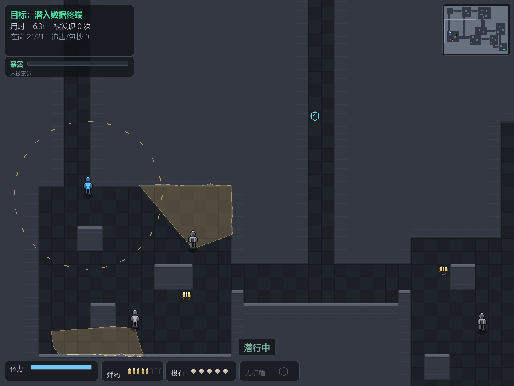
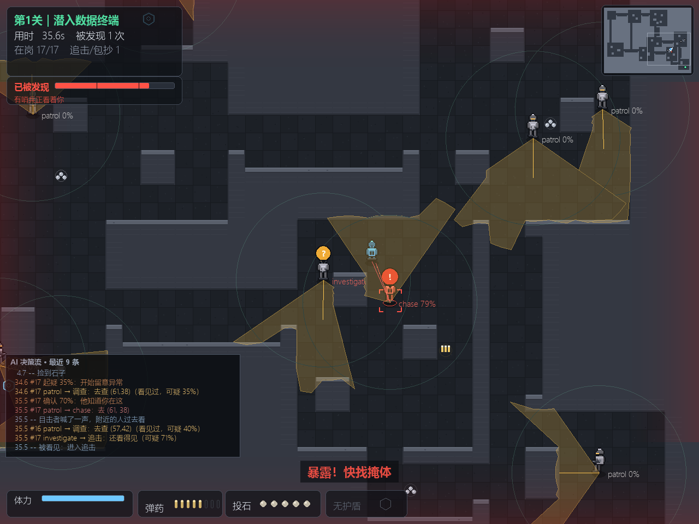

# 敌人不再隔着墙角看见你，帧耗时砍掉一半

*黄褐色的区域是哨兵的视野锥，它撞墙就停 —— 这一版修的就是"这堵墙到底挡没挡住"。按 **F1** 能看到 AI 的实时决策链：*

*每个哨兵头顶是他的状态（`patrol` / `investigate` / `chase`）和可疑度，虚线圈是听觉半径，左下角是"最近 9 条决策"。这不是事后加的日志 —— 是同一个行为树每帧吐出来的。*

这一版**没有新关卡、没有新敌人、没有新机制**。两件事：修掉一个让敌人"隔墙看见"的判定错误，和把每帧耗时砍掉一半。

前者会改变你玩到的东西，后者不会 —— 但它改变了两件事在时间上的比例。

## 一、敌人一直在从墙缝里看你

视野锥的画面和"敌人到底看不看得见你"的判定，用的是同一套射线。原来这套射线是**按固定步长往前探**：画锥体每 0.25 格探一次，判定每 0.5 格探一次。

固定步长有个经典漏洞：射线**斜着切过墙的角点**时，一个采样点落在角这边，下一个落在角那边，中间那一格墙**整个被跳过**。追反例的时候抓到的第一个是：射线从 `(69,24)` 直接跳到 `(70,25)`，而 `(69,25)` 是实心墙。

按五张真图、8 格内的 1864 对视线实测：

| 结论 | 占比 |
|---|---|
| 新旧一致 | 96.24% |
| 只差在"切格角要不要从严" | 2.47% |
| **旧说通、精确说挡** | **1.29%** |
| 旧说挡、精确说通 | **0.00%** |

最后一行是关键：**旧实现只会漏判，从不多判。**那 1.29% 全是"敌人看见了它本来不该看见的地方" —— 而你在画面上找不到任何理由，因为射线确实画到了那儿，只是它中间跳过了一面墙。

修法不是把两处采样调密，而是把几何抽成**一份**精确网格步进（跨一条格线判一次），判定和显示都调它。同一个函数，两个消费者，物理上不可能再对不上。格角口径也统一成"对角任一为墙就算挡住"，和"不许从墙角零宽缝里穿过去"是同一条约定。

**副作用是难度整体变了**，因为敌人真的看少了一点。96 局重测（同一批种子）：

| | 第 1 关 | 第 2 关 | 第 3 关 | 第 4 关 | 第 5 关 |
|---|---|---|---|---|---|
| v1.8.9 | 67.7% | 69.8% | 54.2% | 25.0% | 52.1% |
| **v1.8.11** | **77.1%** | **77.1%** | **50.0%** | **24.0%** | **70.8%** |

第 4 关只从 25.0 动到 24.0（噪声内）—— 放了 1.29% 的水也没让它活过来，说明那一关卡人的地方从来不是"被看见得太早"，而是"被看见之后跑不掉"（`docs/KNOWN_ISSUES.md` A1 有完整证据链）。

## 二、每帧耗时砍掉一半

三轮，每轮都先量再改，而且**先录数值指纹、改完逐项对拍**（这类优化最大的风险不是慢，是把哨兵挪偏一格，然后让 README 里所有历史数字静默失效——不崩、不报错、没有断言变红）。

**第一轮：墙在运行期一格都不会变，那就别每半秒重算一遍。**

流场每 0.5 秒重建一次，每次对全场格子 × 8 个方向调一遍"能不能走"（80×60 的图就是 3.8 万次），单次 8~18ms —— 追击时每半秒就有一帧超出 60 FPS 的预算，能看出规律的顿挫。

| 改动 | 效果 |
|---|---|
| "谁能走到谁"算一次存下来，改墙时失效重算 | 流场重建 L3 **17.96ms → 4.05ms** |
| 可达性用计数版 BFS，不建中间集合 | 建图 L1 **45.2 → 14.8ms**、L3 **131 → 43.6ms** |
| 碰撞候选格按半径取，不再固定查 3×3 | 每帧 78 次 × 9 格 → 1~4 格 |
| 只初始化用得到的子系统（不是 `pygame.init()`） | 启动 `Game()` **402 → 237ms** |

**第二轮：去优化视野锥，捡回了第一节那个判定错误。** 锥体本身从 89.5 μs 降到 38.6 μs，但那一轮的收益 95% 在正确性上。

**第三轮：把"和画面内容无关"的固定开销砍掉。**

拆项之后才看清：`draw_vision_cones` 的 0.95ms 里，几何只占 0.06ms，剩下 0.54ms 是"全屏清零 + 整屏加色叠加"，**和画面里有没有锥体完全无关** —— 第 1 关开局整段没哨兵，这笔钱一帧不落地在付。

改成只清、只贴所有锥体的联合包围盒（一个锥体都没有就直接返回），同时把 HUD 面板整张缓存、光点贴图按 (颜色, alpha) 缓存。

| | 第 1 关 | 第 2 关 | 第 3 关 | 第 4 关 | 第 5 关 |
|---|---|---|---|---|---|
| 整帧 p50 之前 | 2.50 | 2.65 | 3.44 | 2.56 | 2.74 |
| **整帧 p50 之后** | **1.18** | **1.53** | **2.34** | **1.75** | **1.19** |

p95 也跟着下来（第 3 关 6.40 → 4.77ms、第 4 关 4.78 → 3.74ms）—— 小 Surface 的分配本来就落在慢帧上。

## 三、顺带修掉的一个玩法 bug：光点被推进了两次

做光点缓存时得先数清同屏有多少个。数出来：别的关稳定在 42 个，**第 3 关只有 40 个**。

第 3 关是唯一有两个数据终端的关卡。多一个终端，光点反而更少 —— 因为推进光点的调用写在"画一个终端"的函数里，而那个函数每个终端调一次。于是同一批光点每帧被推进两次、绘制两次：**飘移速度翻倍、寿命减半**，你取走一个终端之后，同屏光点会突然慢一半。

修完是 74 个，密度和其他关一致了。发现它的方式不是"看代码觉得不对"，是清点 —— 如果我当时只盯着帧时间降了多少，这个 bug 会一直留着，因为它甚至让第 3 关**更快**。

## 四、两个"看起来更快、实测更慢"，都放弃了

- **把多边形坐标平移到包围盒局部再画**：像素对拍差了 **19062 个像素**，全在顶点附近整片没填。`pygame.draw.polygon` 的栅格化对平移**不是**不变的，"数学上等价"在这里不成立。
- **用 `fill(color, rect)` 只清包围盒**：0.154ms，比全屏 `fill()` 的 0.115ms 还慢 —— 全屏是连续内存 memset，按行清要逐行走。

最终写法是"全屏清零 + 只贴包围盒"，省下来的正好是大头那 0.40ms。

## 五、怎么确认这一版没把别的东西弄坏

这一版改的是**判定**（视线遮挡）和**每帧开销**，两件事都可能悄悄地改掉游戏行为。所以验收不是"跑起来没报错"：

- **36 个测试脚本 + 4 个审计 + 入口自检**，CI 在 Python 3.11 / 3.13 上各跑一遍
- **五关地形 sha256 与 v1.8.9 逐字节相同**（改的是代码，不是地图）
- 新增 4 个测试：`test_w35` 字体真能画出中文、`test_w36` 提速前后逐值对拍（邻接表 vs 暴力枚举、流场 vs 旧实现、碰撞 2.8 万组、缓存失效）、`test_w37` 视线步进 vs 0.002 格细采样一条不漏 + 锥体多边形 == 感知可见、`test_w38` 面板/进度条/视锥/光点全部逐字节对拍旧写法
- **五关各 200 帧的整屏 sha256 与改动前完全一致** —— 性能优化在画面上必须看不见

## 六、仍然没解决的两件事

写在 `docs/KNOWN_ISSUES.md` 里，每条都附了复查命令：

- **第 4 关的 24%**：这一关的瓶颈是"被看见之后跑不掉"，和视野判定、和掩体数量都无关（九种改法九次更差）。卡住的话回主菜单按 **A** 开辅助模式。
- **只有 win64 产物**：源码三平台都能跑（字体候选链已经跨平台，CI 每次推送都在 Linux 上真跑一遍），但 macOS 需要签名，没做。

## 怎么玩

双击 `StealthProtocol-v1.8.11-win64.exe`，不用装 Python。

- **卡住了就回主菜单按 A**，再开一局（辅助模式跨局记住，下次进来还是开着的）
- 想复盘刚打完的一局：结算页按 **Tab**
- 想练某一关：主菜单用 **← →** 选关，单关成绩记在选关行上，不进整局总榜
- 想先确认它能在这台机器上跑：`StealthProtocol-v1.8.11-win64.exe --selfcheck`
