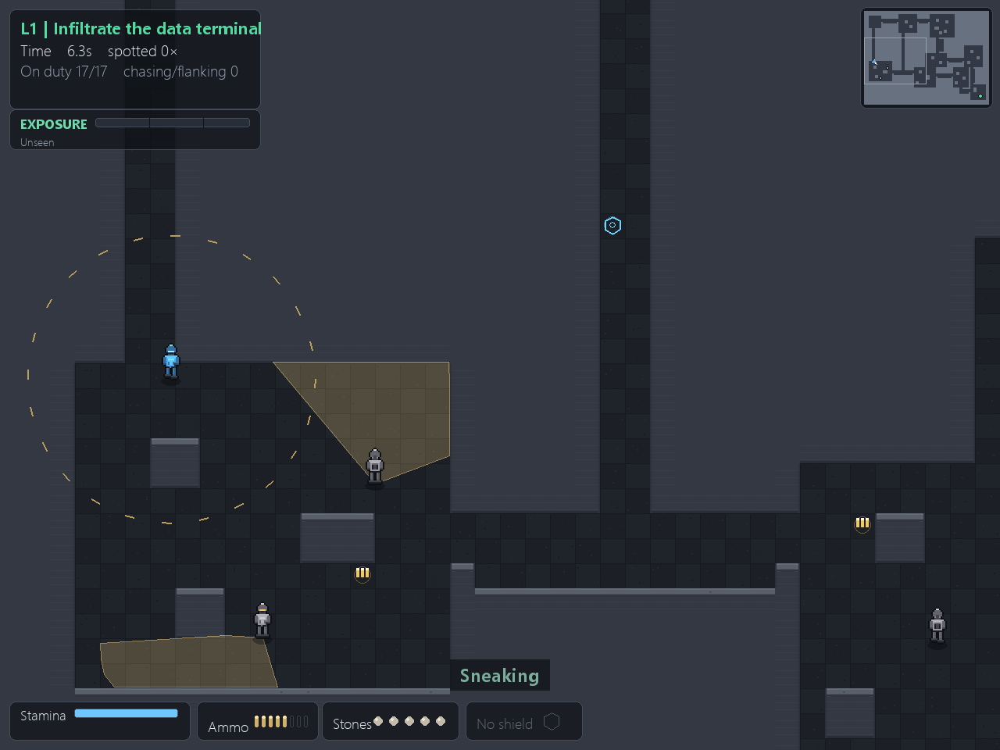
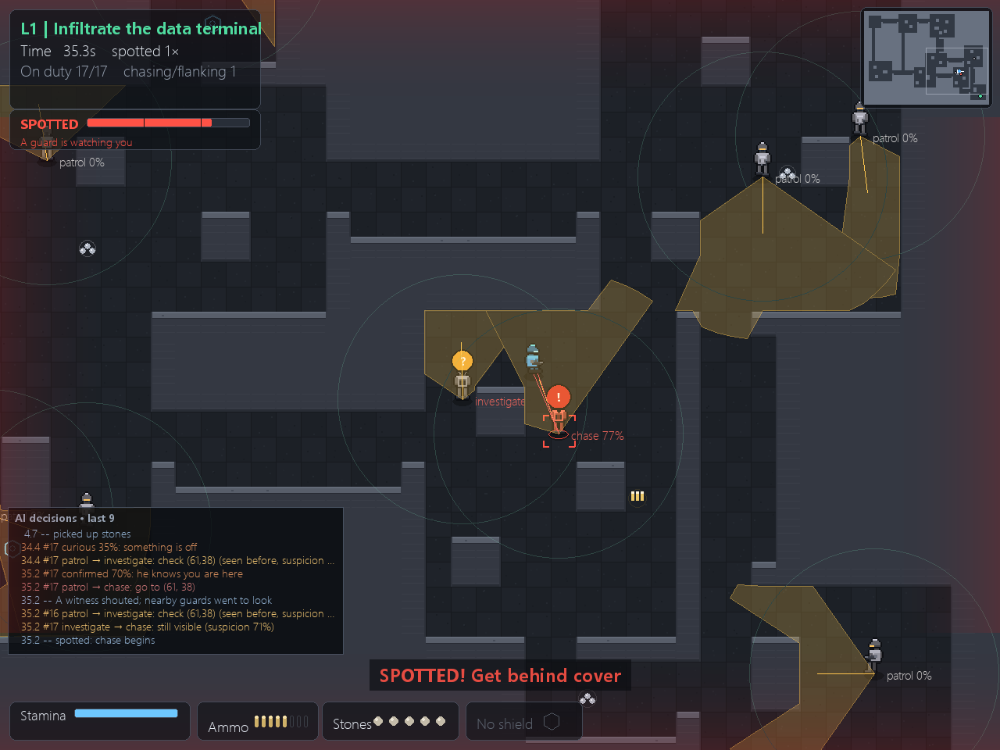

# 界面支持英文了 —— 按 L 切换

*菜单里按 **L** 在 中文 / English 之间切换，跨局记住。中文是默认 —— 中文玩家的画面一个像素都没变。*

连 F1 那条决策链也翻了 —— 这是这一版最该给英文用户看的东西：

*`curious 35%: something is off` → `patrol → investigate: check (61,38) (seen before, suspicion 35%)` → `confirmed 70%: he knows you are here`。同一份行为树每帧吐出来的日志，只是换了语言。*

这一版**没有新关卡、没有新敌人、没有新机制**。只做了一件事：把界面翻译成英文。

## 为什么要做

上架 itch 的素材全是英文：页面正文、devlog、截图说明、Reddit 标题 —— 这是有意的，itch 的流量大头是英文搜索。然后我打开游戏看了一眼：**全中文**。英文用户点下载、双击 exe，看到的是 600 条方块字。

前面每个环节都在把人往下载按钮上推，而按钮后面接的是一堵墙。

## 做了多少

用 AST 扫一遍界面模块（去掉注释、文档字符串、断言信息）：

| | 条数 |
|---|---|
| 中文字面量（去重） | 199 |
| 其中带变量的模板（f-string） | 41 |
| **真正会上屏幕的（跑起来抓的）** | **132** |

翻的是那 132 条，加上一份静态清单兜住罕见分支。英文模式下跑遍菜单 / 五关 / 结算 / 复盘 / 全图 / F1 调试视图，**一条中文都不剩**。

## 怎么做的（三处，不是 199 处）

界面上的字不是一处一句写的 —— 关卡名、决策短语、计分项都是拼好了再交给 HUD 画的。所以在文字汇流的三个入口拦一次：`ui.render()`、`ui.TextCache.get()`、以及 5 处直接 `font().render()`。199 条字面量，一个调用点都没动；以后新加的字也自动被覆盖。

细节（三个坑和一堆数字）写在 [BLOG 第 52 章](https://github.com/lxb0957/sneak_ai/blob/main/BLOG.md) 里：为什么按整句翻而不按碎片、为什么"值是套着拼的"会让屏幕半英半中而所有断言仍然是绿的、以及英文比中文宽 40~80% 之后左下四个面板怎么从"压在进度条上"改回正常。

## 顺手修掉的

- **布局按字宽算**：四处资源面板（体力 / 弹药 / 石子 / 护盾）原来是按"两个汉字"写死的坐标。现在按实际标签宽度定位，**但下限锁死在原坐标** —— 这就是中文画面不动的原因；英文放不下时收槽位间距，不许顶出面板右沿。
- **UI 审计扩到中英两种语言**：`audit_ui.py --lang all`，2 种语言 × 4 种窗口 × 5 关，全部无重叠、无越界。
- 测试从 36 个涨到 **37** 个：新增 `test_w39` 钉四件事 —— 中文恒等、英文无残留、源码字面量全覆盖、切语言后缓存失效。

## 诚实地说

英文是我写的，**没有母语者校对过**。术语（`sneak` / `crawl`、`spotted` / `seen`）和语气都可能不地道。这条记在 [`docs/KNOWN_ISSUES.md` 的 B3](https://github.com/lxb0957/sneak_ai/blob/main/docs/KNOWN_ISSUES.md) 里，附了复查命令。

准确的说法不是"已支持多语言"，是：**中文是母语级，英文是能读懂的初稿。**

---

Windows 64 位免安装，单文件 28 MB，双击即玩。想先确认它能跑：`StealthProtocol-v1.8.12-win64.exe --selfcheck`
