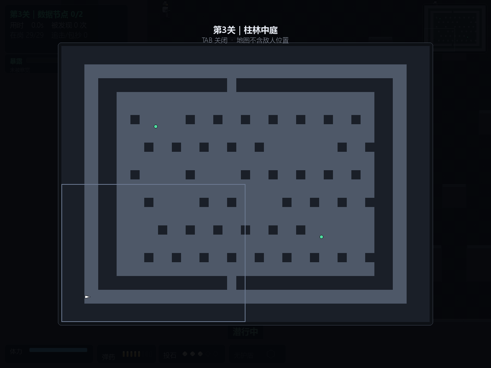

# Tab 全图：四周不再透出巡逻中的哨兵

*打开 Tab 全图时先给整个画面压一层暗，再画地图卡片 —— 之前四周透出的游戏画面里，巡逻中的哨兵会被当成"地图上画错了东西"。*

这一版只有一个视觉改动 + 一张对齐尺寸的截图，不碰任何机制。

## 改了什么

- **Tab 全图全屏压暗**。全图卡片只占窗口中间一块，之前四周直接透出游戏画面 —— 而全图的设计原则是"只画静态信息，不放敌人"，结果背景里偏偏站着敌人。加一层 `170/255` 的黑色遮罩，地图归地图，现场归现场。
- **第 3 关全图截图重出**。itch 第 3 张截图原来是手截的 760×604，和前两张 1280×960 混在一起，gallery 里宽的占满一行、小的留一圈空白。新增 `scripts/make_map_shot.py`（支持 `--lang en`）按窗口尺寸重新生成，三张对齐。
- 上架物料里的版本引用同步更新（v1.8.11 → v1.8.13）。

## 给谁看

不玩这版也不会少什么。但如果你是冲着"每个哨兵的 AI 都能看"来的：按 Tab 摊开地图看路线，现在是干净的。

## 上一版

[v1.8.12](https://github.com/lxb0957/sneak_ai/releases/tag/v1.8.12)：界面双语 —— 菜单按 **L** 切换 中文 / English。
