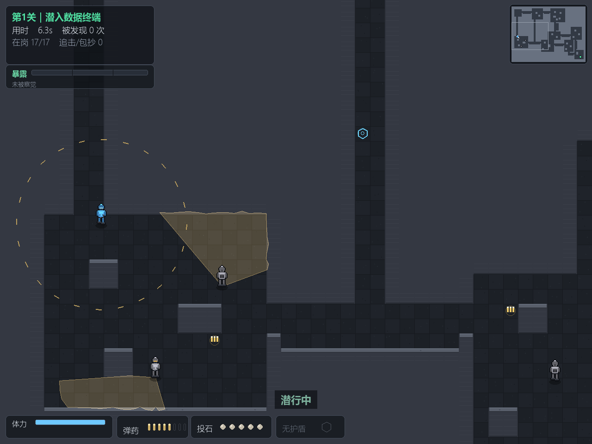

# 高 DPI 清晰化 + 双击不再弹黑框

*这一版不碰玩法，修的是"你看到的画面到底清不清晰"和"双击之后有没有反应"。*

## 两个只有在你机器上才发作的问题

**1. 150% 缩放下的画面是糊的。**

游戏一直没声明 DPI 感知。Windows 遇到这种程序会把窗口**整体拉伸**——在你 2560×1600 @150% 的设置下，SDL 以为桌面只有 1707×1067，于是 1280×960 的窗口被系统按 1.5 倍拉到 1920×1440 物理像素。非整数倍放大意味着每个像素边缘都落在半格上，12px 的字在插值里发虚。

现在启动时声明了 `permonitorv2`，SDL 看到的是 2560×1600，窗口就是 1:1 物理像素。**在 100% 缩放的机器上看不出区别**，在 125% / 150% / 200% 上看得出。

**2. 双击会弹一个黑框。**

PyInstaller 的 `--console` 是当年有意选的：崩了至少看得见。代价是每个玩家双击游戏，先看到一个 DOS 窗口。

改成 `--windowed` 有个坑：没有控制台的进程 `sys.stdout` 是 `None`，而这个项目有 17 处 `print`（自检结果、崩溃提示都在里面）。`print` 撞上 `None` 会抛 `AttributeError`，于是"去掉黑框"会变成"双击之后什么都没发生"——而且连 `crash.log` 都不会有，因为崩在写日志之前。

所以 `launch.py` 现在先兜住输出再进 `main()`：没有控制台时把 stdout/stderr 接到 exe 旁边的 `runtime.log`，并装一个 excepthook，连导入阶段崩掉的 traceback 也落进同一个文件。**代价是你得知道日志在哪**——它就在 exe 旁边，叫 `runtime.log`。

## 顺手删掉一段会骗人的代码

`Perception.update_suspicion` 零调用者，而且系数是死的（`* 1.5`），真实实现早在 `enemy.py` 里改用 `C.SUSPICION_GAIN` 了。名字看起来像"调难度就该改这里"，照它改会发现游戏里毫无变化。按这个项目自己的标准（死代码比没有更糟）删掉了，原位置留了一条注释说明真实实现在哪。

## 两条新护栏

- **`test_w40`：版本号同步**。版本号在这个项目里是手抄 8 处，上次发版就真发生过"上架清单还指着上上版的 exe"。现在凡是写 `StealthProtocol-vX.Y.Z-win64.exe` 的地方，版本对不上就变红。
- **`test_w41`：无控制台不许静默死亡**。用子进程把 stdout/stderr 置空跑一遍自检，断言它能跑完、输出落在 `runtime.log`、而有控制台时行为完全不变。

## 还有一件不是代码的事

`requirements.txt` 里原来混着 matplotlib —— 玩家为了玩个游戏要装一堆科学计算依赖。现在拆成两份：`requirements.txt` 只有运行要的三样，出图 / 打包 / 录视频的进 `requirements-dev.txt`。

## 上一版

[v1.8.13](https://github.com/lxb0957/sneak_ai/releases/tag/v1.8.13)：Tab 全图全屏压暗，四周不再透出巡逻中的哨兵。
